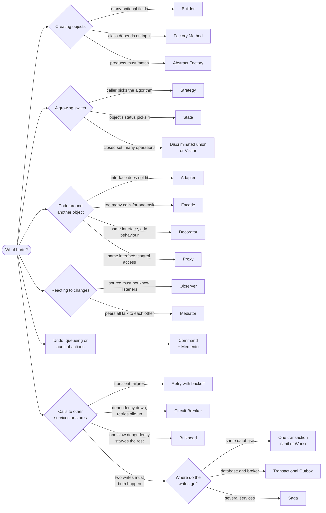

# How to choose a pattern

Start from the symptom, not from the catalogue. A pattern is a named destination for a refactoring: it makes one kind of change cheap and charges you indirection for it. If you cannot say which change it makes cheaper, you do not need it yet.

Ask three questions first:

1. **What varies?** A type, an algorithm, a step, a vendor, the health of a dependency. The pattern goes around the part that varies and nowhere else.
2. **How often, and who changes it?** A variant added every sprint, or by another team, needs a seam. A variant added once a year can be an `if`.
3. **What is the smallest thing that works?** In TypeScript that is often a function, an options object or a discriminated union, not a class hierarchy.

When two candidates look alike, [Pattern confusions](pattern-confusions.md) compares them side by side. When a design already hurts, [Anti-patterns](anti-patterns.md) names the smell and the way out.

## Symptom to pattern

Read the **Try first** column before the pattern. It is often enough, and it is what you fall back to when the pattern does not pay for itself.

### Creating objects

| Symptom in the code | Reach for | What it buys you | Try first |
|---|---|---|---|
| A constructor with 9 optional parameters; call sites read `new Report(id, undefined, undefined, true)` | [Builder](../src/creational/builder/README.md) | Named steps, validation of the combination in `build()`, an immutable result | A typed options object with defaults |
| `if (provider === 'stripe') new StripeGateway()` repeated wherever a gateway is needed | [Factory Method](../src/creational/factory-method/README.md) | One place decides the concrete class; callers see only the interface | A factory function over a `Map` registry |
| Objects must come as a matching set (an AWS bucket with an AWS queue, never with a GCP queue) | [Abstract Factory](../src/creational/abstract-factory/README.md) | Mixing families cannot be written | Wiring each family once at startup |
| Building an object is expensive or fiddly, and new ones differ from an existing one by a few fields | [Prototype](../src/creational/prototype/README.md) | Clone a configured instance, then adjust it | `structuredClone` of plain data plus a spread |
| `Config.getInstance()` is called deep in business code; tests reset globals between cases | [Dependency Injection](../src/modern/dependency-injection/README.md) | Dependencies visible in constructors; tests pass fakes. "Only one instance" stays a lifetime choice ([Singleton](../src/creational/singleton/README.md)), not a global lookup | Create the instance once in `main.ts` and pass it down |
| Opening a connection or a worker per request is slow, and the resource is capped | [Object Pool](../src/modern/object-pool/README.md) | Bounded reuse with a wait queue | The pool your driver already ships |

### Behaviour that varies

| Symptom in the code | Reach for | What it buys you | Try first |
|---|---|---|---|
| A `switch` on a type field keeps growing, and the same switch appears in several methods | [Strategy](../src/behavioral/strategy/README.md) when the caller picks the algorithm; [State](../src/behavioral/state/README.md) when the object's status picks it; plain polymorphism when the type *is* the entity | A new variant is a new class; no existing switch is edited | A discriminated union with an exhaustive `switch`, if the set of variants is closed |
| Methods open with `if (this.status !== 'paid') throw`, and `status` is assigned from anywhere | [State](../src/behavioral/state/README.md) | Legal transitions live in one place; illegal ones have no method to call | A transition table: `Record<Status, Status[]>` |
| Several jobs copy the same skeleton (read, parse, validate, save) and differ in two steps | [Template Method](../src/behavioral/template-method/README.md) | The order of steps exists once; subclasses fill in the hooks | One function that takes the varying steps as parameters |
| `if (logger) logger.info(...)` and `discount ?? 0` are scattered through the code | [Null Object](../src/modern/null-object/README.md) | A do-nothing implementation; call sites drop the checks | A default parameter value |
| The same rule (`active && !overdue && plan !== 'free'`) is written in SQL, in services and in validators | [Specification](../src/modern/specification/README.md) | A named rule, composable with `and`/`or`/`not`, testable alone, translatable to a query | A named predicate function |
| Product or ops want to express rules as data (discount rules, feature-flag targeting) | [Interpreter](../src/behavioral/interpreter/README.md) | An expression tree evaluated at runtime, extended by adding node classes | JSON conditions read by one function; a parser library once the grammar grows |
| New operations keep arriving for a stable set of node types (tax, export and validation over invoice line types) | [Visitor](../src/behavioral/visitor/README.md) | Each operation is one class; the node classes stay untouched | One function per operation over a discriminated union |

### Requests, workflows and undo

| Symptom in the code | Reach for | What it buys you | Try first |
|---|---|---|---|
| Users need undo and redo, or an audit trail of what they did | [Command](../src/behavioral/command/README.md) + [Memento](../src/behavioral/memento/README.md) | Each action is an object with `execute()` and `undo()`; a memento snapshots state when the inverse is hard to compute | Store the previous value on the action |
| Operations must be queued, scheduled, retried or handed to another process | [Command](../src/behavioral/command/README.md) | The request becomes data: serializable, loggable, replayable | A typed job payload and a handler map |
| A request passes several checks (auth, rate limit, validation), any of which may reject it | [Chain of Responsibility](../src/behavioral/chain-of-responsibility/README.md) or [Middleware pipeline](../src/modern/middleware-pipeline/README.md) | One check per unit; the order is configuration | Your framework's middleware |
| Logging, metrics, caching or retries are pasted into every method of a client | [Decorator](../src/structural/decorator/README.md) per object; [Middleware pipeline](../src/modern/middleware-pipeline/README.md) per request | Cross-cutting behaviour added without editing the class | A higher-order function around the call |
| Callers juggle page tokens and offsets, or the data does not fit in memory | [Iterator](../src/behavioral/iterator/README.md) | Callers write `for await`; pages load lazily | An async generator, which is the TypeScript form of Iterator |

### Integration and structure

| Symptom in the code | Reach for | What it buys you | Try first |
|---|---|---|---|
| A third-party API does not match our interface (callbacks, other field names, amounts as decimal strings) | [Adapter](../src/structural/adapter/README.md) | Vendor types stop at one class; the vendor becomes swappable and fakeable | A mapping function, if there is one call site |
| Callers make six calls in the right order to do one thing (create customer, attach card, subscribe, send receipt) | [Facade](../src/structural/facade/README.md) | One use-case method; the subsystem stays reachable for unusual cases | A well-named function, which is already a small facade |
| Lazy loading, caching, access checks or rate limits are needed in front of an object, invisible to the caller | [Proxy](../src/structural/proxy/README.md) | Same interface, controlled access | The client library's own cache or limiter |
| Subclasses multiply along two axes (Alert and Reminder, times Email, SMS and Push) | [Bridge](../src/structural/bridge/README.md) | N + M classes instead of N x M | Pass the channel in as a constructor argument, which is most of Bridge |
| A group must behave like a single item (a bundle priced like a product, nested permission groups) | [Composite](../src/structural/composite/README.md) | Recursive operations with no type checks | A recursive function over a plain tree type |
| Millions of objects carry the same heavy data (currency metadata on every amount, rate-card rows on every call record) | [Flyweight](../src/structural/flyweight/README.md) | Shared intrinsic state; memory grows with distinct values, not with objects | Measure first; a `Map` of shared instances is most of it |

### Events and data

| Symptom in the code | Reach for | What it buys you | Try first |
|---|---|---|---|
| Many objects notify each other, and each holds references to the others | [Mediator](../src/behavioral/mediator/README.md) | Peers know one coordinator; the interaction rules live in one class | A coordinating service function |
| One change must trigger several independent reactions (order placed: receipt, analytics, loyalty points), and the source should not know them | [Observer](../src/behavioral/observer/README.md) in-process; a message broker across services | A new reaction does not touch the source | A direct call, when there is one reaction and it must succeed together with the source |
| SQL and ORM calls are spread through business logic; unit tests need a database | [Repository](../src/modern/repository/README.md) | Domain code talks to a collection-like interface; tests use an in-memory one | Query functions in one module per aggregate |
| One use case writes through several repositories, and a failure leaves half the writes applied | [Unit of Work](../src/modern/unit-of-work/README.md) | One transaction, one commit, one rollback | The ORM's transaction callback |
| Dashboards need joins and denormalized views that complicate or slow down the write model | [CQRS](../src/modern/cqrs/README.md) | Each side shaped for its job | A SQL view, a materialized view or a read replica |
| Auditors ask "what was this balance on 3 March, and why?" | [Event Sourcing](../src/modern/event-sourcing/README.md) | State is a fold over an append-only log of facts | A history table written in the same transaction |

### Calls to other services

| Symptom in the code | Reach for | What it buys you | Try first |
|---|---|---|---|
| Timeouts and 503s fail requests that would succeed a second later | [Retry with backoff](../src/modern/retry-with-backoff/README.md) | Exponential delay with jitter and a cap; safe only for idempotent calls or with an idempotency key | A timeout on every call, which you need anyway |
| Retries are hammering a failing dependency; latency and queue depth climb together | [Circuit Breaker](../src/modern/circuit-breaker/README.md) | Fail fast while the dependency is down; probe before resuming | A retry budget and fewer layers that retry |
| One slow dependency holds every connection and takes unrelated endpoints down with it | [Bulkhead](../src/modern/bulkhead/README.md) | A separate pool or concurrency limit per dependency | Per-dependency pool sizes in client config |
| Two writes must both happen: a database row and a published event | [Transactional Outbox](../src/modern/transactional-outbox/README.md) | The event is stored in the same transaction and published at least once | One transaction, if both writes go to the same database |
| One business transaction spans services that each own a database (order, payment, stock) | [Saga](../src/modern/saga/README.md) | Local transactions plus compensations, no distributed locks | Keep the data in one service and use one transaction |

## The common decisions as a flowchart



The last branch is the one most often answered wrong in interviews: if both writes go to the same database, the answer is a transaction, not a distributed pattern. The [system-design notes on distributed transactions](https://github.com/hardyalsinghdeora/system-design/blob/main/fundamentals/distributed-transactions.md) cover the cross-service case in depth.

## When not to apply a pattern

Every pattern adds indirection: another file, another interface, a jump-to-definition that lands on an abstraction. That cost is paid on every read. Pay it only for change you can point to.

- **YAGNI.** Build for the requirement you have. "We might switch databases one day" does not justify a repository; "the unit tests need Postgres and take four minutes" might.
- **Rule of three.** The first time, write it. The second time, notice the duplication and leave it. The third time, extract the abstraction: three real cases show what actually varies. An abstraction guessed from one case is usually shaped wrong, and the wrong abstraction costs more to undo than the duplication it removed.
- **Language features first.** A function is a Strategy, a closure is a Command, an async generator is an Iterator, a module-level instance is a Singleton, an object literal with no-op methods is a Null Object. Write the class form when you need state, several methods or a name the team will recognise.
- **Closed sets do not need polymorphism.** When the variants are fixed and owned by you, and new operations arrive more often than new variants, a discriminated union with an exhaustive `switch` is clearer than Strategy or Visitor, and the compiler finds every place to update.

```ts
type PaymentEvent =
  | { kind: 'authorized'; amountMinor: number }
  | { kind: 'captured'; amountMinor: number }
  | { kind: 'refunded'; amountMinor: number; reason: string };

function ledgerDeltaMinor(event: PaymentEvent): number {
  switch (event.kind) {
    case 'authorized':
      return 0;
    case 'captured':
      return event.amountMinor;
    case 'refunded':
      return -event.amountMinor;
    default: {
      const unhandled: never = event; // a new kind without a case fails to compile
      return unhandled;
    }
  }
}
```

New variants often and few operations: polymorphism (Strategy, State). New operations often and few variants: a union with one function per operation, or Visitor in a class-based codebase. This trade-off has a name, the *expression problem*, and naming it in an interview shows you chose the switch on purpose.

### Signs a pattern arrived too early

- An interface with one implementation and no test that needs a fake.
- A factory whose only line is `return new Thing()`.
- A Strategy with one strategy, a Builder for an object with two fields, a Mediator between two classes.
- Names that describe the pattern instead of the domain: `AbstractPaymentStrategyFactoryProvider`.
- Layers that pass calls through unchanged (controller, service, manager, repository, each one line long).

### Distributed patterns have a higher bar

In-process patterns cost readability. Outbox, Saga, CQRS with a separate read store and Event Sourcing cost infrastructure, on-call load and eventual consistency that users can see. Before reaching for them, check whether the data can live in one database so that the problem becomes one transaction. A modular monolith with one database avoids most of them.

### A checklist before you add one

1. Name the change the pattern makes cheaper.
2. Has that change happened at least twice, or is it on the plan?
3. Would a function, an options object or a union type do the job?
4. Can a new team member follow the code path from the entry point?
5. If the change never comes, how hard is the pattern to remove?
