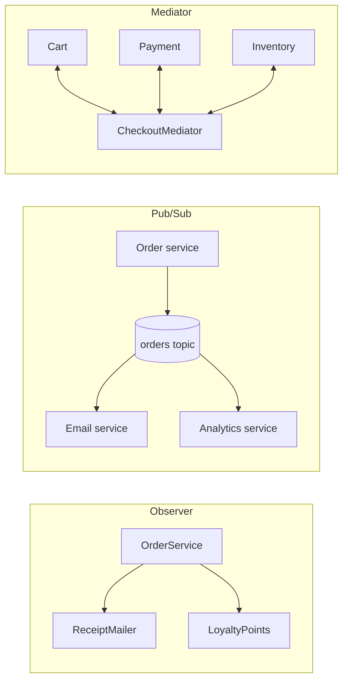

# Pattern confusions

Interviewers like pairs that share a structure, because explaining the difference shows you know the intent and not only the class diagram. Each entry gives the distinction in one line, the differences in a table, and a short code contrast where code says it faster than prose.

Several of these pairs have identical class diagrams. When the structure is the same, the difference is **intent**: which problem the indirection exists to solve, and who decides how it is wired.

## Strategy vs State

**In one line:** with Strategy the client chooses the algorithm; with State the object changes its own behaviour as its status changes, and the transitions are the point.

| | [Strategy](../src/behavioral/strategy/README.md) | [State](../src/behavioral/state/README.md) |
|---|---|---|
| Who picks the implementation | The client or configuration | The current state, on each transition |
| Do implementations know each other | No | Yes: a state decides which state comes next |
| Changes during the object's life | Rarely | Constantly; that is the purpose |
| Typical example | Payment method, tax rule, retry policy | Order lifecycle, subscription status, circuit breaker |

```ts
// Strategy: chosen by the caller; it never replaces itself.
type ShippingRate = (weightGrams: number) => number; // minor units
const perKg: ShippingRate = (grams) => Math.ceil(grams / 1000) * 150;

// State: each state decides what comes next.
interface OrderState { ship(): OrderState }
class Paid implements OrderState { ship(): OrderState { return new Shipped(); } }
class Shipped implements OrderState { ship(): OrderState { throw new Error('already shipped'); } }
```

## Strategy vs Template Method

**In one line:** both vary part of an algorithm; Template Method fixes the skeleton in a base class and varies steps through inheritance, Strategy varies behaviour through composition and can be swapped at runtime.

| | [Template Method](../src/behavioral/template-method/README.md) | [Strategy](../src/behavioral/strategy/README.md) |
|---|---|---|
| Mechanism | Inheritance: a subclass overrides hooks | Composition: the context holds an interface |
| Swap at runtime | No, fixed when the object is created | Yes |
| Who calls whom | The base class calls the subclass (Hollywood principle) | The context calls the strategy |
| Main risk | Fragile base class, deep hierarchies | More objects to wire |

```ts
abstract class StatementExport { // Template Method: the order of steps is fixed here
  render(rows: string[][]): string { return this.header() + rows.map((r) => this.row(r)).join('\n'); }
  protected abstract header(): string;
  protected abstract row(cells: string[]): string;
}
// Strategy: the same variation, passed in instead of inherited, swappable per call.
interface RowFormat { header(): string; row(cells: string[]): string }
const render = (rows: string[][], f: RowFormat): string => f.header() + rows.map((r) => f.row(r)).join('\n');
```

## Strategy vs Command

**In one line:** a Strategy says *how* to do something the context has already decided to do; a Command says *what* to do, packaged with its arguments so it can be queued, logged, retried or undone.

| | [Strategy](../src/behavioral/strategy/README.md) | [Command](../src/behavioral/command/README.md) |
|---|---|---|
| Represents | An algorithm | A request: an action plus its arguments |
| Data it carries | Usually none; arguments arrive per call | Its own arguments: `RefundOrder { orderId, amountMinor }` |
| Lifetime | Long-lived, reused for many calls | One per request; stored, queued, replayed |
| Interchangeable | Yes: same contract, different behaviour | No: different commands do different things |
| Enables | Swapping behaviour | Undo, audit log, retry, scheduling, remote execution |

## Adapter vs Facade vs Proxy vs Decorator

**In one line:** all four wrap something. Adapter changes the interface, Facade puts a new, smaller interface over a subsystem, Proxy keeps the interface and controls access, Decorator keeps the interface and adds behaviour.

| | [Adapter](../src/structural/adapter/README.md) | [Facade](../src/structural/facade/README.md) | [Proxy](../src/structural/proxy/README.md) | [Decorator](../src/structural/decorator/README.md) |
|---|---|---|---|---|
| Interface offered | Ours, different from the wrapped one | New and smaller | Same as the real subject | Same as the wrapped component |
| Wraps | One incompatible object | Several objects of a subsystem | One object | One object, often another decorator |
| Purpose | Make it fit | Make the common case easy | Control access: lazy, remote, cached, guarded | Add responsibilities |
| Stacking | Rare | No | Rare | Expected |
| Backend example | `StripeGateway implements PaymentGateway` | `CheckoutFacade.placeOrder()` | ORM lazy relation, permission-checking client | `new RetryingGateway(new LoggingGateway(gateway))` |

Proxy and Decorator share a structure. A proxy often creates or locates the real object itself (lazy loading, remote stubs) and the caller does not know it is there; a decorator receives an existing object, and the client deliberately chooses the stack. A caching wrapper gets called both, so say which intent you mean.

```ts
interface PaymentGateway { charge(orderId: string, amountMinor: number): Promise<string> }
interface VendorClient { createCharge(req: { reference: string; paise: number }): Promise<{ txn_id: string }> }

class VendorAdapter implements PaymentGateway { // Adapter: their interface in, ours out
  constructor(private readonly vendor: VendorClient) {}
  async charge(orderId: string, amountMinor: number): Promise<string> {
    return (await this.vendor.createCharge({ reference: orderId, paise: amountMinor })).txn_id;
  }
}
class LoggingGateway implements PaymentGateway { // Decorator: ours in, ours out, one behaviour added
  constructor(private readonly inner: PaymentGateway, private readonly log: (line: string) => void) {}
  charge(orderId: string, amountMinor: number): Promise<string> {
    this.log(`charge ${orderId} ${amountMinor}`);
    return this.inner.charge(orderId, amountMinor);
  }
}
```

## Decorator vs Composite

**In one line:** both are recursive and share the interface of what they hold; a decorator holds exactly one child and adds behaviour, a composite holds many children and combines their results.

| | [Decorator](../src/structural/decorator/README.md) | [Composite](../src/structural/composite/README.md) |
|---|---|---|
| Children | Exactly one | Zero or more |
| Purpose | Add behaviour to one object | Treat a group like a single object |
| Result | The child's result, modified | An aggregate of the children's results |
| Shape | A chain | A tree |

```ts
interface Priced { priceMinor(): number }
const product = (unitMinor: number): Priced => ({ priceMinor: () => unitMinor });

class Bundle implements Priced { // Composite: many children, aggregated
  constructor(private readonly items: Priced[]) {}
  priceMinor(): number { return this.items.reduce((sum, item) => sum + item.priceMinor(), 0); }
}
class GiftWrapped implements Priced { // Decorator: one child, behaviour added
  constructor(private readonly inner: Priced) {}
  priceMinor(): number { return this.inner.priceMinor() + 299; }
}
const total = new GiftWrapped(new Bundle([product(1999), product(500)])).priceMinor(); // 2798
```

## Chain of Responsibility vs Decorator vs Middleware pipeline

**In one line:** a classic chain passes a request along until one handler deals with it; a decorator always delegates and adds behaviour around one object; a middleware pipeline lets every stage act before and after the rest, and stop the request.

| | [Chain of Responsibility](../src/behavioral/chain-of-responsibility/README.md) | [Decorator](../src/structural/decorator/README.md) | [Middleware pipeline](../src/modern/middleware-pipeline/README.md) |
|---|---|---|---|
| Typical flow | Passed along until a handler takes it; usually one acts | Every layer acts, then delegates | Every stage may act, then calls `next()`, or stops |
| Knows the next element | Yes, holds a reference | Yes, holds the wrapped object | No, receives a `next` function |
| Assembled as | Linked handlers | Nested constructors | An ordered list, composed once |
| Example | Refund approval by amount: agent, team lead, finance | Logging and caching wrappers around a client | Express and Koa, the AWS SDK v3 middleware stack, Axios interceptors |

The pipeline is the form you will write most often in a backend. The mechanism fits in a few lines:

```ts
type Middleware<C> = (ctx: C, next: () => Promise<void>) => Promise<void>;

function compose<C>(stack: Middleware<C>[]): (ctx: C) => Promise<void> {
  return (ctx) => {
    const run = (i: number): Promise<void> => (i < stack.length ? stack[i](ctx, () => run(i + 1)) : Promise.resolve());
    return run(0);
  };
}
```

Production versions such as `koa-compose` also reject a stage that calls `next()` twice.

## Factory Method vs Abstract Factory vs Builder

**In one line:** Factory Method decides *which class* to instantiate for one product; Abstract Factory creates a *family* of products that must match; Builder assembles *one complex object* step by step.

| | [Factory Method](../src/creational/factory-method/README.md) | [Abstract Factory](../src/creational/abstract-factory/README.md) | [Builder](../src/creational/builder/README.md) |
|---|---|---|---|
| Question it answers | Which concrete class? | Which family of classes? | How is this one object assembled? |
| Products | One | Several related ones | One, with many parts and options |
| Calls per product | One | One per product | Several, then `build()` |
| Example | `createNotifier(channel)` | `cloud.storage()`, `cloud.queue()`, `cloud.secrets()` | `HttpRequest.builder().post(url).header(k, v).timeout(5_000).build()` |

In everyday speech "factory" means a factory function (`createGateway(config)`). The GoF Factory Method is narrower: a creation method that subclasses override. Both are fine; say which one you mean. An Abstract Factory is usually a set of factory methods.

## Observer vs Pub/Sub vs Mediator

**In one line:** in Observer the subject holds its observers and calls them; in Pub/Sub publishers and subscribers know only a topic and a broker sits between them; a Mediator knows every participant and holds the coordination logic itself.

| | [Observer](../src/behavioral/observer/README.md) | Pub/Sub | [Mediator](../src/behavioral/mediator/README.md) |
|---|---|---|---|
| Who knows whom | The subject holds a list of observers | Neither side knows the other; both know the topic | Participants know the mediator; it knows all of them |
| Where the logic lives | In the observers | In the subscribers | In the mediator |
| Delivery | Usually synchronous, in-process | Asynchronous, often across processes and durable | Direct method calls |
| A failing receiver | Can throw into the subject's call | Retried by the broker, then dead-lettered | Handled by the mediator |
| Example | `EventEmitter`, in-process domain events | Kafka, SNS with SQS, Redis pub/sub | Checkout coordinator, chat room |



## Repository vs DAO vs Active Record

**In one line:** a Repository is a collection-like interface for domain aggregates, written in domain terms; a DAO is an API over tables and rows; Active Record puts persistence methods on the domain object itself.

| | [Repository](../src/modern/repository/README.md) | DAO | Active Record |
|---|---|---|---|
| Works with | An aggregate (an order with its lines) | A table or a row | A row, which is the object |
| Its interface speaks | Domain: `findOverdue()`, `save(order)` | Data: `insert`, `updateStatus`, `selectByCustomerId` | `order.save()`, `Order.findById(id)` |
| Domain object knows the database | No | No | Yes |
| Unit tests | In-memory fake | Fake per table | Usually need a database |
| In TypeScript ORMs | TypeORM `Repository<T>`, MikroORM repositories | Hand-written query modules | Sequelize models, TypeORM `BaseEntity` |

In many codebases a "repository" is a DAO with a nicer name. The test: is the interface defined by what the domain needs, and does it return whole aggregates? If it mirrors the tables it is a DAO, which is fine for simple domains, but it will not protect your invariants.

## Repository vs Unit of Work

**In one line:** a Repository finds and stores aggregates of one type; a Unit of Work owns the transaction, so that changes made through several repositories commit or roll back together.

| | [Repository](../src/modern/repository/README.md) | [Unit of Work](../src/modern/unit-of-work/README.md) |
|---|---|---|
| Responsibility | Get and add aggregates of one type | Track changes and commit them atomically |
| Scope | One aggregate type | One business transaction, often one request |
| Owns the transaction | No | Yes |
| In TypeScript ORMs | `Repository<T>` | TypeORM `dataSource.transaction(...)`, MikroORM `em.flush()` |

The idiomatic TypeScript shape is a callback that receives repositories bound to one transaction: `uow.run(async ({ orders, stock }) => { ... })`. Everything inside commits together or not at all, and the use case never sees a connection.

## CQRS vs Event Sourcing

**In one line:** CQRS splits the write model from the read model; Event Sourcing stores state as a sequence of events instead of current values. They are independent decisions that are often combined.

| | [CQRS](../src/modern/cqrs/README.md) | [Event Sourcing](../src/modern/event-sourcing/README.md) |
|---|---|---|
| Decision | Different models for reads and writes | Events are the source of truth; current state is derived |
| Storage | Anything: one database with views, or a separate read store | An append-only event store, plus projections for reads |
| Used alone | Often, with ordinary tables | Rarely: querying a raw event log is impractical, so you build read models, which is CQRS |
| Main costs | Two models; eventual consistency if the stores are separate | Event versioning, replay time, snapshots, deleting personal data |

## Saga vs Two-Phase Commit

**In one line:** two-phase commit makes several participants commit atomically by holding locks until a coordinator decides; a Saga gives up atomicity, commits local transactions in sequence, and compensates the completed ones when a later step fails.

| | Two-phase commit | [Saga](../src/modern/saga/README.md) |
|---|---|---|
| Atomicity and isolation | All or nothing; locks held until the decision | Neither; intermediate states are visible, so use semantic locks such as `PENDING` |
| If the coordinator fails | Prepared participants block, holding locks | Steps are already committed; the saga resumes from its log |
| Requires | Participants that can prepare (XA), one coordinator | Idempotent steps, compensations, an orchestrator or event choreography |
| Third-party APIs | Impossible: a payment provider cannot "prepare" | Natural: charge, then refund as the compensation |
| Fits | A few databases on one fast network, short transactions | Microservices and long-running business processes |

Compensation is not rollback: a refund is a new business event the customer may see on a statement, so design compensations with the business, not as `DELETE` statements. More in [distributed transactions](https://github.com/hardyalsinghdeora/system-design/blob/main/fundamentals/distributed-transactions.md).

## Outbox vs CDC

**In one line:** the outbox is *what* you write (the event, in the same transaction as the state change); change data capture is one way to *ship* it, by tailing the database log instead of polling. They combine well.

| | [Transactional Outbox](../src/modern/transactional-outbox/README.md) | Change data capture (CDC) |
|---|---|---|
| What it is | A table written in the same transaction as the business data | Reading committed changes from the database log (Postgres WAL, MySQL binlog) |
| Event shape | Designed for consumers: `OrderPlaced { orderId, totalMinor }` | Row changes: before and after images |
| Coupling | Consumers see a public event contract | Consumers see your table schema unless you translate |
| Relay | A poller (`SELECT ... FOR UPDATE SKIP LOCKED`) or CDC on the outbox table | A connector such as Debezium, or a stream such as DynamoDB Streams |

Both deliver at least once, so consumers deduplicate. A common production setup uses both: write to an outbox table and let a CDC connector publish its rows (Debezium ships an outbox event router for this). See [transactional outbox and CDC](https://github.com/hardyalsinghdeora/system-design/blob/main/fundamentals/transactional-outbox-and-cdc.md).

## Circuit Breaker vs Retry vs Bulkhead

**In one line:** Retry handles a transient failure of one call; Circuit Breaker stops calling a dependency that is failing for everyone; Bulkhead caps how much of your capacity one dependency can consume.

| | [Retry with backoff](../src/modern/retry-with-backoff/README.md) | [Circuit Breaker](../src/modern/circuit-breaker/README.md) | [Bulkhead](../src/modern/bulkhead/README.md) |
|---|---|---|---|
| Failure it targets | Transient: a blip, a timeout, a 503 | Sustained: the dependency is down or overloaded | Slow: one dependency ties up shared resources |
| What it does | Tries again after a growing, jittered delay | Fails fast without calling, then probes | Rejects or queues work beyond a limit |
| State | Per call | Shared: closed, open, half-open | A shared concurrency counter or pool |
| Alone, it can | Multiply load during an outage (retry storm) | Flap if thresholds are poorly tuned | Reject normal bursts if sized too small |

They are used together, each one a decorator around the call: `withRetry(withBreaker(withBulkhead(withTimeout(call))))`. Every attempt passes through the breaker, and an open circuit is treated as non-retryable. See [resilience patterns](https://github.com/hardyalsinghdeora/system-design/blob/main/fundamentals/resilience-patterns.md) for the system-level view.

## Singleton vs Dependency Injection

**In one line:** Singleton couples "there is one instance" with "everyone fetches it from a global"; dependency injection keeps the first as a lifetime choice and replaces the second with passing the instance in.

| | [Singleton](../src/creational/singleton/README.md) | [Dependency Injection](../src/modern/dependency-injection/README.md), singleton scope |
|---|---|---|
| How code gets the instance | Pulls it: `Db.getInstance()` | Receives it as a constructor parameter |
| Dependencies visible in the signature | No | Yes |
| Replacing it in a test | Module mocking or a reset hook | Pass a fake |
| One per tenant, request or test | Hard | Another scope, or another `new` |

```ts
declare class Db { static getInstance(): Db; sumLinesMinor(invoiceId: string): Promise<number> }

class InvoiceTotalsGlobal { // Singleton: the dependency is hidden in the method body
  total(id: string): Promise<number> { return Db.getInstance().sumLinesMinor(id); }
}
class InvoiceTotals { // DI: the dependency is in the constructor; still one instance, created in main.ts
  constructor(private readonly db: Pick<Db, 'sumLinesMinor'>) {}
  total(id: string): Promise<number> { return this.db.sumLinesMinor(id); }
}
```

In Node, `export const pool = new Pool()` is already a singleton because modules are cached. That is fine at the composition root and the same hidden dependency when imported from deep inside domain code.

## Bridge vs Adapter

**In one line:** both put an interface between an abstraction and an implementation; Adapter is applied after the fact to make an existing class fit, Bridge is designed up front so that two dimensions can vary independently.

| | [Adapter](../src/structural/adapter/README.md) | [Bridge](../src/structural/bridge/README.md) |
|---|---|---|
| When | After the fact, integrating something that exists | Up front, as a design decision |
| Problem | Interface mismatch | Class explosion from two varying dimensions |
| Hierarchies | One target interface, one adaptee | Two: the abstraction and the implementor |
| Example | `S3FileStore implements FileStore`, wrapping the AWS SDK | `Notification` subtypes holding a `Channel` (email, SMS, push) |

With four notification types and three channels, Bridge gives 4 + 3 = 7 classes instead of 12 subclasses such as `SmsPaymentFailedNotice`. Adding WhatsApp is one class, not four.
