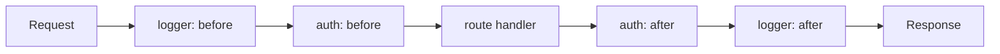

# Patterns in the wild

Where the patterns in this repository show up in Node.js core and in libraries you already use. Reading these APIs with the pattern name in mind makes both the library and the pattern easier to remember. The descriptions stay at the level of the public API; check each library's documentation for version-specific details.

| Where | Pattern(s) | What to notice |
|---|---|---|
| Node `EventEmitter` | [Observer](../src/behavioral/observer/README.md) | Synchronous, in-order notification; `'error'` is special |
| Node streams, `pipeline` | [Iterator](../src/behavioral/iterator/README.md), pipes and filters | Backpressure and error propagation |
| Async iterators | [Iterator](../src/behavioral/iterator/README.md) | Pull-based, lazy consumption |
| Express, Koa | [Middleware Pipeline](../src/modern/middleware-pipeline/README.md), [Chain of Responsibility](../src/behavioral/chain-of-responsibility/README.md) | Order is the contract |
| NestJS | [Dependency Injection](../src/modern/dependency-injection/README.md), [Decorator](../src/structural/decorator/README.md), [Proxy](../src/structural/proxy/README.md) | Container, guards, interceptors |
| Passport | [Strategy](../src/behavioral/strategy/README.md) | One interface per auth method |
| Winston | [Observer](../src/behavioral/observer/README.md), [Composite](../src/structural/composite/README.md) | One log call fans out to transports |
| Knex, Prisma | [Builder](../src/creational/builder/README.md), [Specification](../src/modern/specification/README.md) | Query built step by step, or as data |
| TypeORM | [Repository](../src/modern/repository/README.md), [Unit of Work](../src/modern/unit-of-work/README.md) | Repositories per entity, transactional manager |
| RxJS | [Observer](../src/behavioral/observer/README.md), [Iterator](../src/behavioral/iterator/README.md) | Push-based streams with composable operators |
| AWS SDK v3 | [Command](../src/behavioral/command/README.md), [Middleware Pipeline](../src/modern/middleware-pipeline/README.md) | `client.send(new XCommand(input))` |
| Axios | [Chain of Responsibility](../src/behavioral/chain-of-responsibility/README.md), [Adapter](../src/structural/adapter/README.md) | Interceptors and transport adapters |
| Redux | [Command](../src/behavioral/command/README.md), [Observer](../src/behavioral/observer/README.md), [Event Sourcing](../src/modern/event-sourcing/README.md) (in spirit) | State as a fold over actions |
| React | [Composite](../src/structural/composite/README.md), [Decorator](../src/structural/decorator/README.md) | Trees of components; wrapping components |

## Node.js core

**`EventEmitter` is Observer.** `emitter.on(name, listener)` subscribes, `emit(name, ...args)` notifies, `off` unsubscribes. Three details matter in interviews and in production:

- Listeners run synchronously, in registration order, inside `emit`. A slow listener delays the emitter, and an exception thrown by a listener propagates to the caller of `emit`.
- Emitting `'error'` with no `'error'` listener throws. Every long-lived emitter needs one.
- Node prints a warning when more than a default number of listeners (10) are added for one event. It usually points to a leak: subscribing per request and never unsubscribing.

**Streams are Iterator plus pipes and filters.** A `Readable` produces chunks, a `Transform` is a filter, a `Writable` is a sink. `stream.pipeline(source, ...transforms, sink, callback)` (and the promise version in `stream/promises`) connects them, propagates errors from any stage and destroys every stream on failure, which plain `.pipe()` does not. Backpressure is the part that makes it more than a loop: a slow sink pauses the source.

**Async iterators are the idiomatic Iterator.** Readable streams are async iterable, so `for await (const chunk of stream)` works. `readline` interfaces are async iterable line by line, and `events.on(emitter, name)` turns events into an async iterator. Your own paginated API client can expose the same shape with an async generator:

```ts
async function* allInvoices(client: BillingClient): AsyncGenerator<Invoice> {
  let cursor: string | undefined;
  do {
    const page = await client.listInvoices({ cursor, limit: 100 });
    yield* page.items;
    cursor = page.nextCursor;
  } while (cursor);
}

for await (const invoice of allInvoices(client)) {
  if (invoice.status === 'overdue') await dunning.schedule(invoice);
}
```

The consumer pulls, so the next page is fetched only when the previous one is used: lazy evaluation and natural backpressure.

**Smaller sightings in core.**

- `http.Agent` keeps sockets alive and reuses them across requests: an [Object Pool](../src/modern/object-pool/README.md) with limits such as `maxSockets`.
- `util.promisify` adapts a callback-style function to a promise-returning one: an [Adapter](../src/structural/adapter/README.md).
- `crypto.createHash('sha256')` and `zlib.createGzip()` are factory functions that hide the concrete class: [Factory Method](../src/creational/factory-method/README.md) in its functional form.
- The module cache makes a module's top-level state a per-process [Singleton](../src/creational/singleton/README.md), which is why exporting a configured client "just works" and also why tests leak state between files.

## HTTP frameworks

**Express middleware** is a chain of `(req, res, next)` functions. Each one can end the response, call `next()` to pass control, or call `next(err)` to skip to error handlers, which are recognised by their four-argument signature. It is [Chain of Responsibility](../src/behavioral/chain-of-responsibility/README.md) where most handlers pass the request on rather than stopping it.

**Koa middleware** is `async (ctx, next) => { ... await next(); ... }`. Code before `await next()` runs on the way in and code after it runs on the way out, the "onion" model that this repository calls [Middleware Pipeline](../src/modern/middleware-pipeline/README.md). It makes timing, logging and error wrapping one function each.



**NestJS** combines several patterns on one request path:

- A DI container: classes marked `@Injectable()` are providers, modules declare what they provide and export, and constructors declare their dependencies. This is [Dependency Injection](../src/modern/dependency-injection/README.md) with a composition root you do not write by hand.
- TypeScript decorators (`@Controller`, `@Get`, `@UseGuards`) attach metadata. They are a language feature, not the GoF [Decorator](../src/structural/decorator/README.md), though the framework uses the metadata to wrap handlers.
- Guards implement `canActivate` and decide whether a request proceeds: an access-control check in front of the handler, close to a protection [Proxy](../src/structural/proxy/README.md).
- Interceptors receive the execution context and a handler they call to continue, and can act before and after it (caching, timing, response mapping). That is the GoF Decorator applied to a route handler.
- Pipes validate and transform input, and exception filters map errors to responses; both are further stages of the same pipeline.

**Passport** is a textbook [Strategy](../src/behavioral/strategy/README.md). Each authentication method (`passport-local`, `passport-jwt`, OAuth providers) is a strategy registered with `passport.use(...)` and selected by name in `passport.authenticate('jwt')`. The application code that protects a route does not change when a method is added.

## Logging and data access

**Winston** sends one log call to every configured transport (console, file, HTTP, third-party sinks). The logger is a subject with many sinks, which reads as [Observer](../src/behavioral/observer/README.md), and the set of transports behaves as one logger, which reads as [Composite](../src/structural/composite/README.md). Formats are combined with `format.combine(...)`, a small pipeline of transformations applied to each log entry.

**Knex** is a fluent [Builder](../src/creational/builder/README.md): `knex('orders').where({ status: 'paid' }).orderBy('created_at').limit(50)` accumulates parts, and nothing hits the database until the query is awaited (the builder is thenable). `.toSQL()` shows what was built, which is useful in tests.

**Prisma** takes a different route: the query is a typed object (`prisma.order.findMany({ where: { status: 'PAID' }, take: 50 })`). The `where` object is close to a [Specification](../src/modern/specification/README.md) expressed as data. The generated client is typed from the schema, so invalid field names fail at compile time.

**TypeORM** offers `Repository<Entity>` objects (from `dataSource.getRepository(Order)`) and an `EntityManager` that works across entities. `dataSource.transaction(async (manager) => { ... })` gives a manager scoped to one transaction, which is the useful part of [Unit of Work](../src/modern/unit-of-work/README.md): every write inside commits or rolls back together. Note that TypeORM's built-in repositories are generic data-access objects. A domain [Repository](../src/modern/repository/README.md) (`OrderRepository.findOverdue()`) is usually a class of yours that uses them, so the domain does not depend on the ORM.

## Clients and the frontend

**RxJS** is [Observer](../src/behavioral/observer/README.md) generalised to streams over time: an `Observable` pushes values to an observer's `next`, `error` and `complete`. `Subject` is both observable and observer, so it can multicast. Operators passed to `.pipe(...)` (`map`, `filter`, `retry`, `debounceTime`) are pipes and filters. An Observable is the push-based counterpart of an [Iterator](../src/behavioral/iterator/README.md), which pulls.

**AWS SDK v3** models every API call as a [Command](../src/behavioral/command/README.md) object: `await s3.send(new PutObjectCommand({ Bucket, Key, Body }))`. Because requests are objects, the client can run them through a middleware stack with named steps (such as serialize, build and finalize) where retries, signing and logging are inserted. You can add your own middleware to a client, for example to attach a correlation header.

**Axios** interceptors (`axios.interceptors.request.use(...)`, `axios.interceptors.response.use(...)`) form a chain around every request: add auth headers on the way out, refresh tokens or normalise errors on the way back. Interceptors return promises, so each can transform or reject. Axios also selects a transport adapter (XHR in browsers, the `http` module in Node) behind one API: an [Adapter](../src/structural/adapter/README.md) chosen per environment.

**Redux** keeps state in a store, changes it only by dispatching actions (plain objects that describe a request, close to [Command](../src/behavioral/command/README.md)), and computes the next state with pure reducers. `store.subscribe` is [Observer](../src/behavioral/observer/README.md). Because state is a fold over actions, replaying the actions reproduces the state, which is the idea behind [Event Sourcing](../src/modern/event-sourcing/README.md) and what makes time-travel debugging possible. Redux middleware has the signature `store => next => action`, another [Middleware Pipeline](../src/modern/middleware-pipeline/README.md).

**React** renders a tree of components where a component and a group of components are used the same way: [Composite](../src/structural/composite/README.md). Higher-order components wrap a component and return one with the same props contract plus behaviour: [Decorator](../src/structural/decorator/README.md). Context provides values to a subtree without passing them through every level, a form of dependency injection scoped to the tree.

## How to use this in an interview

- Name the pattern, then the detail that shows you have used it: "Koa middleware is a pipeline; the code after `await next()` runs on the way out, so a timing middleware is one function."
- Say where the library departs from the textbook. NestJS decorators are metadata, TypeORM repositories are generic, EventEmitter is synchronous.
- Use these as evidence for design choices in your own code: "We wrapped the SDK behind a port, the same way Axios hides its transport behind an adapter."

Related guides: [How to choose a pattern](./how-to-choose-a-pattern.md), [Pattern confusions](./pattern-confusions.md), [Interview cheatsheet](./interview-cheatsheet.md).
