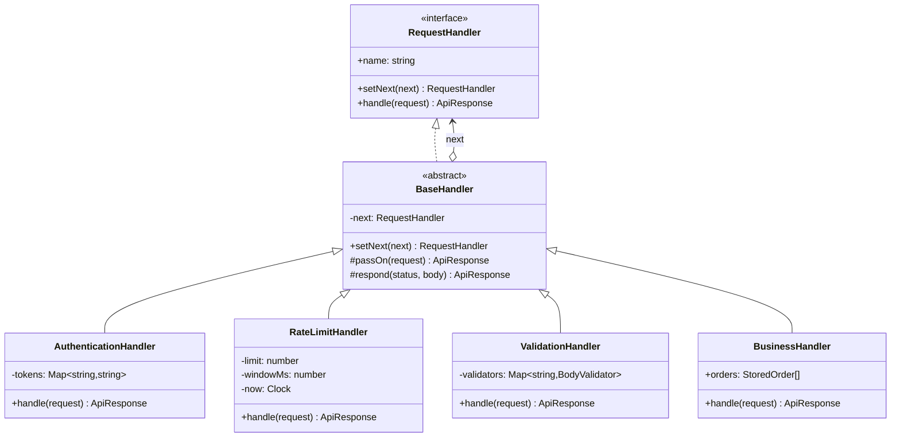

# Chain of Responsibility

**Category:** Behavioral · **Code:** [`chain-of-responsibility.ts`](./chain-of-responsibility.ts) · **Run:** `npm run demo -- chain-of-responsibility` · `npx vitest run src/behavioral/chain-of-responsibility`

## Intent

Give more than one object a chance to handle a request by passing it along a chain until one of them deals with it. The sender talks only to the head of the chain and never learns which link answered.

## The problem it solves

An orders API where every controller method starts with the same ladder: `if (!token) return 401; if (tooManyRequests(user)) return 429; if (!valid(body)) return 400;` and only then does its real work. The ladder is copy-pasted into every endpoint, the order of the checks is implicit (and drifts between endpoints), adding a cross-cutting rule such as maintenance mode means editing every controller, and testing the rate limiter means first building a request that gets past authentication.

## The solution

| Participant | In this example |
|---|---|
| Handler (interface) | `RequestHandler` with `setNext()` and `handle()` |
| Base handler | `BaseHandler`: owns the `next` link; `passOn()` forwards, or ends the chain explicitly |
| Concrete handlers | `AuthenticationHandler`, `RateLimitHandler` (injected clock), `ValidationHandler`, `BusinessHandler` |
| Client | The code that calls `chain(...)` once and sends every request to the head |

At runtime the chain is `AuthenticationHandler -> RateLimitHandler -> ValidationHandler -> BusinessHandler -> endOfChain()`. Each link makes one decision: **handle** (the business link returns 201), **reject** (401, 429, 400) or **pass on**. When every link passes, `endOfChain()` answers 404, so a request can never fall off the end silently.

The second half of `chain-of-responsibility.ts` shows the **functional form** with a support desk: each tier is a function that returns a resolution or `undefined`, the chain is an array (`[level1, level2, level3]`), and `escalate()` walks it. Adding a tier is adding an element; reordering the array reorders the chain.

## When to use it

- Several objects might handle a request and the right one depends on the request itself (support tiers, approval limits, fallback providers).
- Cross-cutting checks in front of business logic: authentication, rate limiting, validation, caching, feature flags.
- You want to add, remove or reorder steps by configuration without editing the other steps.
- Each step should be testable alone: give it no successor and assert whether it answered or passed on.

## When not to use it

- There is exactly one handler and it is known up front: just call it.
- Every step must always run and none may stop the request (enriching a DTO, formatting a log line): a plain list of functions, or **Decorator**, says that more honestly.
- Everyone interested should see the event, not just the first taker: that is **Observer**.
- The routing is a lookup (`category -> team`): a `Map` is clearer than a chain that tries each link in turn.

## Real-world sightings

- Express and Koa middleware: each function either ends the response or calls `next()`. When nothing answers, Express's final handler sends `404 Cannot GET /path`.
- Express error handling: `next(err)` skips ordinary middleware until an error-handling middleware `(err, req, res, next)` takes it.
- The NestJS request lifecycle: middleware, guards (which reject with 403), interceptors and pipes run before the controller.
- Java Servlet filters (`chain.doFilter(request, response)`) and Envoy HTTP filters, which can stop iteration.
- DOM event bubbling: an event climbs the ancestors until a listener calls `stopPropagation()`.
- Support escalation (L1 -> L2 -> L3), expense approval by amount (manager, director, CFO), payment routing that falls back to a second acquirer.

## Related patterns

- **Decorator**: the same recursive shape (each object holds the next one), but a decorator always delegates and adds behaviour around the call; a chain link may stop the request.
- **Command**: the request travelling down the chain is often a command object.
- **Composite**: the chain often follows parent links in a tree (a widget asks its dialog, then the window), which is the GoF book's own example.
- **Observer**: broadcasts to every subscriber; a chain normally stops at the first handler that accepts.
- **Mediator**: one central object decides who does what; in a chain each link decides only for itself.

## Pitfalls

- A request that falls off the end and returns `undefined`. Make the end explicit (`endOfChain()`, the `unassigned` tier) and test it.
- Hidden ordering dependencies: `RateLimitHandler` keys on the principal that `AuthenticationHandler` sets, and `BusinessHandler` trusts `ValidationHandler` to have run. Build the chain in one place and test the assembled chain, not only the links.
- A link that neither answers nor passes on. In Express it is the middleware that forgets `next()`: the request hangs until a timeout ends it.
- One `next` pointer per instance: putting the same handler object into two chains silently relinks it. Create instances per chain, or use the functional form.
- Long chains are hard to debug. Record who answered (`handledBy`) or trace each hop.

## Interview Q&A

**Q: Chain of Responsibility vs Decorator?**
Same structure, different contract. A decorator always forwards and adds behaviour around the call; a chain link decides whether to forward at all, so any link can end the request.

**Q: How does Express middleware relate to this pattern?**
It is a chain in which every link may do some work and then call `next()`, or end the response to short-circuit. Registration order is chain order, and the final handler is the explicit end that sends the 404.

**Q: What happens if nobody handles the request?**
The GoF book admits that "receipt isn't guaranteed". In production that must be a decision, not an accident: a 404, a default handler, a dead-letter queue, or a ticket assigned to a person.

**Q: Should rate limiting run before or after authentication?**
Both, for different reasons. A per-IP limit before authentication protects login and token verification from brute force; a per-user quota after authentication needs to know who the user is. That dependency is exactly why order matters in this example.

**Q: How do you test one handler in isolation?**
Construct it without a successor. If it answers you get its response; if it passes on you get the explicit end-of-chain response. No other handler, mock framework or HTTP server is needed.
