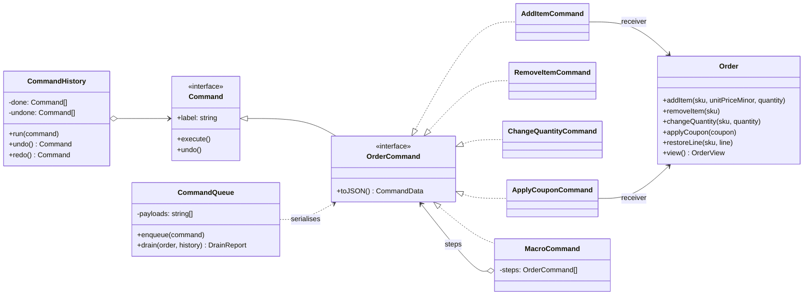

# Command

**Category:** Behavioral · **Code:** [`command.ts`](./command.ts) · **Run:** `npm run demo -- command` · `npx vitest run src/behavioral/command`

## Intent

Turn a request into an object. Once "add two mugs to order 42" is a value rather than a method call, it can be recorded, undone, redone, grouped, queued, retried or sent over the wire.

## The problem it solves

An order-editing screen calls `order.addItem()`, `order.applyCoupon()` and friends directly from its HTTP handlers. Then product asks for undo. Every handler now has to remember what the order looked like before, and the "undo" endpoint grows a `switch` on the last action's name with a hand-written inverse for each case. Next, ops want edits made offline on a tablet to sync later, and audit wants a log of every change. Each of these features reaches into the same handlers again, because the *request* has no existence of its own: it is gone the moment the method returns.

## The solution

Each edit becomes a command object that holds its receiver and arguments and knows how to `execute()` and `undo()` itself. An invoker (`CommandHistory`) runs commands and keeps the undo and redo stacks without knowing what an order is.

| Participant | In this example |
|---|---|
| Command (interface) | `Command` (`execute`, `undo`, `label`); `OrderCommand` adds `toJSON()` |
| Concrete commands | `AddItemCommand`, `RemoveItemCommand`, `ChangeQuantityCommand`, `ApplyCouponCommand` |
| Composite command | `MacroCommand`: all steps succeed or the ones that ran are undone |
| Receiver | `Order`, which owns the business rules and knows nothing of undo |
| Invoker | `CommandHistory` (undo/redo) and `CommandQueue` (deferred replay) |
| Client | The demo or an HTTP handler, which builds commands and hands them to an invoker |

Undo in this example is **captured state**: each command snapshots the line or coupon it is about to change when `execute()` runs, and `undo()` restores it. That is more robust than computing an inverse (`add 2` undone by `remove 2`), which breaks as soon as business rules merge or clamp values.

The `CommandData` discriminated union is the serialised form. `commandFromData` is the one place that switches on `type`, and the `never` check makes the compiler flag a new command type that the worker forgets to handle. `CommandQueue` stores JSON, replays it later and parks poison messages instead of blocking the queue.

The last section of `command.ts` shows the **functional form**: `reversible(label, action)` where the action makes the change and returns a closure that reverts it. It is the idiomatic TypeScript choice for in-process undo, but closures cannot be serialised, so they never go on a queue.

## When to use it

- Undo/redo, or any history the user can walk through (editors, carts, admin back-offices).
- Deferred or remote execution: job queues, outbox tables, offline sync, retries.
- An audit trail or event log of *intents* that can be replayed against a fresh receiver.
- Grouping several operations into one transactional unit (macro) with rollback.
- Decoupling who triggers an action (button, CLI, webhook, cron) from who performs it.

## When not to use it

- A plain CRUD endpoint with no undo, no queue and no audit: a command class per method is ceremony around a function call.
- When undo really means "restore yesterday's data": a database transaction, snapshot or Memento of the whole aggregate is simpler than per-command inverses.
- When the operations are not reversible in the real world (an email was sent, a card was charged). Model the compensating action (refund, correction email) explicitly, as in a **Saga**, instead of pretending `undo()` exists.
- When you need to rebuild state from history rather than undo it: that is **Event Sourcing**, where the log records facts that happened, not requests.

## Real-world sightings

- Job queues such as BullMQ: a job is a named, serialised request that a worker executes later, with retries.
- Redux actions: plain serialisable objects describing a change, dispatched to a reducer (the receiver); time-travel debugging replays them.
- CQRS command buses (for example `@nestjs/cqrs` with `CommandBus` and command handlers).
- Database migration tools with `up`/`down` pairs (Knex, TypeORM, Umzug): each migration is a reversible command.
- Editors such as VS Code and ProseMirror implement undo through recorded edits or transactions.
- The AWS SDK v3 for JavaScript models every API call as a command object: `client.send(new PutObjectCommand(input))`.

## Related patterns

- **Strategy**: also an object wrapping behaviour, but a strategy answers *how* to do something and is swapped in; a command is *one specific request*, with its arguments bound, that can be stored and undone.
- **Memento**: snapshots a receiver's state. Commands often use a small memento (the line before the edit) to implement `undo()`.
- **Composite**: `MacroCommand` is a composite of commands, treated as one.
- **Chain of Responsibility**: passes a request along handlers; it is common for that request to be a command object.
- **Event Sourcing**: a command is a request that may be rejected ("add item"); an event is a fact that already happened ("item added"). Command handlers validate commands and emit events.
- **Saga**: the distributed cousin of `MacroCommand`, where rollback is a compensating action rather than an in-memory undo.

## Pitfalls

- Capturing undo state in the constructor instead of in `execute()`. After an undo and other edits, a redo would restore a stale snapshot. Capture when you run.
- Recording a command whose `execute()` threw. `CommandHistory.run` only pushes after success, so a failed edit never lands on the undo stack.
- Forgetting to clear the redo stack after a new command: redoing an edit made against an older state corrupts the order.
- Macros that are not atomic. If step three fails, steps one and two must be rolled back, newest first.
- Serialising commands with their receiver attached. Send the *data* (`toJSON`) and bind the receiver on the worker, or you leak object graphs into the queue.
- Trusting queue payloads. They are untrusted input: validate with a schema before rebuilding a command.
- Unbounded history. Cap the undo stack or it becomes a memory leak in a long-lived session.

## Interview Q&A

**Q: How do you implement undo with Command?**
Each command knows how to reverse itself, usually by capturing the state it is about to change when it executes. The invoker keeps a done stack and an undone stack; undo pops one and calls `undo()`, redo pops the other and calls `execute()`, and any new command clears the redo stack.

**Q: Command vs Strategy?**
A strategy is an algorithm you plug into a context and call many times with different inputs. A command is a single request with its arguments already bound, so it can be queued, logged and undone. Strategy varies *how*; Command reifies *what*.

**Q: How would you make a group of edits atomic?**
A `MacroCommand` executes its steps in order, remembers which ones succeeded, and if one throws it undoes those in reverse before rethrowing. The invoker sees one command, so one undo reverts the whole group.

**Q: How do commands relate to job queues?**
A job is a serialised command: a type and its arguments as JSON. The producer enqueues it, and a worker rebuilds the command, binds it to a receiver and executes it, possibly much later and with retries. Closures cannot cross that boundary, so queued commands must be plain data.

**Q: Command vs event in event-driven systems?**
A command is imperative and can be rejected ("ApplyCoupon"); it usually has one handler. An event is past tense and is a fact ("CouponApplied"); it can have many subscribers and cannot be refused.
