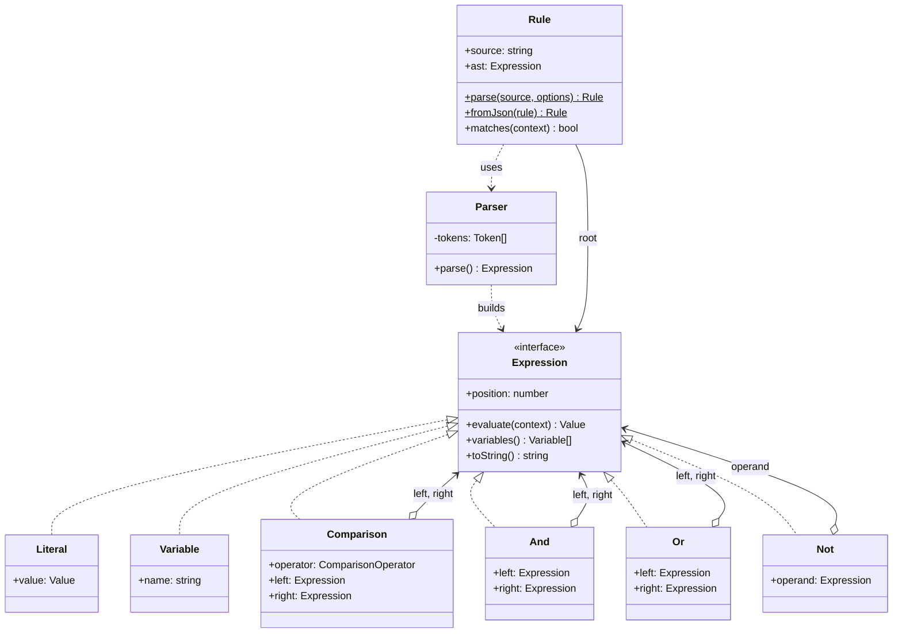
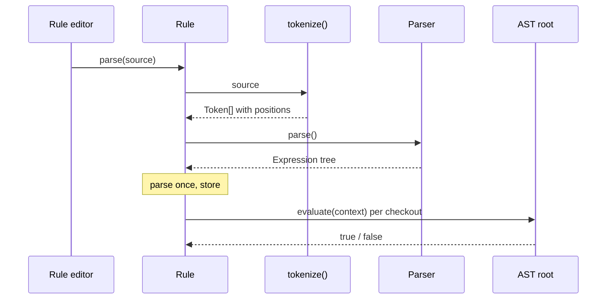

# Interpreter

**Category:** Behavioral · **Code:** [`interpreter.ts`](./interpreter.ts) · **Run:** `npm run demo -- interpreter` · `npx vitest run src/behavioral/interpreter`

## Intent

Give a small language a grammar, represent each grammar rule as a class, and evaluate a sentence by parsing it into a tree of those classes and asking the root to `evaluate(context)`.

## The problem it solves

Marketing wants discounts like "carts over Rs 1,000 from India or from gold customers", product wants feature flags like "beta users not in the EU", and both change weekly. Hard-coding each one as an `if` means a deploy per campaign. Storing a few flags in a config table works until someone needs an `OR`, then a nested `OR`, and the config grows fields like `country_or_tier_mode`. The other shortcut, `eval()` or `new Function()` on a string, hands remote code execution to anyone who can edit a rule. What is needed is a tiny, safe language with clear error messages:

```
cart_total >= 100000 AND (country = 'IN' OR tier = 'gold')
```

## The solution

The grammar, one parser method per line, lowest precedence first:

```
or         := and ( OR and )*
and        := not ( AND not )*
not        := NOT not | comparison
comparison := primary ( op primary )?
primary    := '(' or ')' | number | string | true | false | identifier
```





| Participant | In this example |
|---|---|
| Abstract expression | `Expression` with `evaluate(context)` |
| Terminal expressions | `Literal`, `Variable` |
| Non-terminal expressions | `Comparison`, `And`, `Or`, `Not` (each holds child expressions) |
| Context | `Context`, a read-only record of cart and customer fields |
| Parser (not in GoF, always needed) | `tokenize()` plus the recursive-descent `Parser` |
| Client | `Rule` and `eligibleOffers()`, which parse once and evaluate per request |

Errors are part of the design: `RuleSyntaxError` carries a 0-based `position` and a caret `pointer()` for the rule editor, `UnknownVariableError` names the variable and where it appears, and `Comparison` refuses `country > 5` instead of quietly returning `false`. `Rule.parse(source, { knownVariables })` rejects a typo like `cart_totl` when the rule is saved rather than at checkout.

The end of `interpreter.ts` shows the **JSON alternative**: `JsonRule` (`{ all: [...] }`, `{ any: [...] }`, `{ not }`, `{ var, op, value }`) maps straight onto the same AST classes. Prefer JSON rules when rules are built in an admin UI (no parser, no syntax errors, easy to diff and validate with a schema). Prefer an existing library when you need more than a handful of operators: functions, dates, lists, arithmetic, or sandboxing guarantees you would rather not own, for example Google's CEL, `json-logic-js` or `json-rules-engine`. Write your own interpreter only when the language is small and the error messages matter to your users.

## When to use it

- A small, stable language that non-developers write: eligibility rules, alert conditions, search filters, routing rules.
- Rules must be stored as data, changed without a deploy and evaluated safely (no `eval`).
- You need precise error messages with positions for a rule editor.
- The same expression runs against many contexts, so you parse once and evaluate many times.

## When not to use it

- The grammar is large or keeps growing. A class per rule gets unwieldy; use a parser generator or an existing expression language.
- Performance is critical. Tree-walking is slow compared with compiling to closures or bytecode.
- Rules are only ever built in a UI. Structured JSON avoids the parser entirely.
- A flag and a list cover it (`countries: ['IN']`). A language is overkill.

## Real-world sightings

- `json-rules-engine` and `json-logic-js` on npm: rule trees stored as JSON and evaluated against facts.
- Google's Common Expression Language (CEL), used for Kubernetes validation rules and admission policies.
- SQL `WHERE` clauses, Elasticsearch query DSL and MongoDB query filters: a small boolean language evaluated per row or document.
- Template engines (Handlebars, EJS) and `mathjs`, which parse source text into a node tree and evaluate it.
- GitHub Actions `if:` expressions, a small language evaluated against a workflow context.

## Related patterns

- **Composite**: the AST is a Composite; Interpreter adds the meaning (`evaluate`) to it.
- **Visitor**: once you need several operations over the AST (evaluate, pretty-print, extract variables, compile to SQL), move them into visitors instead of adding a method to every node class.
- **Specification**: composes `and/or/not` predicates built in code. Interpreter adds a textual language and a parser in front of the same idea.
- **Strategy**: chooses among algorithms written in code; Interpreter lets users write the algorithm as data.

## Pitfalls

- Using `eval` or `new Function` "just for now". Rules are user input; treat them like SQL.
- Getting precedence wrong. `a AND b OR c` must group as `(a AND b) OR c`; encode it in the grammar, and test it with `toString()`.
- Losing positions. Without them, "syntax error" in a 200-character rule helps nobody.
- Looking up variables with `in` or plain indexing: `constructor` and `toString` exist on every object. Use `Object.hasOwn`.
- Loose typing that turns `tier = 5` into `false`. Fail loudly so rule authors fix the rule.
- Re-parsing on every request. Parse when the rule is saved or loaded, cache the tree, evaluate per request.

## Interview Q&A

**Q: What are terminal and non-terminal expressions?**
Terminals are leaves that need no children to evaluate (`Literal`, `Variable`). Non-terminals combine other expressions (`And`, `Or`, `Not`, `Comparison`). Evaluating the root recursively evaluates the tree.

**Q: How does a recursive-descent parser get precedence right?**
One method per precedence level, lowest first: `parseOr` calls `parseAnd`, which calls `parseNot`. The deeper a rule is, the tighter it binds, so `AND` groups before `OR`. Parentheses restart at the top from `parsePrimary`.

**Q: Why not just use `eval` on the rule string?**
It executes arbitrary code with the server's privileges and gives poor error messages. An interpreter only understands the operators you defined and can point to the exact character that is wrong.

**Q: When would you choose JSON rules or a library over writing an interpreter?**
JSON when rules come from a UI builder: no parsing, schema-validated, easy to store. A library like CEL when you need functions, dates or lists, or strong guarantees about sandboxing and cost. A hand-written interpreter fits a small language whose error messages you want to own.

**Q: How would you make evaluation faster?**
Parse once and cache the AST per rule version. If that is still too slow, compile the AST to nested closures or to a SQL `WHERE` clause and let the database filter.
