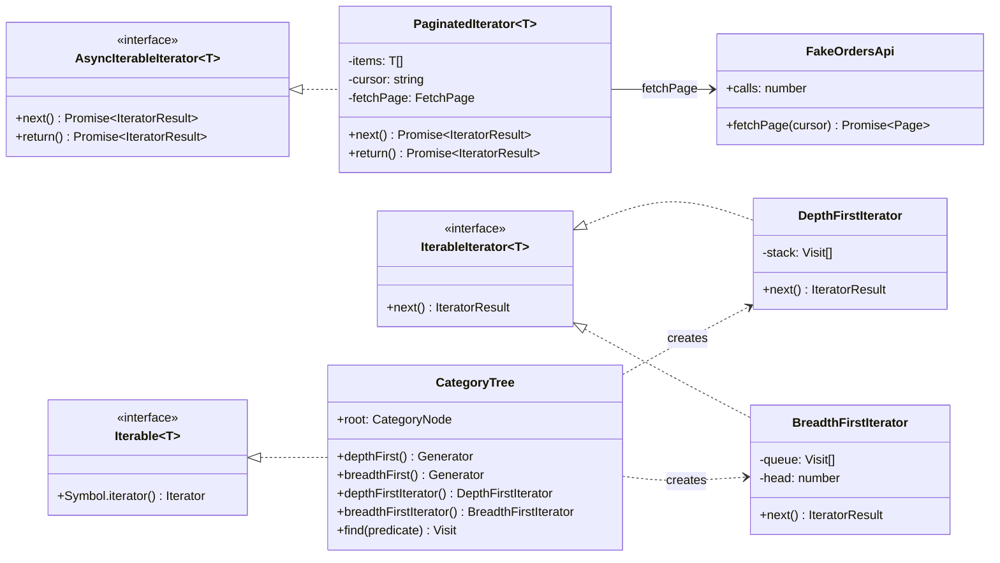
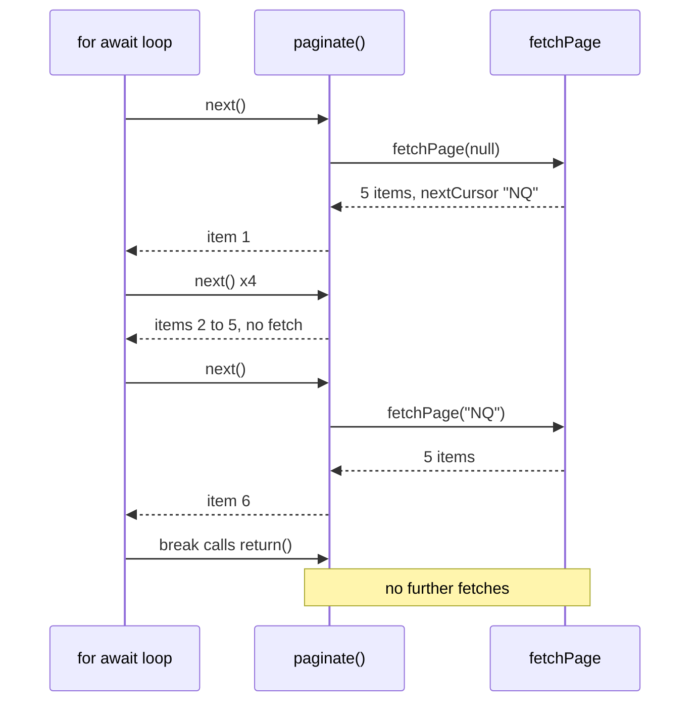

# Iterator

**Category:** Behavioral · **Code:** [`iterator.ts`](./iterator.ts) · **Run:** `npm run demo -- iterator` · `npx vitest run src/behavioral/iterator`

## Intent

Give sequential access to the elements of a collection without exposing how it is stored, fetched or traversed. The consumer asks for "the next one" and the iterator decides where it comes from.

## The problem it solves

A nightly job exports every order from a partner's REST API, which returns 25 orders per page and an opaque `nextCursor`. The first version loops on `while (cursor)`, pushes every page into one big array, and only then filters for paid orders. It holds 200,000 orders in memory to keep 60,000, it keeps fetching even after a "preview" caller only wanted the first 50, and the pagination loop is copied into three other jobs with slightly different bugs (one forgets the last page). The same happens for the category tree: one function walks it recursively for menus, another builds a queue for level-by-level rendering, and every caller is coupled to `children` arrays.

The smell: consumers know *how* the data is laid out (pages, cursors, children) when all they want is a sequence.

## The solution

| Participant | In this example |
|---|---|
| Iterator (interface) | The language protocols: `Iterator` / `IterableIterator` (`next()`), `AsyncIterator` (`next()` returns a promise) |
| Concrete iterators | `PaginatedIterator`, `DepthFirstIterator`, `BreadthFirstIterator`, and the generators `paginate()`, `depthFirst()`, `breadthFirst()` |
| Aggregate (iterable) | `CategoryTree` (its `[Symbol.iterator]` walks depth-first) and the paginated API behind `FetchPage` |
| Client | `for...of`, `for await...of`, spread, `collect()` and the pipeline helpers |

In JavaScript, Iterator is built into the language. Any object with `[Symbol.iterator]()` works with `for...of`, spread and destructuring; any object with `[Symbol.asyncIterator]()` works with `for await...of`. The code shows both forms side by side:

- **Classic classes** (`PaginatedIterator`, `DepthFirstIterator`, `BreadthFirstIterator`) hold their cursor explicitly: a page buffer and cursor, a stack, a queue with a head index. This is what the diagram shows and what an interviewer means by "implement an iterator".
- **Generators** (`paginate`, `depthFirst`, `breadthFirst`) are the idiomatic form. The function's paused stack frame *is* the iterator state, `yield*` delegates to a child, and leaving a `for await` loop early calls `return()` on the generator automatically.

**Laziness is the point.** `paginate()` fetches a page only when the consumer has used up the previous one. `filterAsync`, `mapAsync` and `takeAsync` each pull one item at a time from the stage before, so `takeAsync(…, 3)` finishing closes the whole chain and the API stops being called: the test proves 2 fetches for 100 available orders.

## When to use it

- Paginated or streamed sources (REST cursors, database cursors, S3 listings, Kafka partitions, file lines) that should look like one sequence.
- Large or unbounded data where materialising an array is wasteful or impossible.
- One structure with several traversal orders (depth-first for menus, breadth-first for level rendering or shortest-path search).
- Lazy pipelines where downstream may stop early (`take`, `find`, "first match").
- Hiding a collection's representation so it can change (array to linked list, page size from 25 to 100) without touching consumers.

## When not to use it

- The data is small and already in an array: `array.filter().map()` is clearer than a custom iterator.
- Consumers need random access, length or multiple passes; an iterator is single-pass and forward-only. Return an array or a collection class.
- Throughput-critical batch work where per-item `await` overhead dominates: process page by page (`for await (const page of pages)`) instead of item by item.
- When concurrency matters more than order, an async iterator serialises fetches. Use a bounded concurrent pool, or prefetch the next page deliberately.

## Real-world sightings

- Node streams are async iterable: `for await (const chunk of fs.createReadStream(path))`, and `readline` interfaces yield lines the same way.
- The AWS SDK v3 paginators (`paginateListObjectsV2` and friends) return async iterables of pages.
- The Stripe Node library supports `for await` auto-pagination over list endpoints.
- MongoDB's Node driver cursors and `pg-cursor`/`pg-query-stream` for Postgres read rows lazily from the server.
- `Map`, `Set`, `Array` and strings implement `Symbol.iterator`; `map.entries()` returns an iterator, not an array.
- Iterator helpers (`Iterator.prototype.map`, `filter`, `take`) were added in ES2025 and ship in recent V8 versions; the helpers in this file do the same job in a form that type-checks against the ES2022 lib used here.

## Related patterns

- **Composite**: the category tree is a composite; Iterator is how you walk it without the client knowing about `children`.
- **Visitor**: also walks a structure, but performs a type-specific operation on each element. Iterator only answers "what is next"; the two are often combined (iterate, then visit).
- **Generator / coroutine**: the language feature JavaScript uses to implement iterators; not a separate GoF pattern.
- **Observer / streams (RxJS)**: push-based, the producer decides when values arrive. Iterator is pull-based, the consumer decides, which gives natural backpressure.
- **Factory Method**: `[Symbol.iterator]()` and `depthFirstIterator()` are factory methods that create a fresh iterator for each loop.

## Pitfalls

- Returning `this` from the aggregate's `[Symbol.iterator]`, so two loops share one cursor. Each call must create a new iterator (the tree does; the classic iterator *object* returns itself, which is the protocol for iterators).
- Iterating a single-use iterator twice: a generator or `PaginatedIterator` is exhausted after one pass, and the second loop silently sees nothing.
- Forgetting `return()` in a hand-written iterator, so `break` cannot release resources (close a cursor, abort a request). Generators get this for free, including `finally` blocks.
- Eager helpers in a lazy pipeline (`await collect()` in the middle, `Array.from` on an async source) that quietly fetch everything.
- Mutating a collection while iterating it, which leads to skipped or repeated elements.
- `Array.prototype.shift()` as a queue in breadth-first traversal is O(n) per call; use a head index as `BreadthFirstIterator` does.
- Recursive generators on very deep trees grow the call stack; the explicit-stack iterator does not.

## Interview Q&A

**Q: What is the iterator protocol in JavaScript?**
An iterable has a `[Symbol.iterator]()` method that returns an iterator; an iterator has `next()` returning `{ value, done }`, and optionally `return()` for early exit. The async versions use `Symbol.asyncIterator` and return promises. `for...of`, spread and destructuring are built on it.

**Q: How do you expose a paginated API so callers do not deal with cursors?**
Wrap it in an async generator that fetches a page, `yield*`s its items, and follows `nextCursor` until it is null. Callers write `for await (const order of paginate(fetchPage))`, pages are fetched only as consumed, and a `break` stops further requests.

**Q: Why are generators preferred over hand-written iterator classes in TypeScript?**
The generator's suspended frame holds the state, so there is no manual cursor bookkeeping, `yield*` composes nested traversals, and `return()` with `finally` cleanup is automatic. A class is still useful when the state must be inspectable or serialisable, such as resuming an export from a saved cursor.

**Q: Depth-first vs breadth-first: when would you use each on a category tree?**
Depth-first (pre-order) for rendering nested menus or breadcrumbs, because a parent is followed by its whole subtree. Breadth-first for level-by-level work: a mega-menu showing top levels first, or finding the shallowest match.

**Q: How does early termination propagate through a lazy pipeline?**
When the consumer stops (`take` reaches its count, or a loop breaks), `for await` calls `return()` on its source, which closes that generator, whose own loop then calls `return()` on its source, all the way back to the paginator. No further `next()` is ever called, so no further pages are fetched.
