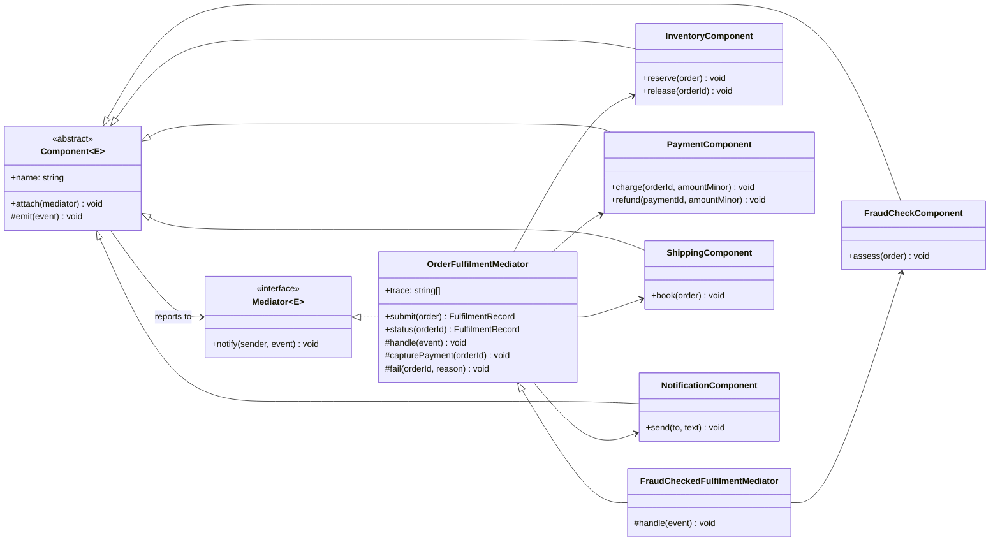
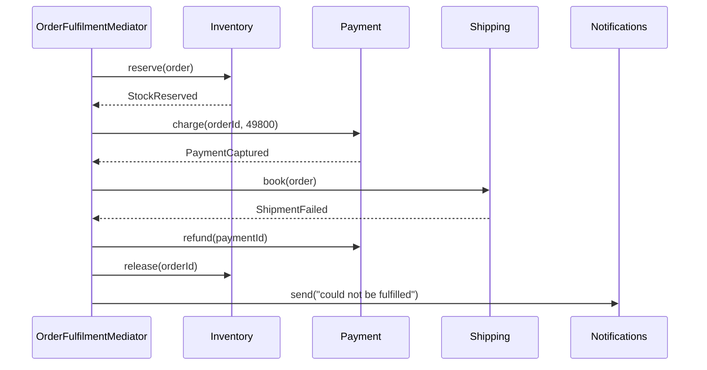

# Mediator

**Category:** Behavioral · **Code:** [`mediator.ts`](./mediator.ts) · **Run:** `npm run demo -- mediator` · `npx vitest run src/behavioral/mediator`

## Intent

Move the rules about how a group of objects interacts into one object, the *mediator*. The components stop referring to each other and only report to the mediator, so the many-to-many web of calls becomes a star.

## The problem it solves

Order fulfilment first gets written as components calling each other directly:

```ts
class Inventory {
  constructor(private payment: Payment, private notifier: Notifier) {}
  reserve(order: Order) { /* ... */ this.payment.charge(order); }
}
class Payment {
  constructor(private shipping: Shipping, private inventory: Inventory, private notifier: Notifier) {}
  charge(order: Order) {
    if (declined) { this.inventory.release(order); this.notifier.orderFailed(order); }
    else this.shipping.book(order);
  }
}
class Shipping {
  constructor(private payment: Payment, private inventory: Inventory, private notifier: Notifier) {}
  book(order: Order) { if (noCourier) { this.payment.refund(order); this.inventory.release(order); /* ... */ } }
}
```

Every component imports most of the others, `Inventory` and `Payment` depend on each other (construction needs setters or a container), and the business process ("reserve, charge, ship; on failure undo in reverse") is smeared across three files. Adding a fraud check between stock and payment means editing `Inventory` (which now calls fraud instead of payment) and the fraud class (which calls payment), and none of them can be unit tested without the rest.

## The solution

Each component gets a reference to a `Mediator` and nothing else, does its own job, and reports the outcome as an event. `OrderFulfilmentMediator` decides what happens next.



The conversation when the courier cannot ship, showing the compensation the mediator owns:



| Participant | In this example |
|---|---|
| Mediator (interface) | `Mediator<E>` with `notify(sender, event)` |
| Concrete mediator | `OrderFulfilmentMediator` (and `FraudCheckedFulfilmentMediator`); `ChatRoom` in the mini example |
| Colleague (abstract) | `Component<E>`: holds the mediator, `emit()`s events |
| Concrete colleagues | `InventoryComponent`, `PaymentComponent`, `ShippingComponent`, `NotificationComponent`, `FraudCheckComponent`; `ChatUser` |
| Client | The demo or an HTTP handler calling `mediator.submit(order)` |

Notes on the implementation:

- **Events are a discriminated union** (`FulfilmentEvent`), so the mediator's `switch` is checked for exhaustiveness by `assertNever`; a new event type that nobody handles is a compile error.
- **Run-to-completion queue.** `notify()` enqueues; the mediator drains the queue in a loop. A component's call returns before the next step starts, so the trace reads in business order instead of as a five-deep call stack.
- **Adding a component** (`FraudCheckComponent`) changes the mediator only: a subclass overrides the `StockReserved` rule. The four existing components are untouched, which is the pattern's promise.
- **The chat room** is the textbook mini example: `ChatUser` instances never hold references to each other; `ChatRoom` owns routing (broadcast, whisper, bounce when the recipient left).

## When to use it

- Several objects interact in well-defined but complex ways, and the interaction is the thing that changes (a checkout flow, a booking workflow, form fields that enable and validate each other).
- You want to reuse components in a different process (the same `PaymentComponent` in refunds and in subscriptions) without dragging their neighbours along.
- Failure handling and compensation must happen in a specific order and be readable in one place.

## When not to use it

- Two objects talking to each other: a direct call is clearer. A mediator for two colleagues is indirection with no payoff.
- The reactions are independent and order does not matter (send an email, update analytics): Observer is lighter and does not create a central class.
- The mediator would end up owning half the domain. A mediator that grows without bound becomes a god object; split it per process (one per workflow), not per system.
- The steps span services, take minutes and must survive restarts: you want a durable orchestrator (a saga with persisted state), not an in-memory object.

## Real-world sightings

- Saga orchestrators and workflow engines (Temporal workflows, AWS Step Functions, Camunda): the orchestrator decides the next step and the compensations; services only report outcomes.
- `@nestjs/cqrs` command and query buses, and .NET's MediatR: handlers are reached through a bus instead of being injected into each other.
- Socket.IO rooms and chat servers: clients send to the server, which routes to the other members.
- Air-traffic control, the classic analogy: aircraft talk to the tower, not to each other.
- Redux: UI components dispatch actions to the store instead of calling each other, and reducers decide what changes.

## Related patterns

- **Observer**: also decouples senders from receivers, but nobody coordinates the reactions. Mediator knows every participant and sequences them; components often report to it through an Observer-style `notify`.
- **Facade**: simplifies a subsystem for clients *outside* it, and the subsystem does not know the facade exists. A mediator coordinates objects *inside* a subsystem, and they do know about it.
- **Chain of Responsibility**: passes a request along until someone handles it; the order is the chain. In a mediator the order is decided by explicit rules.
- **Command**: components may send commands to the mediator; the mediator decides which handler runs them.

## Pitfalls

- **God object.** All the coupling you removed from the components can accumulate in the mediator. Keep one mediator per process and keep business work in the components; the mediator only decides *what next*.
- **Components that sneak around the mediator** (a shipping component that imports payment "just for the refund"). Enforce it with module boundaries or lint rules.
- **Re-entrancy.** With direct `notify -> handler -> notify` recursion, the order of side effects depends on the call stack. A queue (as here) or async steps make it explicit.
- **Compensation is not rollback.** A refund is a new operation that can itself fail; make compensations idempotent (`release` is) and record what was done.
- **Hidden flow.** Event names like `StockReserved` are greppable; keep a trace and log it, or the process is impossible to debug.

## Interview Q&A

**Q: Mediator vs Observer?**
Observer: one subject broadcasts and the listeners react independently, with no coordination. Mediator: a central object knows the participants and decides who acts next and in what order. Use Mediator when sequence and failure handling matter.

**Q: Doesn't the mediator just become a god class?**
It can. Scope it to one process (order fulfilment, not "the shop"), keep domain logic inside the components, and let the mediator hold only the routing and compensation rules. When it grows, split per workflow.

**Q: How does this relate to a saga?**
An orchestrated saga is a Mediator across services: the orchestrator sends commands, services reply with events, and the orchestrator runs compensating actions on failure. The in-process version here is the same shape without persistence.

**Q: How do you add a fraud check between reserving stock and charging?**
Add a `FraudCheckComponent` that reports `FraudCleared` or `FraudRejected`, and change the mediator's rule for `StockReserved` (here, in a subclass). Inventory, payment, shipping and notification code does not change.

**Q: How do you unit test a component?**
Attach it to a fake mediator that records `notify` calls, call its method, and assert on the reported event. No other component is needed, because none is referenced.
