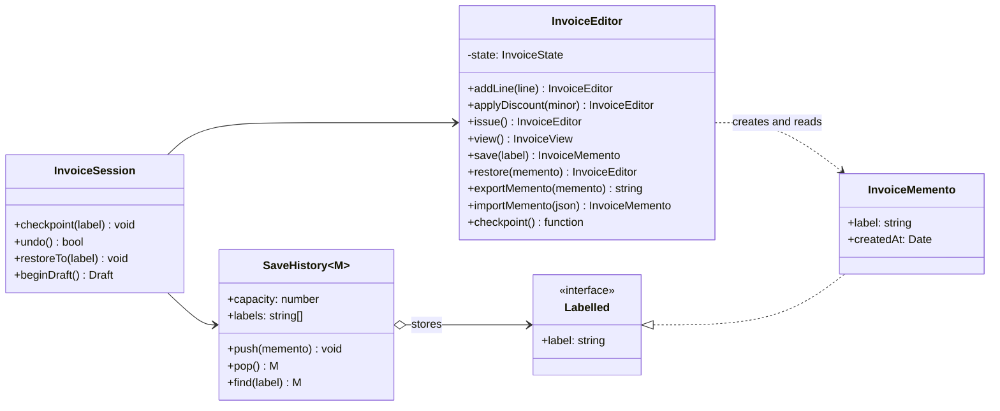

# Memento

**Category:** Behavioral · **Code:** [`memento.ts`](./memento.ts) · **Run:** `npm run demo -- memento` · `npx vitest run src/behavioral/memento`

## Intent

Capture an object's internal state as an opaque token so the object can be put back into that state later, without breaking its encapsulation. Whoever stores the token (undo stack, autosave) cannot read or change what is inside it.

## The problem it solves

An invoice editor needs undo, named save points ("before discount") and "try an edit, then throw it away". The quick version lets the undo stack do the copying: `history.push({ ...invoice })`. That shallow copy shares the `lines` array, so the next `addLine` silently edits every save point. Fixing it means the history code must know which fields are nested, the editor's private fields become public so they can be copied and written back, and anyone holding a save point can mutate it (or restore a half-built state that skips the editor's validation). Every new field on the invoice is now an edit to the undo code.

## The solution

The editor (*originator*) creates and consumes snapshots itself. The snapshot (*memento*) shows the outside world only a label and a timestamp. The history (*caretaker*) stores mementos and hands them back, and never looks inside.

| Participant | In this example |
|---|---|
| Originator | `InvoiceEditor`: the only code that can read a snapshot (`save`, `restore`, `exportMemento`) |
| Memento | `InvoiceMemento`: public `label` and `createdAt`; the state sits in a module-private `WeakMap` |
| Caretaker | `SaveHistory<M>` (bounded stack, generic so it cannot depend on the contents) and `InvoiceSession` (undo, named restore, draft then discard) |
| Client | The demo or an HTTP handler that calls `session.checkpoint()` before a risky edit |

How the code keeps the promises:

- **Narrow vs wide interface.** GoF gives the originator a "wide" view of the memento and everyone else a "narrow" one (C++ `friend`). In TypeScript, a module-private `WeakMap<InvoiceMemento, State>` does it: the memento object has no state properties at all, so neither `Object.keys` nor a cast can reach it, and the entry is garbage-collected with the memento.
- **Immutability.** `save()` stores a `structuredClone` that is deep-frozen; `restore()` thaws a fresh copy for the editor. Later edits cannot leak into a save point, and a save point can be restored any number of times.
- **Invariants stay with the originator.** `restore()` rejects save points from another invoice and refuses to rewrite an issued invoice, which the caretaker could never check.
- **Bounded history.** `SaveHistory` drops the oldest entry past `capacity`, so a long editing session does not grow memory without limit.
- **Draft then discard.** `beginDraft()` takes one memento and returns `commit()` / `discard()`; the caller never touches the memento.
- **Closure form.** `checkpoint()` returns `() => void`: in TypeScript the most idiomatic memento is often a function that closes over the frozen snapshot.

### Serialisation

A memento held in memory dies with the process. To persist one (autosave to a database, a draft that survives a deploy), the *originator* serialises it, because only it knows the fields: `exportMemento()` writes `{ v, label, createdAt, state }` and `importMemento()` validates the shape and the version before creating a memento. The version number is the important part: once save points are stored, `InvoiceState` is a public schema, and adding a field needs a migration for old snapshots, just like a database column. The caretaker stores the string and still cannot interpret it (encrypt or sign it if the client stores it, so it cannot be edited).

## When to use it

- Undo/redo, save points, "revert to last saved" in editors (invoices, pricing rules, workflow definitions, CMS pages).
- Trying a change and rolling back in memory: a what-if price calculation, a speculative move in a solver, a failed multi-step edit.
- When the state to snapshot is private and you do not want to widen the class's API to let others copy it.

## When not to use it

- The state is large and changes often: full snapshots cost memory and time. Store inverse operations (Command with `undo()`) or deltas instead.
- The object is already an immutable value: keeping the previous reference *is* the memento; no extra class needed.
- The state lives in a database: use transactions for rollback and an audit/event table for history, not in-memory snapshots.
- The state contains handles that cannot be copied (open sockets, file descriptors, other aggregates by reference).

## Real-world sightings

- Redux undo libraries such as `redux-undo`, which keep `past`, `present` and `future` states and restore one on undo.
- Immer: `produce()` returns a new frozen object and the old one stays as an untouched snapshot.
- `structuredClone`, the platform's deep copy, which this example uses for snapshots.
- Database savepoints (`SAVEPOINT` / `ROLLBACK TO SAVEPOINT` in PostgreSQL and MySQL): the engine keeps the state, the client only holds a name.
- Snapshots in event-sourced systems: a periodic serialised aggregate state, so rebuilding does not replay every event.

## Related patterns

- **Command**: undo by reversing each operation. Memento undoes by restoring a whole state. Commands are cheaper for small changes to big objects; mementos are simpler and cannot get the inverse wrong. They combine: a command stores a memento of what it changed.
- **Prototype**: also copies an object, but to create a new one with its own life. A memento is not usable on its own; it only goes back into its originator.
- **Iterator**: some iterators store a memento of their position so iteration can resume.
- **Event sourcing**: history as events; snapshots in event sourcing are mementos used to shorten replay.

## Pitfalls

- **Shallow copies.** `{ ...state }` shares nested arrays and objects. Use a deep clone and freeze the result.
- **Leaky mementos.** A memento with public fields lets any caretaker change history, and a restore then bypasses validation. Keep the state unreachable, as with the `WeakMap` here. (`InvoiceMemento.capture` is still a public static, marked `@internal`; in a library, keep it unexported.)
- **Unbounded history.** Every keystroke saved forever is a memory leak. Cap it, or coalesce rapid edits into one save point.
- **Restoring across invariants.** Restoring an old state can violate rules that hold now (an issued invoice, a closed accounting period). The originator must check, not the caretaker.
- **Serialised state is a schema.** Once a snapshot is on disk, renaming a field breaks old save points. Version the format.

## Interview Q&A

**Q: Who is allowed to read a memento?**
Only the originator. The caretaker can store, list and hand back mementos but sees nothing but metadata. That is what keeps encapsulation intact and lets the originator validate on restore.

**Q: Memento or Command for undo?**
Memento when the state is small or the operations are hard to invert (a bulk edit, a reorder). Command when the state is large and each operation has a cheap, reliable inverse. Many editors use commands for undo and mementos for checkpoints.

**Q: How do you make a memento immutable in TypeScript?**
`readonly` is compile-time only. Deep-clone the state, `Object.freeze` it recursively, and hide it where outside code cannot reach it (a module-private `WeakMap` or `#private` field). Thaw a new copy on restore.

**Q: How do you persist save points?**
Let the originator serialise them to a versioned format and validate on load. The version allows migrations as the class evolves; storing a raw class instance or relying on the caretaker to know the fields defeats the pattern.

**Q: What bounds the history and what do you drop?**
A capacity (count or bytes). Drop the oldest, since recent undo matters most; keep named save points separately if users expect them to survive.
