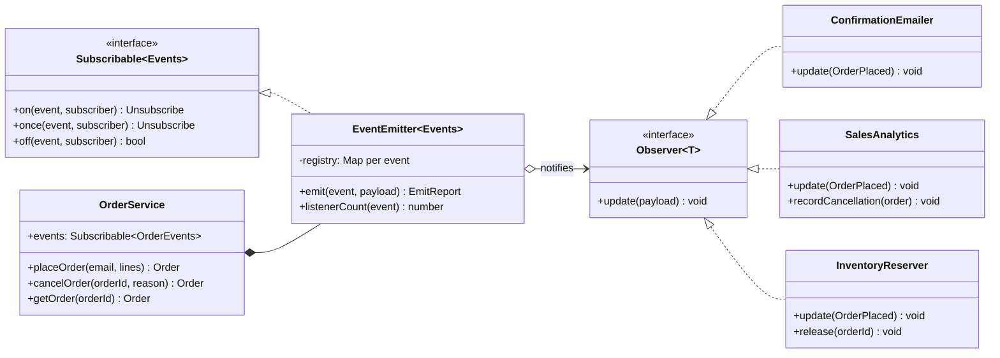
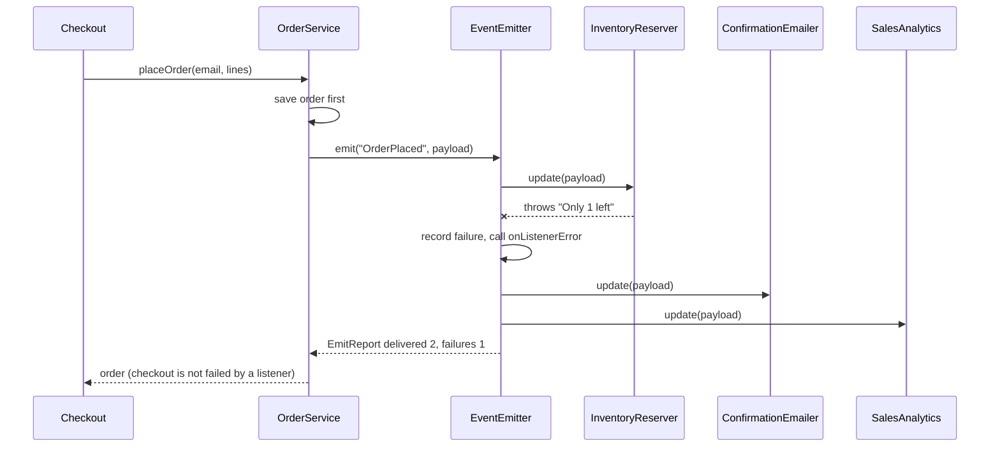

# Observer

**Category:** Behavioral · **Code:** [`observer.ts`](./observer.ts) · **Run:** `npm run demo -- observer` · `npx vitest run src/behavioral/observer`

## Intent

Let one object (the *subject*) announce that something happened, and let any number of other objects (the *observers*) react, without the subject knowing who they are. The subject depends on a subscription interface, never on its listeners.

## The problem it solves

`OrderService.placeOrder()` starts life saving an order. Then product asks for a confirmation email, so it calls `emailService.sendConfirmation(order)`. Then analytics wants revenue, so it calls `analytics.track(order)`. Then the warehouse wants stock reserved, so it calls `inventory.reserve(order)`. The order service now imports three unrelated modules, its unit tests need three mocks, a slow SMTP provider makes checkout slow, and an exception in analytics fails the customer's order. Every new reaction (loyalty points, fraud scoring, a webhook) is another edit to the most critical function in the system.

## The solution

`OrderService` owns a typed `EventEmitter<OrderEvents>` and announces `OrderPlaced` and `OrderCancelled`. Listeners subscribe from a composition root (`wireOrderListeners`). The service exposes only the `Subscribable` half of the emitter, so outsiders can listen but cannot emit its events.

What happens on one `placeOrder` when inventory is short:

| Participant | In this example |
|---|---|
| Subject (interface) | `Subscribable<Events>`: `on`, `once`, `off` |
| Concrete subject | `EventEmitter<Events>`, owned by `OrderService`, which decides when to emit |
| Observer (interface) | `Observer<T>` with `update(payload)`, or the function form `Listener<T>` |
| Concrete observers | `ConfirmationEmailer`, `SalesAnalytics`, `InventoryReserver`, plus the inline `releaseStock` and `reverseRevenue` functions |
| Client / composition root | `wireOrderListeners`, the only code that knows both sides |

Design choices worth pointing out in an interview:

- **Typed events.** `EventEmitter<OrderEvents>` maps each event name to its payload, so `on('OrderPlaced', e => ...)` infers `e: OrderPlaced` and a typo in the event name is a compile error.
- **Two observer forms.** The classic GoF `Observer` object with `update()` (matches the diagram) and the idiomatic TypeScript form, a plain function. The emitter accepts both, as the DOM's `addEventListener` does.
- **Error isolation.** Each listener runs in its own `try/catch`; failures are collected into an `EmitReport` and passed to `onListenerError`. Node's `EventEmitter` does the opposite: a throwing listener propagates out of `emit()` and the remaining listeners never run.
- **Push vs pull.** `OrderPlaced` is a *fat* event (push): it carries lines, total and email, so listeners never call back. `OrderCancelled` is *thin* (pull): it carries the id, and `reverseRevenue` asks `service.getOrder()` for the total. Push decouples listeners from the subject's query API; pull keeps events small and always fresh, at the price of a call back into the subject.
- **Commit, then announce.** The order is saved before the event goes out, so no listener ever reacts to an order that does not exist.
- **Snapshot during emit, dedupe on subscribe, `once()` removed before it runs.** These are the three bugs every hand-rolled emitter ships with first.

## When to use it

- One state change has several independent reactions owned by different teams or modules (email, analytics, search indexing, cache invalidation).
- The set of reactions changes more often than the thing that triggers them.
- You want the core path (place an order) testable without the side effects.
- In-process domain events, before you need (or as a stepping stone to) a message broker.

## When not to use it

- There is exactly one reaction and it is part of the same transaction (debit the wallet *and* create the payment): a direct call is clearer and fails atomically.
- The caller needs a result back. Observers are fire-and-forget; a return value means you wanted a function call, a Strategy or a Chain of Responsibility.
- Ordering between reactions matters (reserve stock *before* charging): implicit listener order is fragile. Make it an explicit workflow or a Mediator.
- The reaction must survive a crash or run in another service. An in-memory emitter loses events on restart; use an outbox and a broker.

## Real-world sightings

- Node's `EventEmitter` (`node:events`): streams, `http.Server`, `process` and sockets are all subjects. Listeners run synchronously in registration order; `emit('error')` with no listener throws.
- The DOM's `EventTarget.addEventListener`, which ignores a duplicate registration of the same listener.
- RxJS `Subject` / `Observable`, which add composition (map, filter, debounce) on top of the same idea.
- Vue's and MobX's reactivity systems: a component observes the state it reads.
- Distributed versions: Kafka topics, RabbitMQ fanout exchanges, AWS SNS, Redis pub/sub and PostgreSQL `LISTEN/NOTIFY`, where the broker is the subject and consumers are observers in other processes.

## Related patterns

- **Mediator**: observers react independently and nobody coordinates them; a mediator knows all the components and sequences them. Use Mediator when the order and the failure handling between reactions matter.
- **Publish/subscribe**: Observer with a broker in the middle. Publisher and subscriber do not even share a process, delivery can be durable and at-least-once, and the subject no longer holds the listener list.
- **Chain of Responsibility**: a request travels until *one* handler takes it; an event goes to *every* observer.
- **Command**: an event says "this happened" (past tense, many listeners); a command says "do this" (imperative, one handler).

## Pitfalls

- **Exceptions leaking to the subject.** With Node's `EventEmitter`, an analytics bug fails checkout. Isolate listeners, or catch inside each one.
- **Async listeners.** An `async` listener's rejection is not caught by a synchronous `try/catch` around the call. Await them (`Promise.allSettled`) or attach `.catch` explicitly.
- **Memory leaks.** Every subscription is a strong reference from the subject to the observer. Long-lived subjects with short-lived listeners (per-request) must unsubscribe; Node warns after 10 listeners on one event for this reason.
- **Event before commit.** Emitting before the save (or inside a transaction that later rolls back) tells the world about something that did not happen. In a database-backed system use a transactional outbox.
- **Cascades.** A listener that emits another event that triggers another listener makes the control flow invisible. Keep handlers shallow and log event names.
- **Assuming order.** Listeners run in subscription order here, but nothing in the pattern guarantees it, and a broker certainly will not.

## Interview Q&A

**Q: Observer vs pub/sub?**
Observer: the subject holds its listener list and calls them directly, in the same process. Pub/sub puts a broker between them, so publisher and subscriber know only a topic name, can live in different services, and delivery can be durable and retried.

**Q: Push or pull: which do you prefer for domain events?**
Push (a fat event with the data listeners need) for events that cross module or service boundaries, because listeners should not call back into the publisher. Pull (a thin event with an id) when the payload is large or must be read fresh, accepting that listeners depend on the subject's query API.

**Q: What happens in Node if one `EventEmitter` listener throws?**
`emit()` is a synchronous loop: the exception propagates to whoever called `emit()`, and the listeners registered after the failing one do not run. This file isolates each listener and reports failures instead.

**Q: How do you make sure an email is sent only if the order was really saved?**
Emit after the commit. Across a database and a broker, write the event to an outbox table in the same transaction as the order and have a relay publish it, so the event and the state change succeed or fail together.

**Q: How do you test `OrderService` without sending email?**
Do not subscribe the emailer. The service only knows the `Subscribable` interface, so a test can attach a recording listener, or none at all, and inject `now` and `nextId` for determinism.
