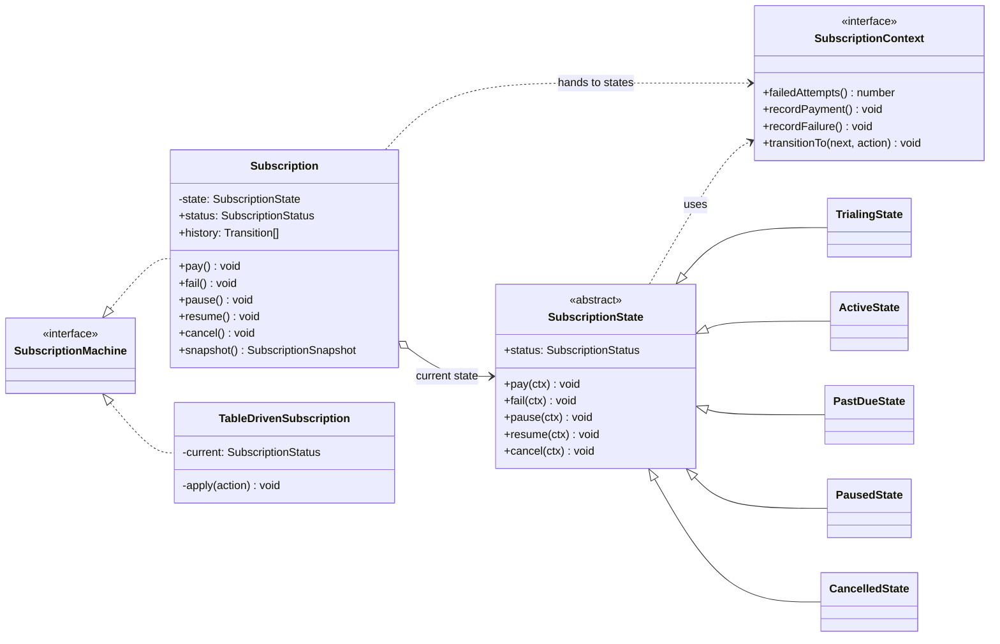
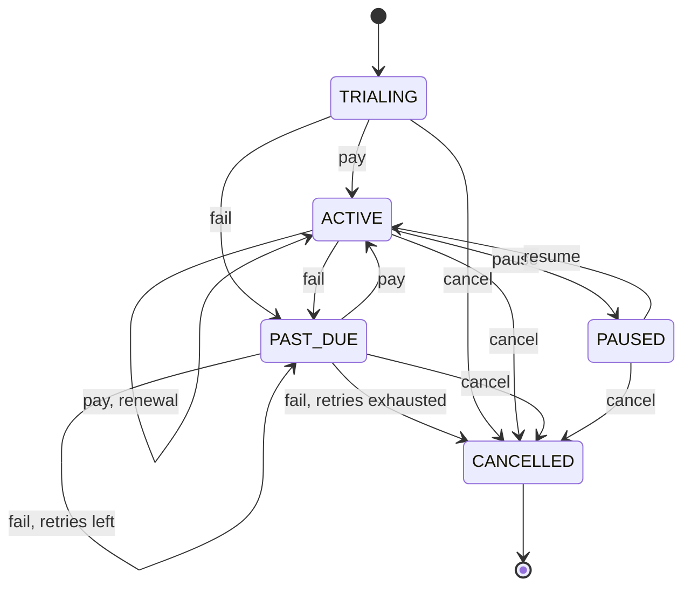

# State

**Category:** Behavioral · **Code:** [`state.ts`](./state.ts) · **Run:** `npm run demo -- state` · `npx vitest run src/behavioral/state`

## Intent

Let an object change its behaviour when its internal state changes, by delegating each operation to a state object and swapping that object on a transition. From the outside it looks as if the object changed its class.

## The problem it solves

A subscription has five statuses and five operations. The first version is a `switch (this.status)` inside each of `pay()`, `fail()`, `pause()`, `resume()` and `cancel()`: 25 cases, most of them "throw, not allowed", spread over five methods. The rules for one status (what PAST_DUE allows, when dunning gives up) are scattered across all of them, a new status (GRACE_PERIOD) means editing every method, and it is easy to forget one and let a cancelled subscription be paused. Billing bugs of this kind charge cancelled customers.

## The solution

`Subscription` (the *context*) holds a `SubscriptionState` and forwards every operation to it. Each concrete state implements only the operations it allows; the base class throws `InvalidTransitionError` for the rest. States perform the transition through a narrow `SubscriptionContext` handle.

The lifecycle both implementations encode (any action not drawn throws):

| Participant | In this example |
|---|---|
| Context | `Subscription`: one-line methods that forward to the current state |
| State (abstract) | `SubscriptionState`: rejects everything by default, allows `cancel` |
| Concrete states | `TrialingState`, `ActiveState`, `PastDueState`, `PausedState`, `CancelledState` |
| Context handle | `SubscriptionContext`: what a state may do (record a payment, transition) |
| Alternative | `TRANSITIONS` table plus `TableDrivenSubscription` |

Design notes:

- **States are stateless and shared.** The counters (failed attempts, periods paid) live in the context, so one instance of each state class serves every subscription (a Flyweight).
- **Narrow context.** States receive a `SubscriptionContext`, not the `Subscription`, so `transitionTo` is not part of the public API and clients cannot jump to ACTIVE without paying.
- **Table-driven alternative.** `TRANSITIONS` is `status -> action -> { effect, to }`, with a guard function for the one conditional transition (dunning). `TableDrivenSubscription` is a 20-line interpreter of that table. The tests run the same script against both and require identical status, counters and history.

**Classes or table?** The table wins when transitions are mostly "from X on Y go to Z": the whole machine fits on a screen, it can be loaded from config, drawn as a diagram, and questions like "which buttons should the UI show?" become `allowedActions(status)`. State classes win when each state has real behaviour (different pricing, different emails, different entry/exit work), because that code sits in one class per state instead of in effect callbacks keyed by strings.

## When to use it

- An entity with a lifecycle whose allowed operations depend on its status: orders, payments, subscriptions, shipments, support tickets, KYC checks.
- Several methods each switch on the same status field.
- Invalid transitions must be impossible, not just unlikely (charging a cancelled subscription, refunding an unpaid order).

## When not to use it

- Two or three states with trivial rules: a status enum and a guard clause are clearer.
- The behaviour does not vary by state, only the label does: store the label.
- The workflow is long-running, distributed or needs timers and retries across restarts: reach for a persisted state machine or workflow engine, not in-memory objects.
- The variation is chosen by the caller rather than driven by the object's own lifecycle: that is Strategy.

## Real-world sightings

- XState: statecharts for TypeScript, defined as a transition config (the table-driven form) with guards and actions.
- Stripe subscriptions use statuses such as `trialing`, `active`, `past_due`, `paused`, `canceled` and `unpaid`, with dunning retries moving between them.
- Node streams and sockets have internal states (flowing, paused, ended, destroyed) that decide what `write()` or `read()` does.
- TCP connections (`LISTEN`, `SYN_SENT`, `ESTABLISHED`, `TIME_WAIT`), the classic GoF example.
- Circuit breakers (closed, open, half-open) in resilience libraries such as `opossum`.

## Related patterns

- **Strategy**: the same shape (context delegates to an interchangeable object). In Strategy the *client* picks the algorithm and strategies do not know each other; in State the *states* trigger transitions and know their successors.
- **Flyweight**: stateless state objects can be shared, as `STATES` is here.
- **Memento**: snapshot the context (state plus counters) to roll back a lifecycle change.
- **Command**: each action (`pay`, `pause`) can be a command, so the history doubles as an audit log that can be replayed.

## Pitfalls

- **Data in state objects.** Put counters in a state class and two subscriptions sharing that instance corrupt each other. Keep data in the context or create a state instance per context.
- **Transitions decided in two places.** Either states call `transitionTo`, or the context does after asking the state; mixing both makes the flow impossible to follow.
- **Silent no-ops.** Ignoring an invalid action (instead of throwing) hides client bugs, such as a double cancel from a retried webhook. Reject explicitly, or make it idempotent on purpose and document it.
- **Persistence.** Store the status *name*, not the object, and rebuild the state from it on load. Concurrent updates need optimistic locking (`UPDATE ... WHERE status = 'ACTIVE'`), or two webhooks can both transition from the same state.
- **State explosion.** States multiplied by flags (paused *and* past due?) grow fast; hierarchical statecharts or separate machines per concern help.

## Interview Q&A

**Q: State vs Strategy?**
Same structure, different intent. Strategy: the client chooses an algorithm and it rarely changes. State: the object moves between states as a result of its own operations, and the transitions are the point.

**Q: When would you use a transition table instead of state classes?**
When transitions are mostly data ("from X on Y go to Z"), when the machine must be configurable or visualised, or when you need "which actions are allowed now?". Use classes when states carry significant behaviour.

**Q: How do you persist a state machine?**
Store the status as a column, rebuild the state object from it, and make every transition a conditional update on the expected current status (or a version number) so concurrent requests cannot both apply. Log transitions for audit.

**Q: Where do the dunning retry counters live?**
In the context (`Subscription`), not the state objects. That keeps states stateless and shareable, and a state decides using the counters through the context handle, as `PastDueState.fail` does.

**Q: How do you add a GRACE_PERIOD status?**
Add a `GracePeriodState` class (or a row in the table) and change the one transition that leads into it (ACTIVE on fail). The other states and the context are untouched.
