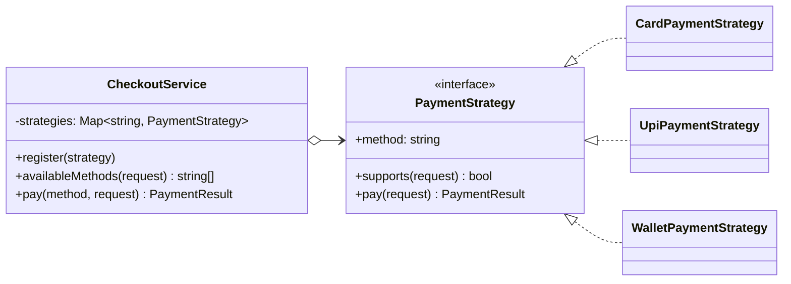

# Strategy

**Category:** Behavioral · **Code:** [`strategy.ts`](./strategy.ts) · **Run:** `npm run demo -- strategy` · `npx vitest run src/behavioral/strategy`

## Intent

Define a family of interchangeable algorithms, encapsulate each one, and let the client choose one at runtime. The code that uses the algorithm (the *context*) depends only on the interface.

## The problem it solves

A checkout service that handles card, UPI and wallet payments with an `if/else` or `switch` on the method name grows a new branch for every payment option, every branch touches the same function, and testing one method means wiring up all of them. Limits (UPI cap, wallet balance) and fees get tangled into one place.

## The solution

| Participant | In this example |
|---|---|
| Strategy (interface) | `PaymentStrategy` with `supports()` and `pay()` |
| Concrete strategies | `CardPaymentStrategy`, `UpiPaymentStrategy`, `WalletPaymentStrategy` |
| Context | `CheckoutService`, which holds a registry and delegates |
| Client | The demo, which registers strategies and asks the context to pay |

The second half of `strategy.ts` shows the **functional form**: when a strategy is one stateless method, a function type (`DiscountStrategy = (subtotal) => discount`) is the idiomatic TypeScript, and strategies compose (`bestOf(...)`).

## When to use it

- Several ways of doing one thing, chosen at runtime (pricing, routing, retry policy, compression, auth providers).
- A class has a `switch` on a "kind" field that keeps growing.
- You want to test an algorithm in isolation from the code that calls it.

## When not to use it

- Only one algorithm exists and no second one is on the roadmap. An interface with one implementation is ceremony.
- The variants differ in *data*, not *behaviour*: a configuration object is simpler.
- The variation belongs to a whole object's lifecycle, not one operation: look at **State**.

## Real-world sightings

- Passport.js authentication strategies (`LocalStrategy`, `JwtStrategy`, `GoogleStrategy`).
- `Array.prototype.sort(comparator)`: the comparator is a strategy.
- Express/Fastify body parsers, compression algorithms, storage backends in Multer.
- Payment gateways routing to acquirers; tax calculation per country; shipping-rate calculators.

## Related patterns

- **State**: same structure, but the *context* switches strategy as its state changes, and transitions are part of the pattern.
- **Template Method**: varies steps through inheritance instead of composition. Strategy is preferred when you need to swap at runtime.
- **Factory / Registry**: often used to pick which strategy to instantiate, as `CheckoutService.register` does.
- **Decorator**: wraps a strategy to add behaviour (logging, retries) without a new strategy class.

## Pitfalls

- Leaking context details into the interface (passing the whole `CheckoutService` to `pay()`); keep the interface minimal.
- Strategies that need wildly different inputs: that is a sign they are not one family.
- Forgetting that the client must know the strategies exist. Hide the choice behind a registry or configuration when the client should not care.

## Interview Q&A

**Q: Strategy vs State, in one sentence each?**
Strategy: the client chooses the algorithm. State: the object changes its own behaviour as its internal state changes, and the transitions are the point.

**Q: How would you add a new payment method without redeploying the checkout service?**
Strategies are registered, not hard-coded, so a plugin module (or a config-driven factory) can add one. The context has no switch to edit.

**Q: Isn't this just polymorphism?**
Yes, deliberately. Strategy is polymorphism applied to *one operation* that varies, held by composition rather than inheritance, so it can be swapped at runtime.

**Q: Where does Strategy show up in a billing system?**
Proration (daily vs. none), tax rules per jurisdiction, dunning retry schedules, invoice numbering schemes, and payment routing. All change per customer or per region without changing the invoice engine.
