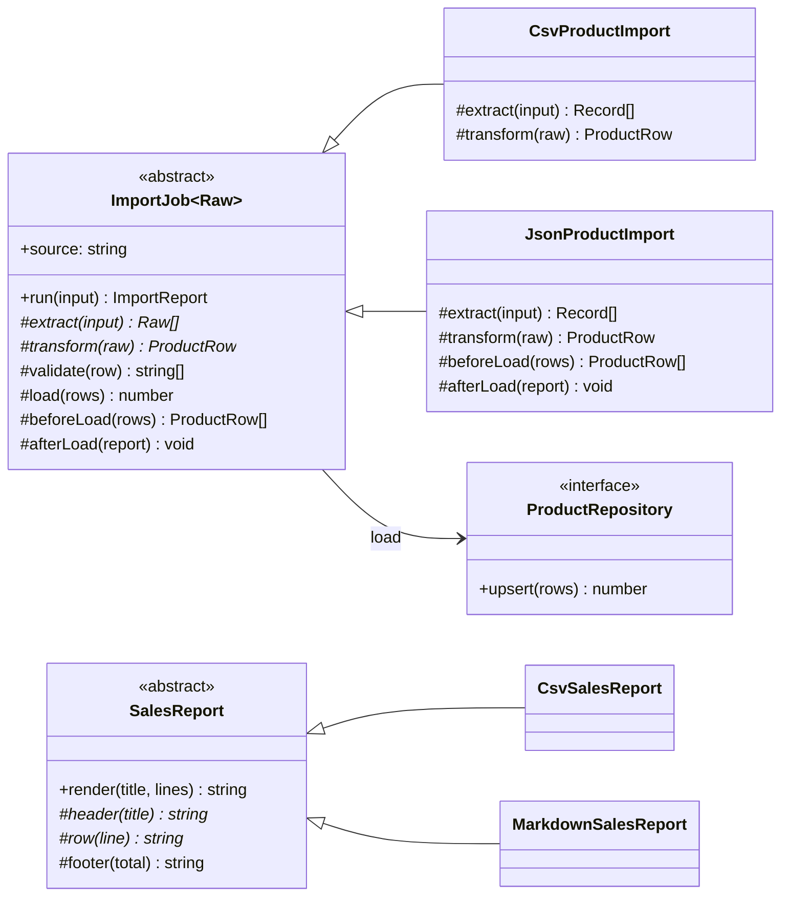
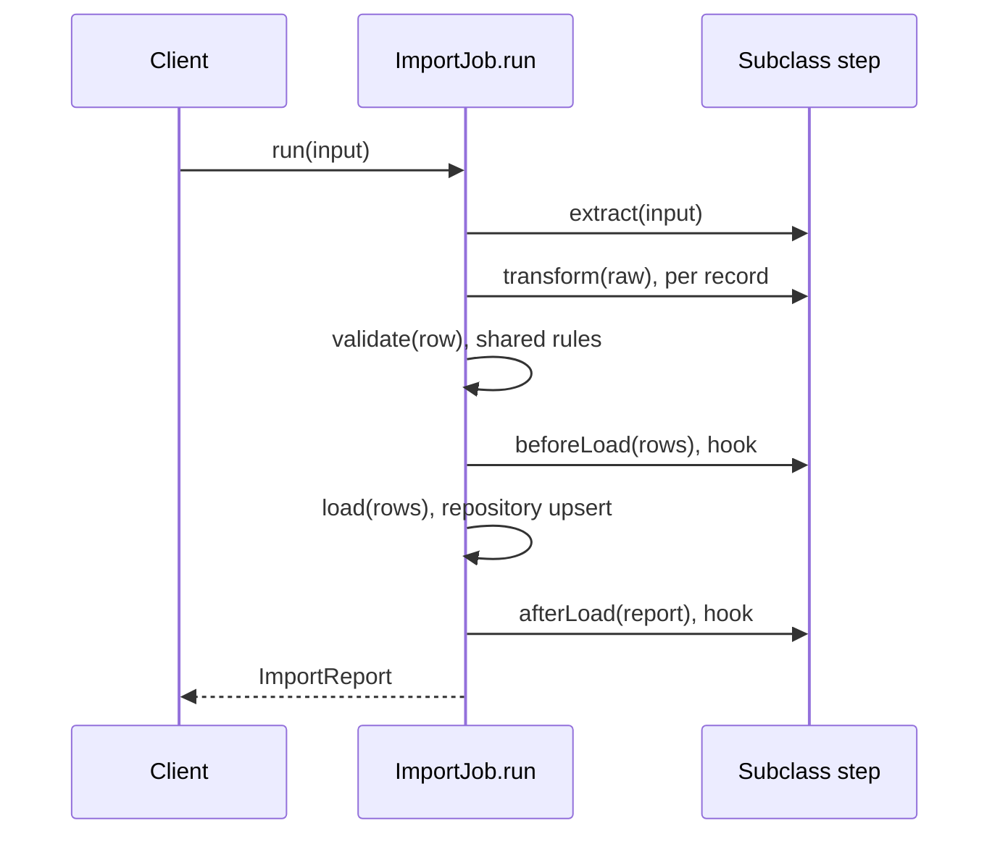

# Template Method

**Category:** Behavioral · **Code:** [`template-method.ts`](./template-method.ts) · **Run:** `npm run demo -- template-method` · `npx vitest run src/behavioral/template-method`

## Intent

Define the skeleton of an algorithm once, in a base class method, and let subclasses supply some of the steps. The order of the steps, and the steps every variant shares, cannot be changed by a subclass.

## The problem it solves

The catalogue service imports products from a supplier's CSV export and from a partner's JSON feed. The two importers were written by different people as two long functions: parse, map fields, check the SKU format, check the price, upsert, log. They agree on most of it, but not quite: the JSON importer forgot the SKU check, the CSV importer validates *after* writing to the database, and when finance asked for "reject non-positive prices", the rule was added to one of them. Every new source (an XLSX upload, an SFTP drop) is a third copy that drifts too. The smell is copy-pasted procedures whose differences are a few lines in the middle.

## The solution

`ImportJob.run()` is the template method: extract, transform, validate, `beforeLoad`, load, `afterLoad`, always in that order, with rejection bookkeeping in one place. Subclasses implement the two format-specific steps; validation and loading are shared concrete steps; the two hooks are empty unless a subclass needs them.

| Participant | In this example |
|---|---|
| Abstract class | `ImportJob<Raw>`; `SalesReport` in the second example |
| Template method | `ImportJob.run()`; `SalesReport.render()` |
| Primitive operations (must override) | `extract`, `transform`; `header`, `row` |
| Concrete steps (shared, may override) | `validate`, `load` |
| Hooks (optional, empty by default) | `beforeLoad`, `afterLoad`; `footer` |
| Concrete classes | `CsvProductImport`, `JsonProductImport`; `CsvSalesReport`, `MarkdownSalesReport` |

Notes on the code:

- `CsvProductImport` overrides exactly two methods; `JsonProductImport` adds the two hooks (dedupe by SKU, audit log). A test checks the prototypes to prove it.
- Money is parsed from text (`parseMoney("249.00") === 24900`); `Number("0.29") * 100` would not be an integer.
- **Functional form.** `defineImport(source, { extract, transform, validate?, beforeLoad?, afterLoad? }, repository)` returns an import function. The skeleton is a higher-order function and the steps are a config object of functions with defaults for the optional ones. It is the idiomatic TypeScript choice when the variants have no state of their own, and a test shows it produces the same report as the class form.

### Template Method vs Strategy

Both let you vary part of an algorithm. Template Method varies **steps** of a fixed skeleton through **inheritance**: the variant is chosen when you pick the class, and the base class calls the subclass ("don't call us, we'll call you"). Strategy varies the **whole algorithm** through **composition**: the context holds an object that can be swapped at runtime. The functional `defineImport` sits between them: the steps are passed in like strategies, but the skeleton still owns their order, so it is a template method without inheritance. Choose Template Method when the invariant is the *sequence* (validate before load, always audit); choose Strategy when the invariant is only the *interface*.

## When to use it

- Several procedures share the same sequence and differ in a few steps: importers, exporters, report renderers, payment provider adapters with the same authorise-capture-settle flow.
- Some steps must always happen in a fixed order (validate before writing, audit after) and you want that enforced in one place.
- Frameworks that call user code at well-defined points (lifecycle hooks).

## When not to use it

- The variants differ in the whole algorithm, or must be swapped at runtime: use Strategy.
- The variation is along two axes (format and destination): inheritance multiplies classes (`CsvToPostgres`, `CsvToS3`, ...). Compose steps instead.
- Only one variant exists: a plain function is clearer than an abstract class with one subclass.
- The hierarchy is already deep: each level that overrides hooks makes the real flow harder to follow.

## Real-world sightings

- Framework lifecycle hooks: Angular's `ngOnInit` / `ngOnDestroy`, NestJS's `onModuleInit` / `onApplicationBootstrap`, React class components' `componentDidMount`: the framework owns the sequence and calls your steps.
- Node's `stream.Readable`, `Writable` and `Transform`: the base class runs buffering and backpressure and calls your `_read()`, `_write()` or `_transform()`.
- Test runners: `beforeAll`, `beforeEach`, the test, `afterEach`, `afterAll` in vitest and Jest, a skeleton with hooks.
- ETL tools and batch jobs (Spring Batch's reader, processor, writer is the same shape).

## Related patterns

- **Strategy**: composition and runtime swapping of the whole algorithm; see the section above.
- **Factory Method**: often *is* a step of a template method (a `createParser()` step that subclasses override).
- **Hooks / callbacks**: the functional form; a template method whose steps are passed in.
- **Chain of Responsibility / pipeline**: a sequence of independent handlers that can be reordered. Template Method fixes the order on purpose.

## Pitfalls

- **Overriding the template method.** TypeScript has no `final`; a subclass can override `run()` and skip validation. Keep steps `protected`, document the rule, and consider the functional form when this matters.
- **Forgetting `super`.** A subclass that overrides a concrete step (`validate`) and forgets `super.validate(row)` silently drops the shared rules.
- **Too many hooks.** A base class with ten hooks has an implicit protocol nobody can remember. Keep it to the steps that really vary.
- **Fragile base class.** Changing the order of steps in the base class changes every subclass's behaviour at once; that is the point, but it needs tests on the base class too.
- **Inheritance for code reuse only.** If subclasses override almost every step, there is no shared skeleton; use separate implementations behind an interface.

## Interview Q&A

**Q: Template Method vs Strategy, in one sentence each?**
Template Method: inheritance, the base class fixes the order of steps and subclasses fill some in. Strategy: composition, the context delegates the whole algorithm to an object that can be swapped at runtime.

**Q: What is a hook, and how is it different from an abstract step?**
An abstract step must be implemented by every subclass (`extract`). A hook has a default, usually empty, implementation and is overridden only when needed (`beforeLoad` for dedupe, `afterLoad` for an audit log).

**Q: How do you stop a subclass from overriding the template method in TypeScript?**
There is no `final`. Make the steps `protected`, keep the template method small and documented, test it in the base class, or use the functional form where the skeleton is a function that cannot be overridden.

**Q: What is the Hollywood principle?**
"Don't call us, we'll call you": the base class (or framework) controls the flow and calls the subclass's steps, rather than the subclass calling into library helpers. Lifecycle hooks in NestJS and Angular are the everyday example.

**Q: How would you add an XLSX importer?**
A new subclass that implements `extract` (read the sheet into records) and `transform` (map the columns). Validation, rejection reporting, loading and auditing come from the base class unchanged.
