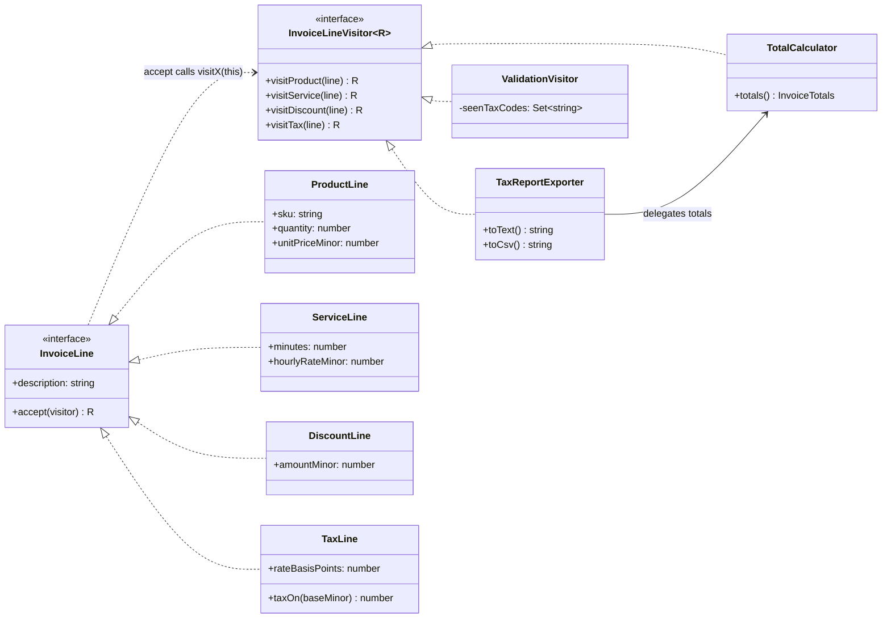
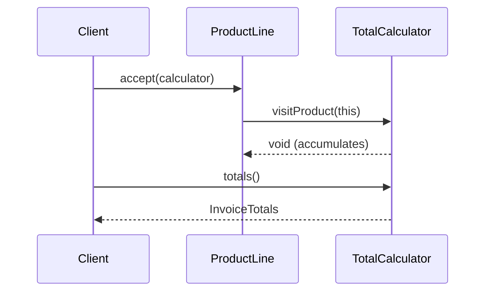

# Visitor

**Category:** Behavioral · **Code:** [`visitor.ts`](./visitor.ts) · **Run:** `npm run demo -- visitor` · `npx vitest run src/behavioral/visitor`

## Intent

Separate operations from the object structure they run over. The element classes stay fixed and only know how to `accept` a visitor; each new operation is a new visitor class with one method per element type, picked by double dispatch.

## The problem it solves

An invoice is a list of lines: products, services, discounts and taxes. Finance wants totals, then a tax report as text and CSV, then validation before an invoice is issued, then ledger postings. If each operation becomes a method on every line class (`total()`, `toCsvRow()`, `validate()`, `toLedger()`), every new requirement edits four classes, and the line classes fill up with CSV quoting and accounting rules that have nothing to do with being a line. The other naive fix, one function per operation with `if (line instanceof ProductLine) ... else if ...`, scatters type checks everywhere and silently ignores a line type someone forgets.

## The solution

Double dispatch is the whole trick: the call is resolved first on the element (which `accept`?), then on the visitor (which `visitX`?).

| Participant | In this example |
|---|---|
| Visitor (interface) | `InvoiceLineVisitor<R>`, one `visitX` per line type, generic in the result |
| Concrete visitors | `TotalCalculator` (stateful, `R = void`), `TaxReportExporter` (composes a `TotalCalculator`), `ValidationVisitor` (`R = string[]`) |
| Element (interface) | `InvoiceLine` with `accept(visitor)` |
| Concrete elements | `ProductLine`, `ServiceLine`, `DiscountLine`, `TaxLine` |
| Object structure | The invoice: a `readonly InvoiceLine[]` walked by `visitAll()` |
| Client | The demo and tests, which build lines and run visitors over them |

The second half of `visitor.ts` shows the **TypeScript alternative**: `InvoiceItem` is a discriminated union on `kind`, `totalOfItems` uses a `switch` whose `default` calls `assertNever(item)`, and `matchItem(item, handlers)` takes a mapped handler object the compiler checks for completeness. It beats Visitor when the data is plain (parsed JSON, a database row, a queue message), when you own every operation, and when you would rather not wrap data in classes just to get `accept()`. Visitor still earns its place when the elements are classes with behaviour of their own, when third parties must add operations to a hierarchy they cannot edit, or when traversal of a tree is part of what you hand to the visitor (compilers, linters).

## When to use it

- The set of element types is stable but operations keep arriving (export formats, reports, validation, pricing passes).
- Operations need state across many elements (running totals, duplicate detection) that does not belong on any one element.
- You walk trees of heterogeneous nodes: ASTs, document models, rule trees, config graphs.
- You want the compiler to tell you every operation that must handle a newly added element type.

## When not to use it

- Element types change often. Every new type adds a method to the visitor interface and breaks every visitor; that is the opposite trade-off from what you want.
- There are one or two operations. A method on each class is simpler.
- The data is plain objects in TypeScript. A discriminated union with an exhaustive `switch` gives the same safety with less code.
- The operation needs private internals of the elements. Visitors force elements to expose state, which weakens encapsulation.

## Real-world sightings

- Babel plugins export a `visitor` object keyed by node type (`Identifier(path) { ... }`); Babel's traversal does the dispatch.
- ESLint rules return an object of node-type handlers that the linter calls while walking the AST.
- `graphql-js` exposes `visit(ast, visitor)` for walking and transforming GraphQL documents.
- The TypeScript compiler API uses `ts.visitEachChild` and visitor callbacks in custom transformers.
- Backend code: invoice and order exporters (CSV, PDF, e-invoicing JSON), query-plan rewriting in ORMs and SQL builders.

## Related patterns

- **Composite**: Visitor is most often run over a Composite tree; Composite gives the structure, Visitor adds operations to it.
- **Iterator**: walks a structure but treats every element alike; Visitor does something different per type.
- **Strategy**: swaps one algorithm for one context; Visitor bundles one operation across many element types.
- **Interpreter**: puts `evaluate()` on each node class. When interpreters need many operations (evaluate, print, optimise), they often move them into visitors.
- **Command**: encapsulates a request; a visitor is an operation, but it is applied to a structure rather than queued.

## Pitfalls

- Adding an element type is expensive: every visitor changes. Pick Visitor only when the element set is the stable axis.
- Forgetting that `accept` must call the method for its own type. A copy-pasted `accept` that calls `visitProduct` from `ServiceLine` compiles if the types happen to line up.
- Stateful visitors are single-use. Reusing a `TotalCalculator` across invoices doubles the totals; create one per traversal (`TotalCalculator.of`).
- Order-dependent logic: tax depends on all other lines, so compute it at the end (`totals()`), not inside `visitTax()`.
- Exposing internals just so a visitor can read them. Keep elements as data plus invariants and let visitors use their public API.

## Interview Q&A

**Q: What is double dispatch and why does Visitor need it?**
Most OO languages pick a method by the runtime type of one object only. Visitor needs to choose by two: the element and the operation. `line.accept(visitor)` dispatches on the line, and inside it `visitor.visitProduct(this)` dispatches on the visitor.

**Q: What trade-off does Visitor make?**
It makes adding operations cheap and adding element types expensive. It is the mirror of plain polymorphism, where a new type is cheap and a new operation touches every class.

**Q: In TypeScript, when would you use a discriminated union instead?**
When the elements are plain data and you own all operations: a `switch` on `kind` with an `assertNever` default is checked by the compiler, needs no `accept()` plumbing and works on JSON straight off the wire. Choose Visitor when the elements are behaviour-rich classes or outside code must add operations.

**Q: How do you make sure a new element type is handled everywhere?**
In Visitor, add `visitNewType` to the interface and the compiler fails every visitor that lacks it. In the union form, the `never` check in each `switch` default, or a mapped handler type like `ItemHandlers<R>`, gives the same guarantee.

**Q: Where would you use Visitor in a backend?**
Over an AST (rule engines, query builders, GraphQL documents) or over a fixed document model like invoice lines, where reports, exports and validations keep growing but the line types rarely do.
