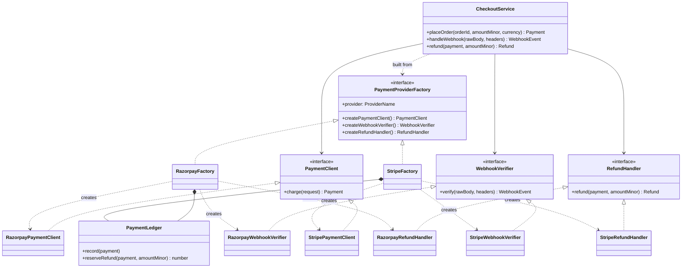

# Abstract Factory

**Category:** Creational · **Code:** [`abstract-factory.ts`](./abstract-factory.ts) · **Run:** `npm run demo -- abstract-factory` · `npx vitest run src/creational/abstract-factory`

## Intent

Provide one interface for creating a *family* of related objects, so the client gets products that are guaranteed to belong together without naming any concrete class. Swapping the factory swaps the whole family at once.

## The problem it solves

A checkout service supports two payment gateways. Charging, verifying webhooks and issuing refunds each have their own `if (provider === 'stripe')` branch, in three different files. The branches must agree: a payment created through one gateway can only be refunded through the same gateway, and its webhooks are signed with that gateway's scheme. Nothing enforces this. A config typo that sends refunds to one provider while charges go to the other compiles fine and fails in production, and adding a third gateway means finding every branch.

## The solution

| Participant | In this example |
|---|---|
| Abstract factory | `PaymentProviderFactory
` with `createPaymentClient()`, `createWebhookVerifier()`, `createRefundHandler()` |
| Concrete factories | `RazorpayFactory`, `StripeFactory` (each owns one `PaymentLedger` its products share) |
| Abstract products | `PaymentClient
`, `WebhookVerifier
`, `RefundHandler
` |
| Concrete products | `Razorpay*` (ids `pay_`/`rfnd_`, `X-Razorpay-Signature`), `Stripe*` (ids `pi_`/`re_`, timestamped `Stripe-Signature`) |
| Client | `CheckoutService
`, which receives a factory and never names a provider |

Both families are in-memory simulations of each gateway's dialect; no network calls are made.

Two TypeScript touches go beyond the classic form. The provider is a **type parameter** on every product (`Payment<'stripe'>`, `RefundHandler<'razorpay'>`), so handing a Stripe payment to a Razorpay refund handler is a compile error; a runtime guard in `PaymentLedger` catches the case where the type was erased. And the factory is picked from configuration through a **typed record of factory functions** (`families`), so adding a provider is one entry, and the record's mapped type makes the compiler require an entry for every `ProviderName`.

## When to use it

- Several objects must vary together and must not be mixed: payment client + webhook verifier + refunds; SQL dialect compiler + schema builder + type mapper; a cloud's storage + queue + secrets clients.
- The family is chosen once (configuration, tenant, region) at the composition root and the rest of the code should not know which one.
- You want a complete fake family for tests (the object-literal factory in the tests replaces all three products in one place).

## When not to use it

- There is only one product that varies. Use **Factory Method** or a plain function.
- The products do not actually depend on each other. Independent choices (logger, cache, mailer) are better injected separately than bundled into a "factory" that forces them to change together.
- The family changes shape often. Adding a new *product* means changing the abstract factory and every concrete factory; this pattern makes new families cheap and new product kinds expensive.
- You only ever have one family in production and no fakes in tests. Plain dependency injection is enough.

## Real-world sightings

- Knex: a dialect client creates the matching query compiler, schema compiler, table compiler and column compiler. Picking `client: 'pg'` swaps the whole set.
- TypeORM: each database `Driver` creates its own `QueryRunner` and schema builder, so the runner and the schema code always speak the same SQL dialect.
- Payment orchestration layers that route between gateways keep one adapter family per gateway (charge, refund, webhook parsing), exactly as here.
- Multi-cloud or multi-environment adapters: one family for AWS (S3, SQS, Secrets Manager), another for local development (filesystem, in-memory queue, `.env`).
- Test doubles: an in-memory family that replaces every external dependency of a module at once.

## Related patterns

- **Factory Method**: one creation method varied by subclassing. An abstract factory is a set of factory methods; each `create*()` here is one.
- **Builder**: assembles *one* complex object step by step. Abstract Factory returns several finished objects in one call each.
- **Prototype**: a concrete factory can be implemented by cloning configured prototypes instead of calling `new`.
- **Singleton**: concrete factories are often single instances per process, but that is a lifetime choice made by the composition root, not part of this pattern.
- **Bridge / Adapter**: each concrete product is often an adapter over a vendor SDK; Abstract Factory is what keeps the adapters of one vendor together.

## Pitfalls

- **Mixing families anyway.** A factory that is passed around as `PaymentProviderFactory` without its type parameter loses the compile-time guarantee. Keep the parameter where you can and keep a runtime check where you cannot.
- **Shared state in the wrong place.** Products of one family often need shared state (the ledger, a connection pool, credentials). Put it in the concrete factory instance, not in module globals, or two accounts in one process will see each other's payments.
- **A lowest-common-denominator interface.** If every provider-specific feature is squeezed out of the abstract products, callers start downcasting. Expose capabilities explicitly instead (`supportsPartialRefunds`).
- **Adding a product kind is a breaking change** to every factory. Plan the family boundary before you have five implementations.
- Choosing the factory in many places. Choose it once, at startup, from configuration.

## Interview Q&A

**Q: Abstract Factory vs Factory Method?**
Factory Method varies one product through an overridable method used by a base-class algorithm. Abstract Factory is an object you pass around that creates several related products; you swap the whole object to swap the family.

**Q: How do you stop someone refunding a Stripe payment with the Razorpay handler?**
Get all three products from one factory so they share a ledger and a provider, encode the provider in the product types (`Payment<'stripe'>`), and keep a runtime check for code paths where the types have been erased.

**Q: What does it cost to add a new provider, and to add a new product such as payouts?**
A new provider is a new concrete factory plus its products and one config entry; no client code changes. A new product kind changes the abstract factory and every concrete factory, which is the pattern's known trade-off.

**Q: How does this help testing?**
`CheckoutService` depends only on the abstract factory, so a test hands it a fake family (here an object literal) and checks the checkout logic without signatures, gateways or network.
