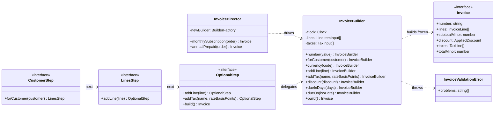
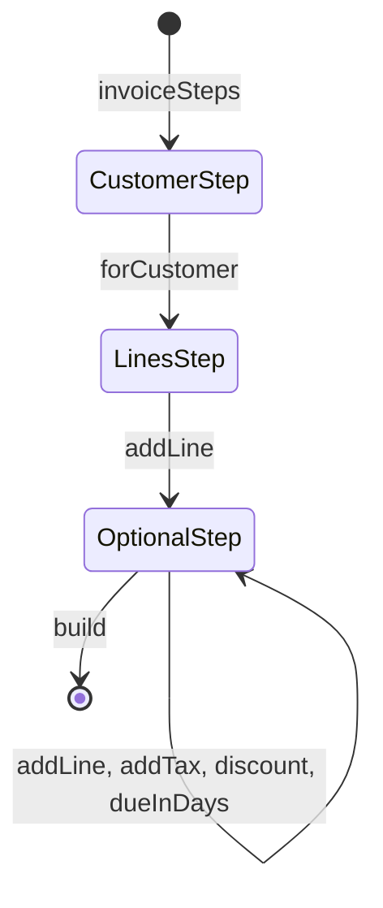

# Builder

**Category:** Creational · **Code:** [`builder.ts`](./builder.ts) · **Run:** `npm run demo -- builder` · `npx vitest run src/creational/builder`

## Intent

Separate *how* a complex object is put together from the object itself: callers add parts step by step through a small API, and one `build()` call validates the whole thing and returns a finished, immutable result.

## The problem it solves

A billing service creates invoices from subscriptions, one-off services and credit notes. The `Invoice` constructor takes eleven positional arguments (`new Invoice(num, cust, 'INR', null, lines, null, taxes, 30, ...)`), several of them optional and two of them easy to swap. Totals are computed in some call sites and not in others, validation is scattered (one path checks that the discount is below the subtotal, another forgets), and an invoice object can be mutated after it has been sent to the customer. Every new optional field adds another `null` to every call.

## The solution

The step builder turns "required before build" into a type-level sequence:

| Participant | In this example |
|---|---|
| Builder | `InvoiceBuilder`: fluent setters that record intent, `build()` that validates and computes |
| Product | `Invoice`, deeply frozen, with derived totals (`subtotalMinor`, `taxMinor`, `totalMinor`) |
| Director | `InvoiceDirector` with standard recipes: `monthlySubscription()`, `annualPrepaid()` |
| Type-safe step builder | `invoiceSteps()` returning `CustomerStep` then `LinesStep` then `OptionalStep` |
| Client | Billing jobs and the demo, which either drive the builder directly or ask the director |

The **TypeScript-idiomatic form** is the step builder. Each step returns a narrower interface, so `build()` does not exist on the type until a customer and one line have been given, and forgetting them is a compile error rather than a runtime one. Value checks (positive quantity, valid dates, discount below subtotal) still run in `build()`, because types cannot see values.

## When to use it

- An object has many optional parts, several required ones and invariants that span fields (discount below subtotal, due date after issue date).
- You want the result to be immutable but need to assemble it incrementally (from a form, a cart, a pricing engine).
- The same construction recipe recurs (monthly invoice, annual invoice): put it in a director instead of copying it.
- You want to report *all* validation errors at once, which a constructor that throws on the first bad argument cannot do well.

## When not to use it

- The object has three fields and no cross-field rules. An options object (`new Invoice({ number, customer, lines })`) with defaults is simpler and just as readable in TypeScript.
- The data arrives complete (a parsed request). Validate it with a schema and construct once.
- Mutable objects that are fine to change after creation: a builder adds a second class for no safety gain.
- A director with one recipe used in one place is indirection; call the builder there.

## Real-world sightings

- Query builders: Knex (`knex('invoices').where(...).orderBy(...)`), TypeORM's `createQueryBuilder()`, and Kysely, which tracks the selected tables and columns in the types much like the step builder here.
- Schema builders such as Zod (`z.object({...}).strict()`), where each call returns a new schema.
- SuperTest's chained `request(app).post('/invoices').set(...).send(...).expect(201)`.
- Protocol Buffers' generated builders in Java, and the request builders in many HTTP client libraries.
- Billing systems: invoice and credit note assembly with tax, discount and proration steps, often with directors per plan type.

## Related patterns

- **Abstract Factory**: returns finished products in one call, often several related ones. Builder assembles one product over several calls and finishes it in `build()`.
- **Factory Method**: decides *which class* to create; Builder decides *how to assemble* one class.
- **Prototype**: start from a copy of a configured object instead of a sequence of steps. The two combine well: clone a template invoice configuration, then hand it to a builder.
- **Fluent interface**: a style (methods that return `this`), not a pattern. A builder usually has one, but a fluent API is not automatically a builder.

## Pitfalls

- **Validating in setters.** Then steps must come in a specific order and cross-field rules have no single home. Record in setters, validate in `build()`.
- **Returning a product that shares arrays with the builder.** Calling `addLine()` after `build()` would change an invoice you already sent. Copy on build, as the test "later builder calls cannot change" checks.
- **Freezing only the top level.** `Object.freeze` is shallow; `invoice.lines.push()` still works unless nested arrays are frozen too.
- **Floating-point money.** Rates as basis points and amounts in minor units, with one rounding rule per tax, keep totals reproducible.
- Reusing one builder for two invoices through a director. Give each recipe a fresh builder (`BuilderFactory`).
- Reading the clock inside `build()` without injecting it, which makes issue and due dates untestable.

## Interview Q&A

**Q: Builder vs a constructor with an options object?**
In TypeScript an options object covers most cases. Use a builder when the object is assembled incrementally, has cross-field invariants checked in one place, should be immutable once built, or when you want a step builder to make required fields a compile-time requirement.

**Q: What is the Director for?**
It holds standard construction recipes (monthly subscription invoice, annual prepaid invoice) so call sites do not repeat them. It depends on the builder's interface, so the same recipe can drive a different builder.

**Q: How do you make "customer is required" a compile error?**
A step builder: each method returns an interface that only exposes the next legal steps, and only the final interface has `build()`. Here `invoiceSteps().build` does not type-check until `forCustomer()` and `addLine()` have been called.

**Q: Where do validation errors go, and why all at once?**
In `build()`, collected into one `InvoiceValidationError` with a `problems` list. An API or form can show every issue in one round trip instead of making the user fix them one by one.
