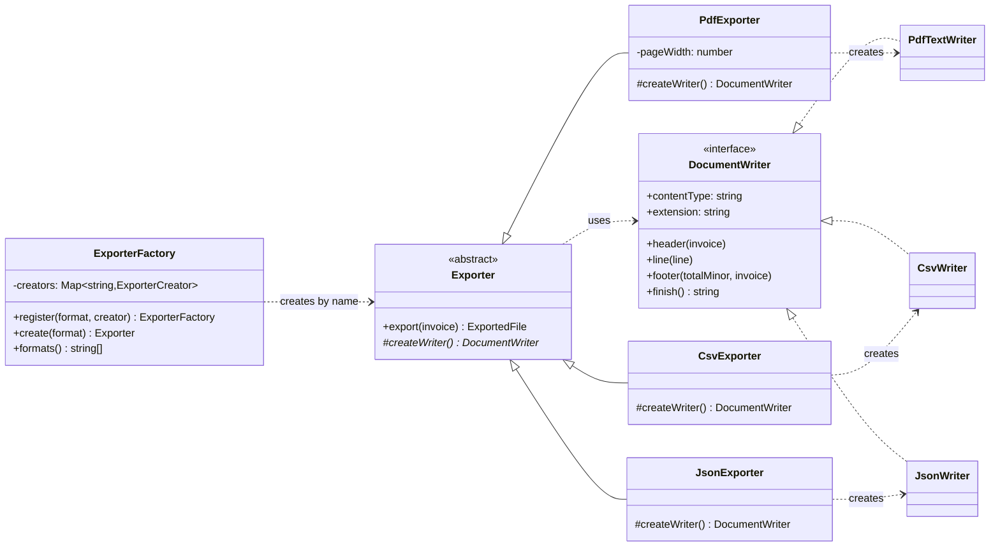

# Factory Method

**Category:** Creational · **Code:** [`factory-method.ts`](./factory-method.ts) · **Run:** `npm run demo -- factory-method` · `npx vitest run src/creational/factory-method`

## Intent

Let a base class own an algorithm that needs an object, and let subclasses decide which concrete object that is by overriding one creation method. The algorithm talks to the product's interface and never calls `new` on a concrete class.

## The problem it solves

An invoicing service exports invoices for download, email attachments and the accounting team's nightly import. The first version has one `exportInvoice(invoice, format)` with a `switch (format)` that builds a PDF string in one branch, a CSV in another and JSON in a third. The walk over the lines, the empty-invoice check and the file naming are copied into every branch, so a bug fix lands in two of three. Adding XLSX means editing the same function again, and testing the shared logic means going through a real format.

## The solution

| Participant | In this example |
|---|---|
| Product (interface) | `DocumentWriter`: `header()`, `line()`, `footer()`, `finish()` |
| Concrete products | `PdfTextWriter`, `CsvWriter`, `JsonWriter` |
| Creator | `Exporter`, whose `export()` holds the shared algorithm and calls `createWriter()` |
| Factory method | `Exporter.createWriter()`, abstract and protected |
| Concrete creators | `PdfExporter`, `CsvExporter`, `JsonExporter` |
| Client | The download endpoint (the demo), which asks `ExporterFactory` for a format by name |

The second half of `factory-method.ts` shows the **TypeScript-idiomatic form**. `ExporterFactory.register('pdf', () => new PdfExporter())` is a registry of creator functions keyed by format name: the client passes a string from a query parameter, and a plugin module adds a format with one `register()` call. `exporterFrom(() => writer)` turns a plain function into an `Exporter`, for when a subclass would exist only to override one method.

## When to use it

- A base class has a real algorithm (validation, iteration, naming, retries) and only the object it works with varies.
- Frameworks and libraries that must let users plug in their own product: "subclass this and override `createX()`".
- The product is stateful or expensive and the creator should decide when a fresh one is made (one writer per export, one connection per request).
- You want to test the shared algorithm with a fake product (the recording writer in the tests).

## When not to use it

- There is no shared algorithm around the creation. A creator class whose only job is `return new X()` is ceremony; a plain function or a `Map<string, () => X>` does the job.
- Only one product exists and none is planned.
- You need several related products that must match each other: that is **Abstract Factory**.
- The object needs many optional parts to be put together: that is **Builder**.

## Real-world sightings

- `[Symbol.iterator]()`: `for...of` calls it on any iterable and each class (`Array`, `Map`, `Set`, your own) returns its own iterator. That is a factory method in the language itself.
- Knex: each dialect client (`pg`, `mysql2`, `sqlite3`) subclasses a base `Client` and overrides methods such as `queryCompiler()` and `schemaCompiler()` to return dialect-specific compilers. The query builder code calls the method and never names the dialect.
- NestJS custom providers with `useFactory`, which hands creation of a dependency to a function the container calls.
- Node's `http.createServer()` and `net.createConnection()` are factory functions (the simple-factory cousin), hiding which class is constructed.
- Report and export services in billing systems: one exporter per format behind a format registry, exactly as here.

## Related patterns

- **Simple factory** (not GoF): one function with a `switch` that returns a product. Factory Method replaces the `switch` with overriding; the registry here replaces it with registration.
- **Abstract Factory**: an object with *several* factory methods that create a family of products that must be used together. Abstract factories are often built from factory methods.
- **Template Method**: `export()` is a template method and `createWriter()` is one of its steps. Factory Method is a Template Method whose varying step creates an object.
- **Prototype**: creates by copying a configured instance instead of subclassing a creator.

## Pitfalls

- **Calling the factory method from the base constructor.** In TypeScript and JavaScript, subclass fields (including constructor parameter properties) are assigned after `super()` returns, so an override called from the base constructor sees `undefined` for `pageWidth`. Call it lazily, as `export()` does.
- **Subclass explosion.** One creator subclass per product, each overriding one line, doubles the class count. Use the registry or `exporterFrom()` when there is nothing else in the subclass.
- **Caching a stateful product.** If the creator stored one writer and reused it, the second export would contain the first one's rows. The test "creates a fresh writer per export" guards this.
- **Silent overwrites in the registry.** Two plugins registering `csv` should fail at startup, not depend on import order.
- Leaking format-specific options into the creator's interface (`export(invoice, { pdfMargin })`). Put them in the concrete creator's constructor.

## Interview Q&A

**Q: Factory Method vs Abstract Factory?**
Factory Method is one overridable method that creates one product, used by an algorithm in the base class. Abstract Factory is an object with several creation methods that produce a family of products meant to work together; you swap the whole factory to swap the family.

**Q: Why not just write `new CsvWriter()` inside `export()`?**
Then `export()` depends on every concrete format and needs a `switch` to choose. With the factory method, `export()` depends only on `DocumentWriter`, and a new format is a new subclass or registration with no edit to existing code (Open/Closed).

**Q: How do you add a format at runtime, for example from a plugin?**
Keep a registry of creator functions keyed by name and let the plugin call `register('xlsx', () => new XlsxExporter())`. Reject duplicates so conflicts fail loudly at startup.

**Q: What is wrong with calling `this.createWriter()` in the base constructor?**
In JS the subclass's fields are initialised after the base constructor finishes, so the override runs against a half-built object. Create products lazily, at the point of use.
