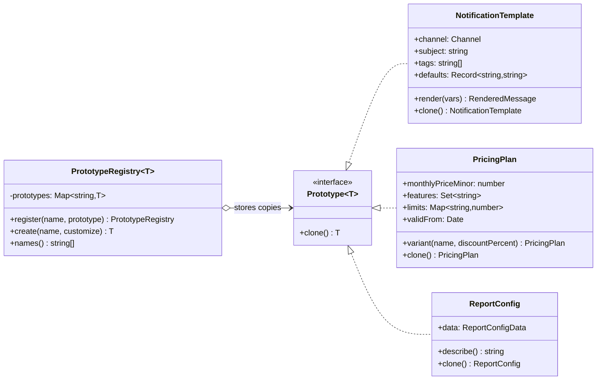

# Prototype

**Category:** Creational · **Code:** [`prototype.ts`](./prototype.ts) · **Run:** `npm run demo -- prototype` · `npx vitest run src/creational/prototype`

## Intent

Create new objects by copying an existing, fully configured instance (the prototype) and adjusting the copy, instead of building each one from scratch or knowing which class and settings produced it.

## The problem it solves

A SaaS backend has preset notification templates, pricing plans and scheduled report configurations. Each preset takes a dozen lines to set up (subject, tags, default variables; features, limits, effective date; filters, columns, delivery schedule, alert thresholds). Call sites that need "the Pro plan, but 20% off for a promotion" or "the monthly revenue report, but for APAC" either copy the setup code or copy the object with `{ ...preset }`. The second option is worse: the spread copies only the top level, so `copy.filters.regions.push('AU')` silently changes the preset for every later user. A JSON round-trip "fixes" that but turns every `Date` into a string and every `Map` into `{}`.

## The solution

| Participant | In this example |
|---|---|
| Prototype (interface) | `Prototype<T>` with `clone()` |
| Concrete prototypes | `NotificationTemplate` (copy constructor), `PricingPlan` (new `Set`, `Map`, `Date`), `ReportConfig` (`structuredClone` of nested data) |
| Prototype registry | `PrototypeRegistry<T>`: named presets, returns a fresh clone from `create()` |
| Client | The demo and the preset catalogues (`notificationPresets()`, `pricingPresets()`, `reportPresets()`) |

The code shows the **failing-then-fixed** copy on `ReportConfigData`: `shallowCopy` (spread) leaks nested changes into the original, `jsonCopy` loses `Date` and `Map`, and `deepCopy` uses **`structuredClone`**, the idiomatic deep copy in modern JavaScript, which handles nested objects, `Date`, `Map`, `Set` and cycles. `structuredClone` does not keep class prototypes or functions, so classes implement `clone()` themselves and use `structuredClone` only for their plain-data insides (`ReportConfig.clone()`).

## When to use it

- Objects are expensive or verbose to configure and you need many slight variations (plan variants, per-tenant report configs, test fixtures).
- A catalogue of named presets that callers start from and customise (`registry.create('order-shipped', t => ...)`).
- The code that needs a copy should not know the concrete class or how it was configured.
- Snapshotting state before a risky change, so it can be compared or restored.

## When not to use it

- Objects are cheap and simple to construct: a factory function with parameters is clearer than a clone plus mutations.
- Objects hold resources that cannot be meaningfully copied (sockets, file handles, database connections, timers). Clone the *configuration*, then create a new resource from it.
- Immutable data: if nothing can be mutated, sharing the instance is safe and copying is wasted work.
- Deep object graphs with identity that matters (two references to one customer object must stay one): a naive deep copy duplicates them, and a correct copy needs care.

## Real-world sightings

- JavaScript's object model itself: `Object.create(proto)` makes a new object whose prototype is an existing object, and classes are built on that.
- `structuredClone()`, a global in Node 17+ and browsers, implementing the HTML structured clone algorithm used by `postMessage` and worker threads.
- The Fetch API's `Request.prototype.clone()` and `Response.prototype.clone()` (available in Node 18+), which copy a request or response so its body can be read twice.
- Kubernetes Deployments: the pod `template` is a prototype from which every pod replica is stamped.
- Lodash's `cloneDeep`, and test-fixture factories that start from a base object and override a few fields.

## Related patterns

- **Factory Method / Abstract Factory**: create from a class. Prototype creates from an instance, so new "kinds" can be registered at runtime as data instead of subclasses.
- **Builder**: assembles an object step by step. A clone of a configured prototype is a good starting point for a builder, or a substitute for a director recipe.
- **Memento**: also copies state, but to restore the same object later, not to create new ones.
- **Flyweight**: the opposite instinct. Flyweight shares one instance to save memory; Prototype copies to get independent instances.
- **Singleton registry**: a `PrototypeRegistry` is often a process-wide catalogue, but its point is handing out copies, never the stored instance.

## Pitfalls

- **Shallow copies of nested data.** `{ ...obj }` and `Object.assign` copy one level. The shallow-copy test shows the preset being corrupted.
- **JSON round-trips.** `JSON.parse(JSON.stringify(x))` drops `undefined`, functions and symbols, turns `Date` into strings and `Map`/`Set` into `{}`, and throws on cycles, while the type still claims the original shape.
- **`structuredClone` on class instances** returns a plain object: methods and `instanceof` are gone. It also throws on functions. Wrap it in a class's own `clone()`.
- **Handing out the stored prototype.** A registry that returns its instance lets one caller change the preset for everyone. Return a clone from `create()` and store a clone in `register()`.
- Forgetting new fields in a hand-written `clone()`. Add a test that mutates every field of a copy, as the `PricingPlan` test does.
- Cloning identifiers. A copied entity with the same database id is a bug waiting to happen; reset ids on clone if the object has one.

## Interview Q&A

**Q: Shallow vs deep copy, and how do you deep-copy in modern JavaScript?**
A shallow copy duplicates the top-level object but shares everything nested; a deep copy duplicates the whole graph. Use `structuredClone`, which handles nested objects, `Date`, `Map`, `Set` and cycles, but not functions or class prototypes.

**Q: Why not just `JSON.parse(JSON.stringify(x))`?**
It silently converts `Date` to a string and `Map`/`Set` to `{}`, drops `undefined` and functions, and fails on cycles. The test "Date and Map fields survive structuredClone but not JSON" shows it.

**Q: Why does a class need its own `clone()` when `structuredClone` exists?**
`structuredClone` returns plain objects, so a cloned `PricingPlan` would lose `allows()` and `instanceof`. The class's `clone()` copies its fields (with `structuredClone` for nested plain data if useful) and calls its own constructor.

**Q: What does a prototype registry give you over constants?**
Named presets that callers can only get copies of, so customising one never affects another caller, and new presets can be registered at runtime (from configuration or a plugin) without new classes.
