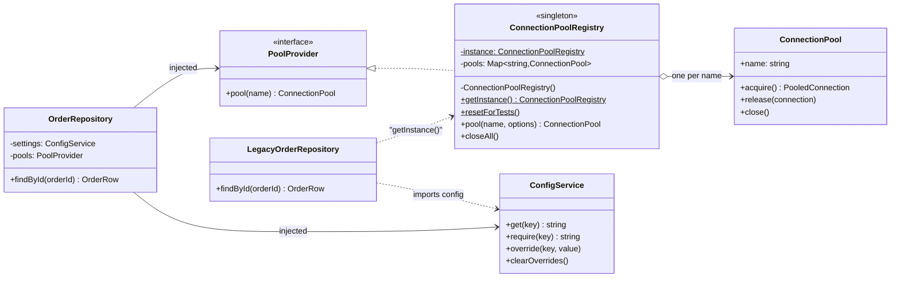

# Singleton

**Category:** Creational · **Code:** [`singleton.ts`](./singleton.ts) · **Run:** `npm run demo -- singleton` · `npx vitest run src/creational/singleton`

## Intent

Ensure a class has exactly one instance in the process and give the rest of the code one well-known way to reach it. In TypeScript the more useful framing is that "only one" is a *lifetime* chosen once at startup, not something every caller has to ask the class for.

## The problem it solves

An order service where every repository does `new Pool({ max: 10 })` in its own constructor. Eight repositories and four cluster workers later, the service holds hundreds of connections and Postgres answers `sorry, too many clients already` under load. Configuration has the same smell: each module parses `process.env` itself, one reads `DB_POOL_MAX` as a string and another as a number, and a flag an operator flips at runtime reaches only the modules that happened to re-read it. An expensive, stateful resource is being constructed at every call site, with no single owner.

## The solution

| Participant | In this example |
|---|---|
| Singleton (classic, lazy) | `ConnectionPoolRegistry`: private constructor, `static getInstance()`, `static resetForTests()` |
| Singleton (TypeScript idiom, eager) | `config`, the module-scope `export const config = new ConfigService(process.env)` |
| Shared state | `ConnectionPool` objects, one per database name, created on first use |
| Client reaching for the global | `LegacyOrderRepository`, which calls `getInstance()` and imports `config` inside its method |
| Client with injected dependencies | `OrderRepository`, which receives a `ConfigService` and a `PoolProvider` in its constructor |

**Lazy vs eager.** The registry is lazy: it is built on the first `getInstance()`, so a CLI script or test that never touches the database never creates pools. `config` is eager: an ES module is evaluated once and cached by resolved path, so the exported object is created at first import and shared by every importer, with no `getInstance()` at all. The classic eager form is the same idea inside a class (`private static readonly instance = new X()`).

**The testing cost and the fix.** `LegacyOrderRepository` has an empty constructor, yet it depends on two globals; a test can only steer it by mutating them and then cleaning up, which is why `resetForTests()` exists. `OrderRepository` runs the same logic with its collaborators injected: `main()` passes the shared instances, tests pass fresh ones, and "one instance" becomes a wiring decision rather than a property of the class.

## When to use it

- A resource that must be shared to be correct or affordable: connection pools, HTTP agents with keep-alive, an in-process cache, a metrics registry.
- Something that is genuinely one per process: the configuration snapshot, the root logger, graceful-shutdown hooks.
- Even then, prefer creating the instance once in the composition root and injecting it; reach for `getInstance()` only where you cannot inject (legacy code, framework callbacks).

## When not to use it

- To avoid passing a parameter. A singleton used that way is a global variable with a class name, and every caller now hides a dependency.
- For anything per request, per tenant or per transaction (current user, DB transaction, request id): use request scope, such as `AsyncLocalStorage` or a DI container's request scope.
- To guarantee "one in the system": a singleton is one per process, so every cluster worker, worker thread, Lambda container and Kubernetes replica has its own. Use a distributed lock or leader election for that.
- When tests or tenants need different instances: that is a shared dependency, not a singleton, so inject it.

## Real-world sightings

- Node's module cache: `export const pool = new Pool()` in a `db.ts` file is the most common singleton in Node code, because `require` and `import` evaluate a module once per resolved path.
- Mongoose: the `mongoose` export is itself an instance of `Mongoose`, and `mongoose.connection` is its default connection.
- `prom-client`: metrics register into a default global registry (`register`) unless you pass your own.
- NestJS: providers are singleton-scoped by default; `Scope.REQUEST` and `Scope.TRANSIENT` opt out.
- Prisma: the docs recommend reusing one `PrismaClient` and storing it on `globalThis` in Next.js development so hot reload does not create a new client on every change.
- AWS Lambda: SDK clients and database pools created outside the handler are reused across warm invocations of the same container.

## Related patterns

- **Dependency injection (singleton scope)**: the modern replacement. The container or `main()` guarantees one instance, and the class itself stays ordinary and testable.
- **Multiton / Registry**: `ConnectionPoolRegistry.pool(name)` is a multiton, one instance per key rather than one in total.
- **Service Locator**: calling `getInstance()` from deep inside business code is a service locator in disguise, with the same hidden-dependency problem.
- **Flyweight**: shares many small immutable objects by key to save memory; a singleton shares one object, often mutable, to share state.
- **Abstract Factory / Facade**: frequently implemented as singletons. Singleton controls *how many* instances exist; those patterns control *what* gets created or exposed.

## Pitfalls

- Hidden dependencies and test leakage: state left by one test (an override, an unreleased connection) changes the next test's result. `resetForTests()` is a patch; injection is the fix.
- First caller wins: `getInstance(options)` silently ignores the options of every later caller. Accept no arguments, or fail on a mismatch as `pool()` does.
- Two "singletons" from one module: two copies of a package in `node_modules`, `npm link`, or the CommonJS and ESM builds of the same package loaded side by side (the dual package hazard) each have their own module state.
- I/O at import time: an eager singleton that connects in its constructor opens sockets in every script and test that merely imports the module. Keep constructors cheap; connect lazily.
- Async initialisation races: two requests calling `await getClient()` while the first `connect()` is still pending create two clients. Cache the promise, not the resolved value.
- Mutable request data on a shared instance: setting `currentUser` on a singleton leaks one request's user into a concurrent request.

## Interview Q&A

**Q: How do you make a singleton thread-safe in Node.js?**
The check-then-create in `getInstance()` cannot be interrupted, because JavaScript runs it on one thread; there is no double-checked locking to get wrong. Worker threads have separate module graphs, so each gets its own instance. The real race in Node is async: concurrent callers awaiting a pending `connect()`, which is solved by caching the promise.

**Q: Why is Singleton often called an anti-pattern?**
It is global mutable state with a class name: callers hide the dependency, are coupled to one concrete class, and tests become order-dependent. The useful half, "exactly one instance", is better delivered by a DI container or `main()` creating one object and injecting it.

**Q: Lazy or eager?**
Eager (a module-scope export or a static field) is simpler and surfaces failures at startup; use it when construction is cheap and has no side effects. Lazy when construction is expensive, needs configuration that is not ready at import time, or many entry points never use it.

**Q: Is `export const config = new ConfigService()` a singleton?**
Yes, per module instance: Node caches modules by resolved path, so every importer shares the object. It breaks when the module is loaded twice (duplicate package copies, dual CJS/ESM builds). The class itself can still be constructed elsewhere, which is a feature: tests build their own.

**Q: How do you test code that depends on a singleton?**
Best, inject it behind an interface and pass a fake. If you cannot refactor, reset it in `beforeEach` with a hook like `resetForTests()`, or for a module-scope instance call `vi.resetModules()` and import the module again, or replace the module with `vi.mock`.
