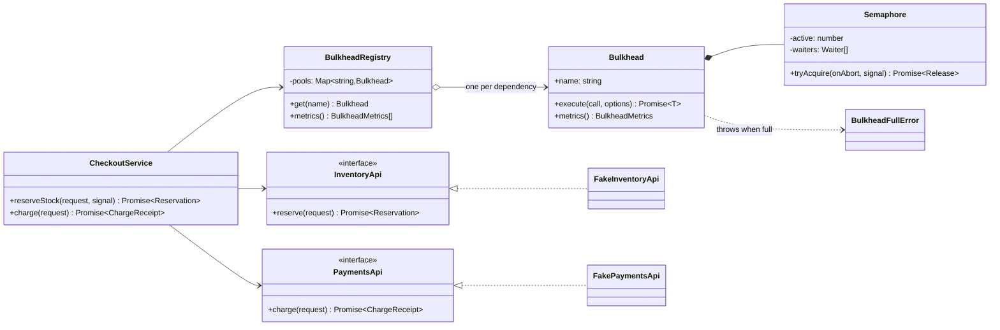
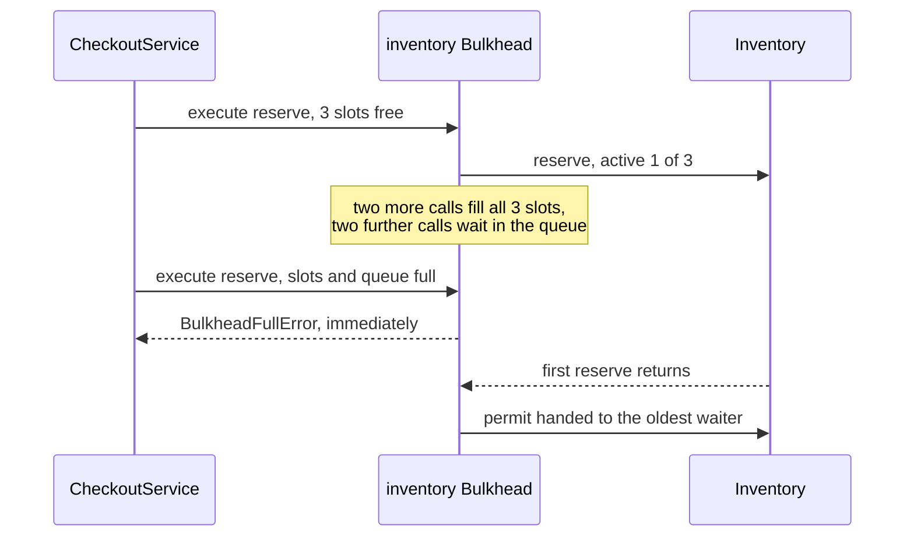

# Bulkhead

**Category:** Modern (resilience) · **Code:** [`bulkhead.ts`](./bulkhead.ts) · **Run:** `npm run demo -- bulkhead` · `npx vitest run src/modern/bulkhead`

## Intent

Partition capacity into compartments, one per dependency (or per tenant, or per workload), each with its own concurrency limit and bounded queue, so that one slow or failing dependency can fill only its own compartment. The name comes from the watertight sections of a ship's hull.

## The problem it solves

Checkout calls the inventory service and the payments service. Inventory has a slow database migration and its p99 goes from 50 ms to 20 seconds. Nothing in checkout limits how many inventory calls may be in flight, so within a minute every pooled socket, every DB connection the handlers hold and most of the memory are tied up by requests waiting on inventory. Payments is perfectly healthy, but payment calls now queue behind the stuck inventory calls for sockets and event-loop time, and checkout as a whole falls over. One sick dependency took down the healthy ones because they shared one unbounded pool of capacity.

The smell: a single shared resource (sockets, connections, workers, an unbounded `Promise.all`) with no per-dependency limit, and "wait forever" as the overload behaviour.

## The solution

`Bulkhead` wraps a counting `Semaphore` with `maxConcurrent` permits and a bounded FIFO queue of `maxQueue` waiters. A call either gets a permit, waits in the queue, or, when both are full, is rejected *immediately* with `BulkheadFullError`, so callers can fall back or shed load instead of piling up. The permit is released in `finally`, so a throwing call can never leak capacity, and a queued caller can leave through an `AbortSignal` (no timers in the library). `BulkheadRegistry` holds one compartment per dependency, sized separately.

| Participant | In this example |
|---|---|
| Bulkhead (compartment) | `Bulkhead`: admission, metrics, release in `finally` |
| Isolation mechanism | `Semaphore`: permits plus a bounded FIFO wait queue |
| Compartment registry | `BulkheadRegistry`: `inventory` and `payments` pools with separate sizes |
| Protected dependencies | `InventoryApi` / `PaymentsApi`, faked by `FakeInventoryApi` / `FakePaymentsApi` |
| Rejection signal | `BulkheadFullError` (full), `BulkheadAbortedError` (caller gave up while queued) |
| Client | `CheckoutService` |

The functional form, `createLimiter(maxConcurrent, maxQueue)`, returns a closure `limit(() => promise)` in the style of `p-limit`, for when you just need to cap a batch of calls.

Node runs your code on one thread, so the bulkhead here limits *in-flight async calls*, which is what holds sockets, connections and memory. The Java world's thread-pool bulkhead (Hystrix, Resilience4j `ThreadPoolBulkhead`) isolates threads; the semaphore form is the one that maps to Node.

## When to use it

- A service calls several dependencies with different reliability, and losing one should not take out the others.
- A shared resource (HTTP agent sockets, DB connections, worker slots) is exhaustible.
- Multi-tenant systems where one noisy tenant must not starve the rest (a compartment per tenant tier).
- Batch jobs and fan-outs (`Promise.all` over 10 000 items) that would otherwise open 10 000 connections.

## When not to use it

- A single dependency and a single workload: a connection pool or HTTP agent limit already does the job.
- When you cannot pick sensible limits yet; a wrong limit throttles healthy traffic. Measure first (Little's law: concurrency = throughput x latency).
- As a substitute for timeouts. Without a timeout a slow call holds its slot for as long as it hangs, and the compartment stays full.
- To protect a downstream service from *all* clients: that is server-side rate limiting or load shedding.

## Real-world sightings

- **Resilience4j** `Bulkhead` (semaphore, `maxConcurrentCalls`, `maxWaitDuration`) and `ThreadPoolBulkhead`; **Hystrix** thread-pool isolation per dependency.
- **p-limit** and **p-queue** in Node: concurrency limits for promise-returning functions.
- **Node `http.Agent` `maxSockets`** and **undici `Pool` `connections`**: per-origin connection limits.
- **Envoy** cluster circuit-breaker thresholds (`max_connections`, `max_pending_requests`, `max_requests`, `max_retries`): per-upstream bulkheads in the proxy.
- Separate worker pools or queues per job type (BullMQ queues with their own concurrency), and separate DB connection pools for OLTP traffic and reporting.

## Related patterns

- **Circuit breaker**: decides *whether* to call (a failing dependency); the bulkhead decides *how many* calls may be in flight (a slow dependency). They combine: the bulkhead stops the slow phase from spreading, the breaker stops the calls once failures dominate.
- **Object pool**: a pool limits concurrency as a side effect of owning reusable objects; a bulkhead limits concurrency for its own sake and holds no objects.
- **Rate limiter / throttling**: limits calls per unit of time; a bulkhead limits calls in flight at once. A fast dependency can take many calls per second through a small bulkhead.
- **Retry**: retries hold slots too; a retry loop inside a full bulkhead makes things worse.

## Pitfalls

- An unbounded queue: it just moves the pile-up from sockets to memory. Bound it and reject.
- Limits too high to ever trigger, or one global limit shared by everything (that is no compartment at all).
- Releasing the permit only on success, or twice: release in `finally`, and make the release idempotent.
- No timeout on the protected call, so slots fill with hung requests forever.
- Treating `BulkheadFullError` like a 500: it is load shedding. Map it to a 503 with `Retry-After`, or use a fallback.
- Not exporting `active`, `queued` and `rejected` metrics; a bulkhead that rejects silently is indistinguishable from an outage.

## Interview Q&A

**Q: What problem does a bulkhead solve that a circuit breaker does not?**
A slow dependency that is not failing. Calls do not error, they hang, so a breaker that counts failures never opens while capacity drains. The bulkhead caps how much capacity that dependency can hold.

**Q: Semaphore bulkhead or thread-pool bulkhead?**
The thread-pool form isolates execution threads and can time out the caller independently, at the cost of thread hand-off. The semaphore form only counts concurrent calls on the caller's thread. In Node there are no request threads, so the semaphore form is the natural one.

**Q: How do you size it?**
Little's law: concurrency = throughput x latency. 100 requests per second at 50 ms needs about 5 in flight; give headroom (say 10) and a small queue. Then watch the rejected metric.

**Q: Why reject when the queue is full rather than wait?**
Waiting is what spreads the failure. Fast rejection keeps latency bounded for everyone else and gives the caller a clear signal to fall back, shed load or retry later.

**Q: Where else do you see bulkheads in a backend?**
Per-tenant worker pools, separate connection pools for reads, writes and reporting, separate queues per job type, and per-upstream limits in Envoy.
