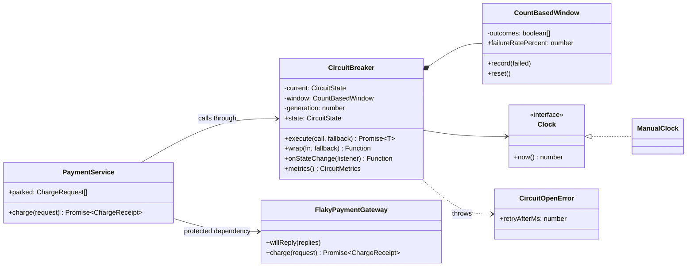
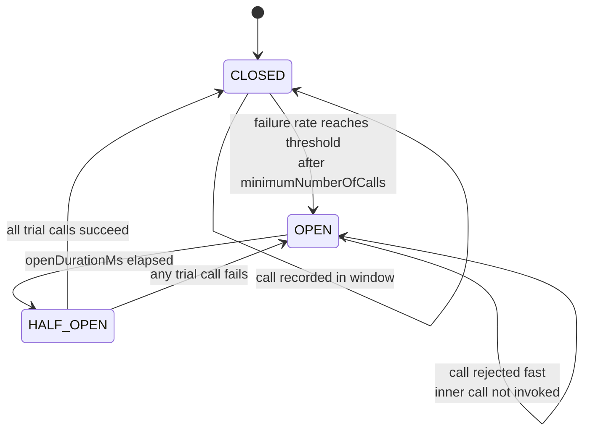

# Circuit Breaker

**Category:** Modern (resilience) · **Code:** [`circuit-breaker.ts`](./circuit-breaker.ts) · **Run:** `npm run demo -- circuit-breaker` · `npx vitest run src/modern/circuit-breaker`

## Intent

Put a stateful guard in front of a remote dependency. When enough recent calls fail, stop calling it for a while and fail fast; after a cool-down, let a few trial calls through to find out whether it has recovered.

## The problem it solves

Checkout calls a payment gateway with a 2-second timeout. The gateway has a bad afternoon and starts timing out. Every checkout request now holds a connection, a socket and a slot in the event loop's work for 2 seconds before failing; request queues grow, latency for *unrelated* endpoints climbs, and retries from clients add more load to a gateway that is already struggling. The code "handles" the error in every caller with `try/catch`, but nothing remembers that the last 50 calls all failed, so call 51 waits its 2 seconds too.

The smell: failure handling is per call and stateless, so a dependency that is clearly down still costs full price on every request, and it never gets breathing room to recover.

## The solution

`CircuitBreaker` wraps any `() => Promise<T>`. It records outcomes in a count-based sliding window (the last `slidingWindowSize` calls) and opens when the failure rate reaches `failureRateThreshold`, but only once `minimumNumberOfCalls` have been seen. While OPEN it throws `CircuitOpenError` (or runs the fallback) without calling the gateway. After `openDurationMs`, measured with an injected `Clock`, it goes HALF_OPEN and permits `permittedCallsInHalfOpen` trial calls: all succeed and it closes, any fails and it opens again for a full period.

An `isFailure` predicate decides what counts. A timeout or a 503 says the gateway is sick; a 400 for an invalid card number says *our request* was wrong and is counted as a success (the dependency answered correctly), so a burst of bad input can never trip the breaker.

| Participant | In this example |
|---|---|
| Circuit breaker (proxy with state) | `CircuitBreaker`: the state machine, permission check and outcome recording |
| Sliding window | `CountBasedWindow`: ring buffer of the last N outcomes with an O(1) failure rate |
| Protected dependency | `FlakyPaymentGateway`: a fake with scripted `ok`, `timeout`, `server-error`, `bad-request` replies |
| Failure predicate | `countsAgainstGateway`: timeouts and 5xx count, 4xx does not |
| Fallback | `PaymentService`'s fallback: park the charge for a capture job and return `status: 'queued'` |
| Clock | `Clock` / `ManualClock`, so tests advance time instead of waiting |
| Client | `PaymentService` (and the demo) |

Two TypeScript-flavoured details: `breaker.wrap(fn, fallback)` is the higher-order-function form (wrap once, call a function with the same signature everywhere), and `onStateChange` gives the events a metrics or alerting hook needs. A `generation` counter makes a slow call that started in CLOSED unable to move a HALF_OPEN breaker when it finally times out.

## When to use it

- Calls to a remote dependency (payment gateway, search cluster, third-party API) that can be down or slow for minutes, where waiting for a timeout on every request hurts your own service.
- There is a sensible degraded answer: cached data, a queued action, a feature switched off.
- You want an operational signal: "the breaker for X opened" is an excellent alert.

## When not to use it

- In-process work or local disk: there is no separate failure domain to protect.
- Errors are about the request, not the dependency (validation, auth, not found). Counting them makes the breaker trip on user input.
- Very low traffic: with three calls an hour, the window never has enough data and a simple retry or timeout is enough.
- When the platform already does it (a service mesh ejecting unhealthy hosts) and a second breaker in code only makes behaviour harder to reason about.

## Real-world sightings

- **opossum** (Node.js): `new CircuitBreaker(asyncFn, { timeout, errorThresholdPercentage, resetTimeout })`, with `fallback()` and `open` / `halfOpen` / `close` events.
- **Resilience4j** (Java): count-based and time-based sliding windows, `minimumNumberOfCalls`, `permittedNumberOfCallsInHalfOpenState`, `waitDurationInOpenState`, and record/ignore exception predicates; this example borrows its vocabulary.
- **Netflix Hystrix** popularised the pattern in microservices (now in maintenance mode); **Polly** is the .NET equivalent.
- **Envoy / Istio outlier detection** ejects a failing upstream host from the load-balancing pool for a period, which is the same idea at host granularity.
- Described by Michael Nygard in *Release It!* and in Martin Fowler's "CircuitBreaker" article.

## Related patterns

- **Retry with backoff**: retry assumes the failure is brief, the breaker assumes it is not. Put the retry *inside* the breaker so each logical call counts once and retries stop when the circuit is open.
- **Bulkhead**: limits how many calls are in flight; the breaker limits whether calls are made at all. A bulkhead protects you from a *slow* dependency, a breaker from a *failing* one. (Envoy calls its concurrency limits "circuit breaking", which is really a bulkhead.)
- **Proxy**: structurally the breaker is a proxy with a state machine; **State** is how the three modes could be modelled as classes if they grew more behaviour.
- **Timeout**: a breaker without a timeout never sees slow calls fail. Always pair them.

## Pitfalls

- Counting the wrong errors: 4xx or business rejections tripping the breaker, or, the opposite, timeouts not counted because they surface as a different error type.
- A `minimumNumberOfCalls` of 1: one failed call after a deploy opens the circuit for everyone.
- One breaker for a whole host when only one endpoint is broken; or one breaker per request parameter, which never collects enough data. Scope it to a dependency operation.
- A fallback that calls the same sick dependency, or that silently returns wrong data (a price of 0). Fallbacks must be safe and visible in metrics.
- Breaker state is per process. Twenty pods each need their own failures to open; that is usually fine, but do not expect a cluster-wide switch.
- HALF_OPEN letting unlimited calls through, which turns recovery into a thundering herd.

## Interview Q&A

**Q: Walk through the three states.**
CLOSED: calls pass, outcomes are recorded, and a failure rate over the threshold (after a minimum sample) opens it. OPEN: calls fail fast without touching the dependency until the open duration elapses. HALF_OPEN: a limited number of trial calls; all succeed and it closes, one fails and it reopens.

**Q: Why a failure *rate* over a window instead of "five consecutive failures"?**
Consecutive counts are fragile under concurrency and reset on one lucky success. A rate over the last N calls with a minimum sample tolerates noise and still reacts to a real outage.

**Q: Should a 400 Bad Request trip the breaker?**
No. It proves the dependency is up and answering; the request was wrong. Only errors that indicate dependency health (timeouts, connection errors, 5xx, maybe 429) should count, which is what the `isFailure` predicate is for.

**Q: How do retries and the breaker interact?**
Retry inside, breaker outside: the breaker sees one outcome per logical call, and when it is open the retry loop is skipped entirely instead of retrying a `CircuitOpenError`.

**Q: How do you test it without waiting 30 seconds?**
Inject the clock. Tests use `ManualClock.advance(30_000)` and a scripted fake gateway, so every transition is deterministic.
