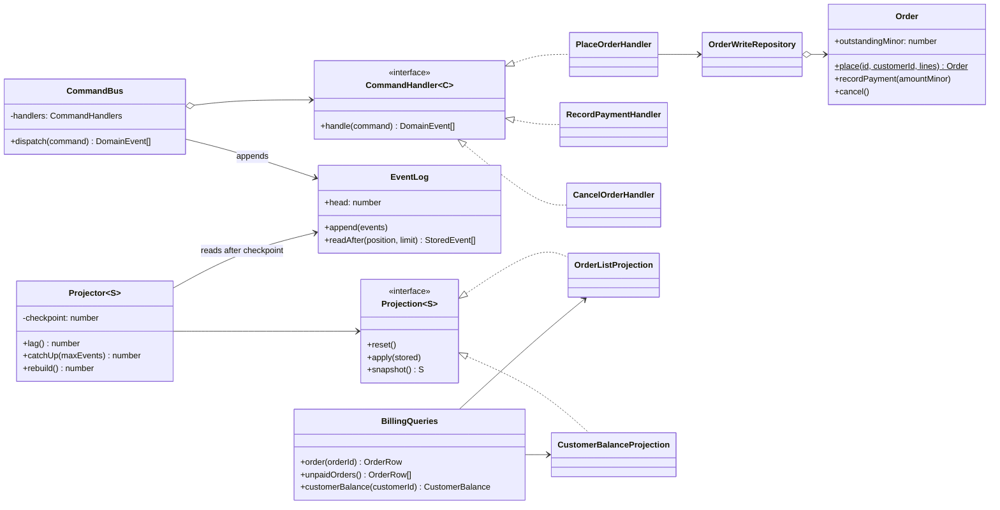
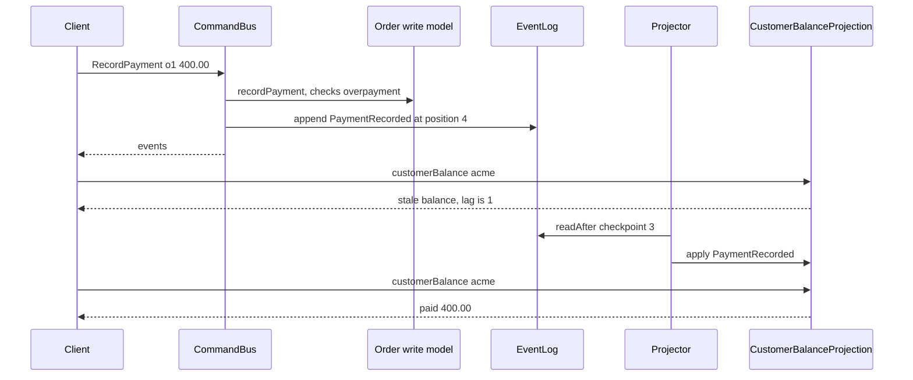

# CQRS (Command Query Responsibility Segregation)

**Category:** Modern · **Code:** [`cqrs.ts`](./cqrs.ts) · **Run:** `npm run demo -- cqrs` · `npx vitest run src/modern/cqrs`

## Intent

Use one model to change state and a different model to read it. Commands go through handlers that enforce the business rules on a write model and emit events; queries are answered from read models shaped for each screen and kept up to date by projectors that consume those events.

## The problem it solves

An orders/billing service has one `orders` table with `order_lines` and `payments` hanging off it. The write path needs strict rules (no overpayment, no cancelling a paid order). The read path needs "outstanding balance per customer" for the billing dashboard and "all unpaid orders" for dunning, each a multi-table `JOIN ... GROUP BY` that runs on every page load. Every new report adds an index that slows the writes, every schema tweak for a report risks the invariants, and the read traffic (100x the writes) has to scale with the same database. The smell: one model that is bad at both jobs, with `SUM()` queries and business rules fighting over the same tables.

## The solution

Split the model in two, connected by an event log:

- **Command side.** `CommandBus.dispatch()` routes each command to its handler (`PlaceOrderHandler`, `RecordPaymentHandler`, `CancelOrderHandler`). The handler loads the normalised `Order` write model, which checks invariants before mutating, saves it, and returns events that the bus appends to the `EventLog`. Commands return events, not data.
- **Query side.** Each `Projection` (`OrderListProjection`, `CustomerBalanceProjection`) is a denormalised read model with precomputed totals. A `Projector` per projection reads the log from its checkpoint and applies events. `BillingQueries` only reads prepared rows.

The projector is driven manually (`catchUp()`), which makes the eventual consistency explicit: after a command, `lag()` is non-zero and the read model is stale until the projector runs. `rebuild()` resets a projection and replays the whole log, which is how a projection bug is fixed or a new read model is backfilled.

How a write becomes visible to a read:

| Participant | In this example |
|---|---|
| Command | `Command` union: `PlaceOrder`, `RecordPayment`, `CancelOrder` |
| Command handler | `CommandHandler<C>` and its three implementations |
| Command dispatcher | `CommandBus`, typed by the `CommandHandlers` mapped type |
| Write model | `Order` (invariants) stored in `OrderWriteRepository` |
| Event / change feed | `DomainEvent` union in the append-only `EventLog` |
| Projector | `Projector<S>`, one per read model, with its own checkpoint |
| Read model | `OrderListProjection`, `CustomerBalanceProjection` |
| Query facade | `BillingQueries` |

The TypeScript-specific part is `CommandHandlers = { [K in Command['type']]: CommandHandler<Extract<Command, { type: K }>> }`: the compiler refuses to build the bus if a command type has no handler, which replaces both a `switch` and a runtime "no handler registered" error.

## When to use it

- Reads and writes have very different shapes or load: dashboards, search, reporting and feeds on one side, small transactional updates on the other.
- Several read models are needed from the same facts (a grid, a per-customer balance, a search index, a cache).
- The domain has real invariants worth protecting in a dedicated model, and you want to change read schemas without touching it.
- You already publish domain events (or use Event Sourcing), so projections are cheap to add.

## When not to use it

- CRUD screens where the read shape equals the write shape. Two models doubles the code for no gain.
- Users must read their own write immediately everywhere and you cannot design around it (read-your-writes is solvable, but it is work).
- A small team, a single database and no performance problem: a SQL view or a cached query gets you the read model without a second pipeline.
- Do not apply it to the whole system. It belongs in the bounded contexts with complex rules or heavy reads.

## Real-world sightings

- `@nestjs/cqrs` provides `CommandBus`, `QueryBus` and `EventBus` with `@CommandHandler` and `@EventsHandler` decorators, the same split as here.
- Axon Framework (Java) and Marten (.NET on PostgreSQL) build projections from events, with replay to rebuild them.
- Change data capture (Debezium into Kafka) feeding Elasticsearch or a cache is CQRS with the database's own log as the event feed.
- Materialised views and read replicas are the lightweight version: a read-optimised copy updated after the write.
- The idea grew out of Bertrand Meyer's Command-Query Separation principle and was named by Greg Young.

## Related patterns

- **Command-Query Separation (CQS)**: a method either changes state or returns data. CQRS applies the same split at the level of whole models and stores.
- **Event Sourcing**: stores the events as the write model itself. CQRS does not require it: here the write model is ordinary state and the events are a by-product, but the two pair naturally.
- **Materialised View**: a read model is one; CQRS adds the command side discipline and the projector that keeps views current.
- **Mediator / Command**: the `CommandBus` is a mediator routing command objects to handlers.
- **Transactional Outbox**: how to make "save write model" and "publish event" atomic in a real database.

## Pitfalls

- **Validating against the read model.** It lags. "Is this order already paid?" must be answered by the write model, as `RecordPaymentHandler` does.
- **Forgetting that the read side is eventually consistent.** The UI that sends a command and immediately queries can show stale data. Return the events or new version from the command, poll the projector's checkpoint, or update the UI optimistically.
- **Non-idempotent projectors.** At-least-once delivery means an event can arrive twice; checkpoint by position (as `Projector` does) or make updates idempotent.
- **Write model and event not saved atomically.** If the process dies between them, the read side never learns about the change. Use an outbox or event sourcing.
- **Projections that cannot be rebuilt** because they depend on external state or wall-clock time instead of event data. Everything a projection needs must be in the events (here `at` is carried in the event).
- **CQRS everywhere**: the complexity is real. Use it where reads and writes genuinely diverge.

## Interview Q&A

**Q: Does CQRS require two databases or event sourcing?**
No. The minimum is two models in code. They can share a database (a table and a view), use separate stores, or sit on an event-sourced write side. Separate stores and events are options you adopt when scale or flexibility demands them.

**Q: How do you handle a user who places an order and immediately sees an empty list?**
Make the consistency visible and design around it: the command returns the event or new version, the client waits until the projector's checkpoint reaches it, or the UI shows the new item optimistically. For a few critical screens, read from the write model.

**Q: How do you change the shape of a read model in production?**
Write the new projection, rebuild it from the event history alongside the old one, switch the queries when it has caught up, then drop the old one. Read models are disposable; the events are the source of truth.

**Q: Where do business rules live?**
On the command side only: handlers and the write model enforce invariants. Projectors never reject an event, because it describes something that already happened.

**Q: What is a projector's checkpoint for?**
It records the last event position applied, so catch-up is incremental, a restart resumes instead of replaying everything, and lag (head minus checkpoint) can be measured and alerted on.
