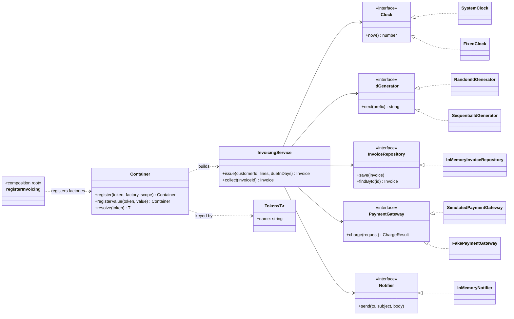

# Dependency Injection

**Category:** Modern · **Code:** [`dependency-injection.ts`](./dependency-injection.ts) · **Run:** `npm run demo -- dependency-injection` · `npx vitest run src/modern/dependency-injection`

## Intent

A class declares what it needs (usually as constructor parameters typed by interfaces) and someone else supplies it. Construction moves to one *composition root*, so business classes never `new` their collaborators, read global state or look services up.

## The problem it solves

The first `InvoicingService` builds everything itself:

```ts
class InvoicingService {
  private gateway = new StripeGateway(process.env.STRIPE_KEY!);
  private repo = new PostgresInvoiceRepository(pool);
  private mailer = new SesMailer();
  issue(...) { const id = `inv_${crypto.randomUUID()}`; const issuedAt = Date.now(); ... }
}
```

Testing "a declined charge marks the invoice failed and emails the customer" now needs a Stripe key, a database and an email account, and the due date changes on every run because of `Date.now()`. Switching to Razorpay in one region means editing the service. Configuration (keys, pools) leaks into business code, and nobody can see the dependencies without reading every method.

## The solution



| Participant | In this example |
|---|---|
| Client (the injected class) | `InvoicingService`, which takes five interfaces in its constructor |
| Services (abstractions) | `Clock`, `IdGenerator`, `InvoiceRepository`, `PaymentGateway`, `Notifier` |
| Implementations | `SystemClock`, `RandomIdGenerator`, `InMemoryInvoiceRepository`, `SimulatedPaymentGateway`, `InMemoryNotifier` |
| Test doubles | `FixedClock`, `SequentialIdGenerator`, `FakePaymentGateway`, `InMemoryNotifier` as a spy |
| Injector / container | `Container` with typed `Token<T>` keys, `singleton` and `transient` scopes, and circular-dependency detection |
| Composition root | `registerInvoicing()` (container) and `composeInvoicingByHand()` (pure DI) |

`Token<T>` exists because TypeScript interfaces vanish at runtime: the container needs a value to look `PaymentGateway` up by, and the phantom type parameter makes `resolve(TOKENS.gateway)` return a `PaymentGateway` without casts at the call site. The container tracks the tokens currently being built, so `A -> B -> A` fails with the whole path instead of a stack overflow.

The **idiomatic TypeScript default** is `composeInvoicingByHand()`: plain constructor calls in `main.ts`, checked by the compiler, no library. Reach for a container when the graph is large, when you need scopes (one instance per request), or when plugins register their own providers.

### Dependency Injection vs Service Locator

`LocatorInvoicingService` takes the container itself and calls `locator.resolve(...)` inside its methods.

| | Dependency Injection | Service Locator |
|---|---|---|
| Who asks for dependencies | The composition root, once | The class, wherever it needs one |
| Visible in the constructor | Yes: five typed parameters | No: one `locator` parameter |
| Missing dependency fails | At wiring time, at startup | When the method runs, possibly in production |
| Testing | Pass fakes to the constructor | Build and populate a locator for every test |
| Coupling | Only to the interfaces | To the interfaces *and* the locator API and its tokens |

The last test in `dependency-injection.test.ts` shows the difference: a `LocatorInvoicingService` constructs happily with an empty container and only fails inside `collect()`.

## When to use it

- Any class that talks to I/O, time, randomness or a third-party API, so tests can replace those.
- An implementation differs by environment or region (sandbox vs live gateway, Razorpay vs Stripe).
- You want the dependency list of a class to be explicit and reviewable.
- Large applications with request-scoped objects (current user, transaction) where a container's scopes pay for themselves.

## When not to use it

- Value objects and pure functions: `Money`, `LineItem` and a `computeTax()` function need no injection.
- Stable standard-library helpers (`path.join`, `JSON.parse`): injecting them is noise.
- Small services where hand wiring in `main.ts` is twenty lines: a container adds indirection and runtime errors that the compiler would otherwise catch.
- As an excuse for twelve constructor parameters. That is a class with too many responsibilities, and the container only hides it.

## Real-world sightings

- **NestJS**: providers, `@Injectable()`, injection tokens, and `DEFAULT`, `REQUEST` and `TRANSIENT` scopes.
- **Angular**: hierarchical injectors and `InjectionToken<T>`, the same idea as `Token<T>` here.
- **InversifyJS**, **tsyringe** and **Awilix** in Node; Awilix offers singleton, scoped and transient lifetimes.
- Spring and ASP.NET Core in other ecosystems; ASP.NET Core's built-in container uses singleton, scoped and transient lifetimes too.
- Many Express and Fastify codebases use pure DI: a `buildApp(deps)` function that takes the database pool, clients and config, which is what makes integration tests with fakes possible.

## Related patterns

- **Service Locator**: the class pulls dependencies from a registry. DI pushes them in. See the comparison table above.
- **Factory / Abstract Factory**: creates objects. In DI, factories are registered with the container; inject a factory when the class must create instances at runtime (one per job).
- **Strategy**: DI is how a strategy usually gets chosen and supplied; the gateway here is a strategy injected by configuration.
- **Singleton**: a singleton *scope* in a container gives one instance per container without a global `getInstance()`, so tests can still create their own.
- **Null Object**: a common injected default for optional collaborators (a no-op notifier in a CLI tool).

## Pitfalls

- **Constructor over-injection.** Eight parameters means the class does too much; split it rather than hiding it behind a container.
- **The container leaking into business code.** Once a class takes `Container`, you have a Service Locator.
- **Scope mismatches.** A singleton that captures a request-scoped object (the current user) serves one user's data to everyone. A singleton may only depend on singletons.
- **Overrides after first resolve.** Replacing a provider does not rebuild singletons that already captured the old one. Override before resolving (the container here drops only that token's cached instance).
- **Stringly-typed tokens.** `resolve('gateway')` loses the type; typed tokens or class keys keep the compiler involved.
- **Hidden cycles.** A container makes circular dependencies easy to write; detect them with a clear path, and break them with an event or by splitting the class.

## Interview Q&A

**Q: Dependency Injection vs Dependency Inversion?**
Dependency Inversion (the D in SOLID) says high-level code depends on abstractions it owns, not on concrete details. Dependency Injection is one technique to supply those abstractions from outside. You can inject concrete classes (DI without inversion) and you can invert without a container.

**Q: Why is Service Locator considered an anti-pattern?**
It hides dependencies: the constructor no longer tells you what the class needs, missing registrations fail at call time instead of startup, and every class couples to the locator. DI keeps the dependencies in the signature and the wiring in one place.

**Q: Do you need a DI framework in TypeScript?**
No. Pure DI (constructors plus one composition root) is type-checked and has no magic. A container helps with big graphs, request scopes and plugin registration; it costs indirection and errors that move from compile time to startup.

**Q: Singleton vs transient vs scoped?**
Singleton: one instance per container (repositories, clients, pools). Transient: a new one on every resolve (cheap, stateful helpers). Scoped: one per unit of work, typically an HTTP request (current user, transaction). Never let a longer-lived object hold a shorter-lived one.

**Q: How do you detect a circular dependency?**
Keep a stack of tokens being resolved. If a token is requested while it is already on the stack, report the path from its first occurrence (`AuditLog -> Mailer -> AuditLog`). Fix it by extracting the shared part into a third service or by decoupling with events.
