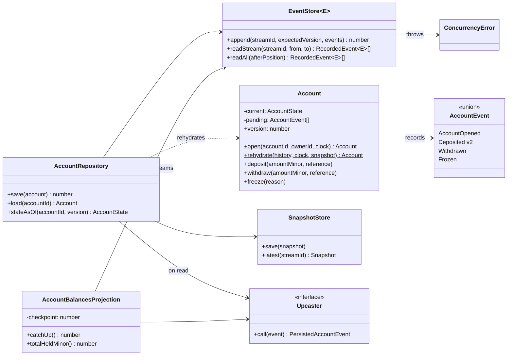
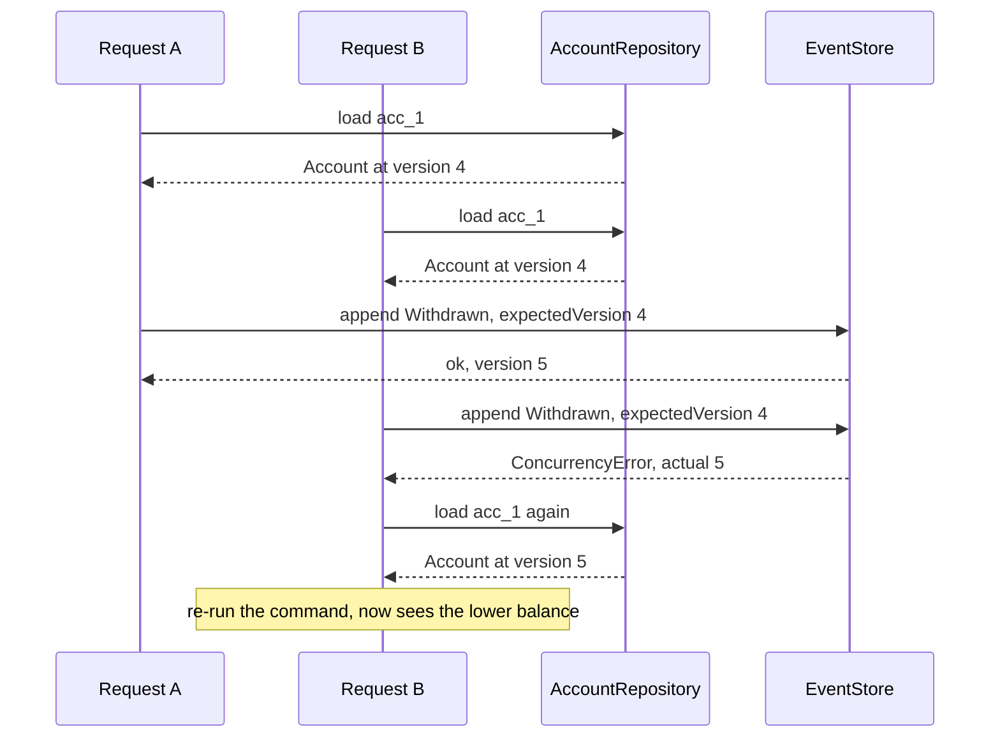

# Event Sourcing

**Category:** Modern · **Code:** [`event-sourcing.ts`](./event-sourcing.ts) · **Run:** `npm run demo -- event-sourcing` · `npx vitest run src/modern/event-sourcing`

## Intent

Persist the sequence of things that happened to an aggregate, not its current state. The append-only event stream is the source of truth; current state, past state and any read model are derived by replaying it.

## The problem it solves

A wallet service keeps `accounts.balance` and updates it in place: `UPDATE accounts SET balance = balance - 25000`. Then support asks "what was this customer's balance before the disputed withdrawal on the 3rd?", finance asks for an audit trail, and a bug that double-applied cashback has to be traced and corrected. The row only knows its latest value. The team bolts on an `account_history` table written "alongside" the update, which drifts from the balance whenever one write succeeds and the other does not. Meanwhile two requests read the same balance and both withdraw, because last-write-wins on a mutable row silently loses one of them. The smell: current state is stored, history is a best-effort afterthought, and concurrent writers overwrite each other.

## The solution

Every state change is an event appended to the account's stream (`AccountOpened`, `Deposited`, `Withdrawn`, `Frozen`). State is a left fold over the stream: `replay(events) = events.reduce(evolve, initialState)`.

- **Aggregate.** `Account` validates commands against its current state (no overdraft, no deposits to a frozen account) and records events. It applies its own events with the same pure `evolve` reducer used for replay, so live and rebuilt state cannot diverge.
- **Event store.** `EventStore.append(streamId, expectedVersion, events)` is append-only with optimistic concurrency: if the stream moved since the caller loaded it, it throws `ConcurrencyError` and the caller reloads and decides again.
- **Snapshots.** Every N events `AccountRepository` stores the folded state; loading starts from the latest snapshot and replays only the tail.
- **Upcasting.** Old events are never rewritten. `depositedV1ToV2` converts the legacy `{ amount: "125.5" }` shape into `{ amountMinor: 12550, reference }` on read.
- **Projection and temporal queries.** `AccountBalancesProjection` builds a cross-account read model from the global feed; `stateAsOf(id, N)` replays up to version N.

Two writers racing on the same stream:

| Participant | In this example |
|---|---|
| Aggregate | `Account`, deciding with invariants and recording events |
| Domain events | `AccountEvent` discriminated union |
| Evolve function | `evolve` (pure reducer) and `replay` |
| Event store | `EventStore<E>` with `append(streamId, expectedVersion, events)` |
| Repository | `AccountRepository`: load from snapshot plus tail, save with concurrency check |
| Snapshot | `SnapshotStore` holding `{ version, state }` every N events |
| Upcaster | `depositedV1ToV2`, applied in `upcast()` on every read |
| Projection | `AccountBalancesProjection` over `readAll()` with a checkpoint |

The class form (`Account` with methods) matches the diagram; the idiomatic TypeScript core underneath is the pair of a discriminated-union event type and a pure `evolve(state, event)` reducer, the same shape as a Redux reducer. A function-only "decider" (`decide(command, state) => events`, `evolve`) is a common alternative to the class.

## When to use it

- Audit and history are requirements, not nice-to-haves: ledgers, wallets, payments, inventory movements, compliance.
- You need temporal queries ("balance at the close of 31 March") or to replay history to debug or to correct a bug.
- Many read models are needed from the same facts, or new ones will be invented later (pairs naturally with CQRS).
- The domain is naturally described by events and concurrent writers must not silently overwrite each other.

## When not to use it

- CRUD data where only the latest value matters (user profile, settings): a table with an `updated_at` is enough.
- The team has no appetite for event versioning, projections and eventual consistency. Those costs are permanent.
- You need ad-hoc queries over current state across aggregates on day one; you will be building projections for every one of them.
- Data must be erasable on request (GDPR) and you cannot design crypto-shredding or tombstoning for an immutable log.

## Real-world sightings

- Accounting ledgers and bank statements are the original event-sourced systems: the balance is derived from the entries.
- EventStoreDB is a database built for this: streams, `expectedVersion` on append, subscriptions for projections.
- Marten (.NET on PostgreSQL) and Axon Framework (Java) provide event-sourced aggregates, snapshots and upcasters (Axon's documentation calls the schema migration step "upcasting").
- Git is the familiar analogy: commits are events, the working tree is a projection, and you can check out any past version.
- Redux and `useReducer` apply the same fold, `state = reduce(actions, initial)`, in the front-end.

## Related patterns

- **CQRS**: separates write and read models. Event Sourcing is one way to implement the write side; CQRS does not need it, but an event-sourced system almost always needs CQRS for queries.
- **Event-driven messaging / event notification**: publishing events between services is not event sourcing. Here the events are the persistence format of one aggregate.
- **Memento**: a snapshot is a memento of the aggregate's state, used as a cache in front of the replay.
- **Command**: commands ask (and may be refused); events record what was accepted. Confusing the two leads to events named `WithdrawRequested` that later fail.
- **Saga**: often driven by events from event-sourced aggregates, but coordinates across aggregates or services.

## Pitfalls

- **Validating in `evolve`.** Applying an event must never fail, or old streams become unloadable. Validate in the command methods; `evolve` only computes.
- **Ignoring `expectedVersion`.** Appending without it reintroduces lost updates, the very thing the stream was supposed to prevent.
- **Rewriting history to change a schema.** Version events and upcast on read; to fix a wrong fact, append a compensating event (a reversal), as an accountant would.
- **Snapshots treated as truth.** They are a cache keyed by version. Their shape also changes, so version them or simply discard and rebuild them.
- **Fat or vague events** (`AccountUpdated { ...wholeRow }`): they lose intent and make projections fragile. Name the business fact.
- **Floats and wall-clock time in events.** Store integer minor units and an explicit `at`; replay must be deterministic.
- **Long streams without snapshots.** A busy account with a million events will load slowly; snapshot or split the stream by period ("closing the books").

## Interview Q&A

**Q: How does an event-sourced system handle two concurrent withdrawals?**
Each request loads the stream at version N and appends with `expectedVersion: N`. The first append wins and moves the stream to N+1; the second gets a concurrency error, reloads, and re-runs the command against the new balance, which may now refuse it.

**Q: Why snapshots, and are they the source of truth?**
To avoid replaying long streams on every load. No: a snapshot is a cached fold at version N; the repository replays the events after it. Deleting all snapshots must only cost time.

**Q: How do you change an event's schema after years in production?**
Never edit stored events. Introduce a new version, write new events in it, and register an upcaster that converts the old shape on read. For larger changes, copy-and-transform into a new stream.

**Q: How do you query "all accounts with balance above X" when you only store events?**
Through a projection: a read model built from the event feed and kept up to date with a checkpoint. The event store answers "load this aggregate" and "give me events after position P"; everything else is a projection.

**Q: What about deleting personal data?**
Keep personal data out of events where possible, or encrypt it with a per-subject key and delete the key (crypto-shredding), so the immutable log stays intact while the data becomes unreadable.
