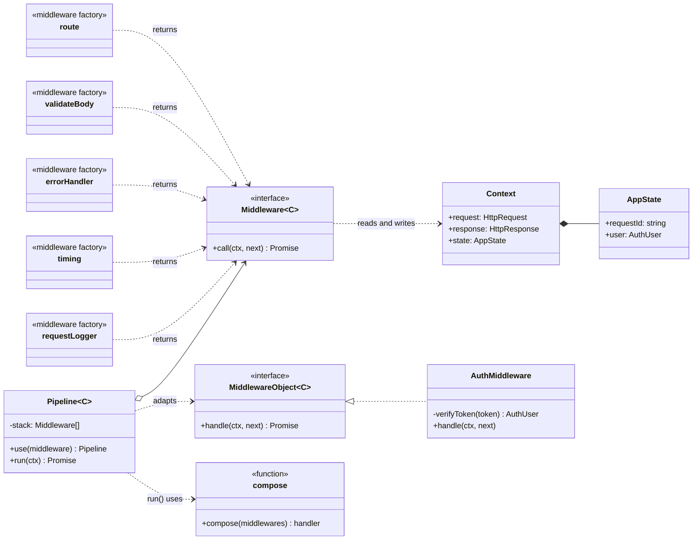
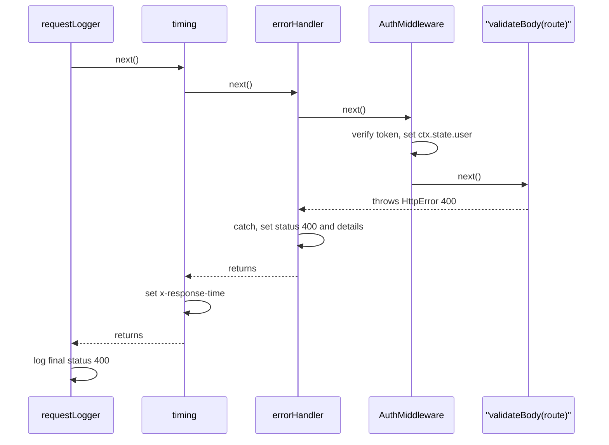

# Middleware Pipeline

**Category:** Modern · **Code:** [`middleware-pipeline.ts`](./middleware-pipeline.ts) · **Run:** `npm run demo -- middleware-pipeline` · `npx vitest run src/modern/middleware-pipeline`

## Intent

Build a request handler out of small, independent functions `(ctx, next)` composed into a single pipeline. Each middleware can act before the rest of the pipeline runs, decide whether it runs at all, and act again after it finishes: the "onion" model popularised by Koa.

## The problem it solves

Every handler of an invoicing API starts the same way: log the request, start a timer, parse the bearer token, return 401 if it is bad, check the role, validate the JSON body, wrap the real work in `try/catch` to turn exceptions into a 500, set `X-Response-Time`, log the status. Copy-pasted into thirty handlers, the copies drift: one forgets the `try/catch` and leaks a stack trace, one logs before the status is known, one checks the role before authentication. Adding rate limiting means editing every handler.

The smell: cross-cutting concerns tangled into business handlers, and their *order* encoded nowhere.

## The solution

One authenticated `POST /invoices` with an invalid body travels through the onion like this:

| Participant | In this example |
|---|---|
| Handler interface | `Middleware<C> = (ctx, next) => Promise<void> \| void`, and `MiddlewareObject<C>` for the class form |
| Composer | `compose(middlewares)`, which builds `dispatch(i)` and guards against double `next()` |
| Pipeline (builder) | `Pipeline<C>.use(...)` / `.run(ctx)` |
| Concrete middlewares | `requestLogger`, `timing` (injected `Clock`), `errorHandler`, `AuthMiddleware`, `requireRole`, `validateBody`, `route` |
| Shared context | `Context` with `request`, `response` and a typed `state` (`requestId`, `user`) |
| Client | `buildInvoiceApi()`, whose order of `use()` calls *is* the order of the onion |

`compose()` is the whole pattern: `dispatch(i)` calls middleware `i` with a `next` that calls `dispatch(i + 1)`. Because each middleware *awaits* `next()`, everything after the `await` runs on the way back out, so the logger sees the final status and timing measures the whole inner pipeline. Calling `next()` twice is rejected, since it would run the rest of the pipeline (and its side effects) twice. Not calling `next()` at all is a short-circuit: `AuthMiddleware` answers 401 and nothing downstream runs, while the outer layers still unwind normally.

Functions are the **idiomatic TypeScript form** and what Koa, Express and Redux use. The `Pipeline` class and `MiddlewareObject` interface are the classic object form, useful when a middleware has dependencies, as `AuthMiddleware` has its token verifier. `validateBody(parse, handler)` keeps the body typed: the handler receives a `CreateInvoiceBody`, not `unknown`.

## When to use it

- Cross-cutting concerns around a core operation: HTTP servers, RPC handlers, message consumers, CLI commands, outbound HTTP clients.
- The concerns need *before and after* behaviour (timing, transactions, tracing spans, error mapping), not only "before".
- Different routes or consumers need different stacks built from the same parts.
- You want the order of concerns written down in one place.

## When not to use it

- A single concern around a single function: a plain wrapper function or decorator is clearer.
- Steps with a fixed business sequence and rich typed outputs (price, then tax, then ship): a pipeline of typed stages or plain function calls documents the data flow better than a shared mutable `ctx`.
- When the order dependencies are so tight that every middleware must know about the others; that is one component split artificially.

## Real-world sightings

- **Koa**: `koa-compose` is the `compose()` here, including the "next() called multiple times" error and the 404 default status.
- **Express** and **Connect**: `(req, res, next)` middleware and four-argument error middleware, without the awaitable onion (code after `next()` does not wait for downstream async work).
- **Hono**, **Fastify hooks** (`onRequest`, `preHandler`, `onSend`, `onResponse`) and **NestJS** interceptors, guards and pipes.
- **Redux** middleware `store => next => action`, and `axios` request and response interceptors.
- **gRPC** interceptors in Node and Go, and ASP.NET Core's middleware pipeline (`app.Use(async (ctx, next) => ...)`).

## Related patterns

- **Chain of Responsibility**: the same "pass it along" structure. In classic CoR a handler either handles the request *or* passes it on, and usually one handler wins. In a pipeline every middleware typically runs, does work both before and after the rest, and short-circuiting is the exception.
- **Decorator**: each middleware wraps the rest of the pipeline the way a decorator wraps a component, and `compose()` is decorator stacking done at runtime from a list. Decorator wraps one object's interface; middleware wraps a single `(ctx) => Promise<void>` call and shares a context object.
- **Interceptor / AOP**: the same before/after idea applied to method calls on objects.
- **Pipes and Filters**: stages transform data and pass *outputs* on; middlewares share and mutate one context and can wrap the downstream call.

## Pitfalls

- **Order bugs.** The error handler must sit outside what it protects; the logger outside the error handler to see the final status; `/health` before auth. Keep the stack in one place and test the order.
- **Forgetting `await next()`.** `next()` without `await` (or without `return`) lets the outer middleware finish before the inner ones, so timing reads 0 and errors escape the handler.
- **Calling `next()` twice.** Doubled side effects; the composer must reject it, as this one does.
- **Untyped `ctx.state`.** Koa's `ctx.state` is `any` by default, so "the auth middleware set `user`" is a convention nobody checks. Type the state, and pass parsed values to handlers with types (`validateBody`).
- **Swallowing errors.** An error middleware that turns everything into 500 must still log it with the request id, or the incident has no trace.
- **Doing heavy work in a global middleware** that only a few routes need; mount it on those routes.

## Interview Q&A

**Q: Explain the onion model.**
Each middleware is `async (ctx, next) => { before; await next(); after; }`. `next()` runs the rest of the pipeline, so the "before" parts run outside-in and the "after" parts inside-out, like peeling into an onion and back out. That is what lets one middleware time, log or wrap in a transaction everything inside it.

**Q: How does `compose()` work?**
It returns a function that calls `dispatch(0)`. `dispatch(i)` invokes middleware `i` with `next = () => dispatch(i + 1)`, wraps the result in a promise, and past the last middleware calls the optional final handler. An index check rejects a second `next()` from the same middleware.

**Q: Middleware vs Chain of Responsibility?**
CoR: handlers are tried in order until one handles the request, and it typically stops there. Middleware: all layers usually run, each wraps the rest with before and after logic, and stopping early (auth failure) is a deliberate short-circuit.

**Q: How do you handle errors in a pipeline?**
Put an error middleware near the outside: `try { await next() } catch (e) { map to status }`. Typed errors (`HttpError(400, details)`) carry their status, anything else becomes a 500 with a request id, and the original error is logged, never sent to the client.

**Q: Why is Express middleware not a true onion?**
Express's `next()` does not return a promise for the downstream work, so code after `next()` runs before async handlers finish, and async errors need explicit forwarding (Express 5 handles rejected promises from handlers, but still has no awaitable `next()`). Koa's `next()` returns a promise, so `await next()` really waits for everything inside.
