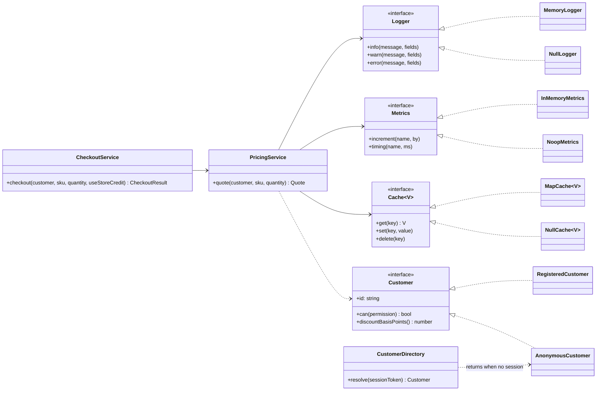

# Null Object

**Category:** Modern · **Code:** [`null-object.ts`](./null-object.ts) · **Run:** `npm run demo -- null-object` · `npx vitest run src/modern/null-object`

## Intent

Represent "nothing here" with an object that implements the expected interface and does the neutral thing: a logger that discards, metrics that count nothing, a cache that always misses, a customer with no rights. Callers treat it like any other collaborator, so the `null` checks go away.

## The problem it solves

A pricing service takes an optional logger, metrics client and cache, because unit tests and one-off scripts do not want to wire them up. A signed-out shopper arrives as `null`. The code now reads:

```ts
let unit = this.cache ? this.cache.get(sku) : undefined;
if (this.metrics) this.metrics.increment('price.cache_miss');
const discountBp = customer ? customer.discountBasisPoints() : 0;
if (this.logger) this.logger.info('quoted', { ... });
```

Every method repeats the same guards (see `PricingServiceBefore`). The day someone adds a log line without the `if`, the script that passes no logger crashes with `Cannot read properties of undefined`. The guards also hide the business rule ("guests get no discount") inside a ternary.

## The solution



| Participant | In this example |
|---|---|
| Abstract object (interface) | `Logger`, `Metrics`, `Cache<V>`, `Customer` |
| Real objects | `MemoryLogger`, `InMemoryMetrics`, `MapCache`, `RegisteredCustomer` |
| Null objects | `NullLogger`, `NoopMetrics`, `NullCache`, `AnonymousCustomer` (the GuestUser) |
| Client | `PricingService` and `CheckoutService`, which call collaborators with no guards |
| Where absence becomes an object | Constructor defaults in `PricingService`, and `CustomerDirectory.resolve()` for a missing or expired session |

Stateless null objects are shared singletons (`NullLogger.instance`, `AnonymousCustomer.instance`). The **idiomatic TypeScript form** is an object literal, `noopLogger: Logger = { info: noop, ... }`, which satisfies the interface without a class. TypeScript's optional chaining (`logger?.info()`) is the other alternative; it is fine for one call site, but it spreads the "maybe absent" type through every signature, where a null object settles it once at the boundary.

The file also shows where the pattern stops: `PriceCatalog.priceOf()` throws `UnknownSkuError` instead of returning a "null price", because a price of 0 would sell the item for free.

## When to use it

- Optional infrastructure collaborators: logging, metrics, tracing, caching, audit hooks, event publishers in tests.
- A "nobody" domain object with an obvious neutral behaviour: guest user, no-op discount, a default plan with no features.
- You keep writing the same `if (x)` around calls to the same collaborator.
- Test doubles for collaborators the test does not care about.

## When not to use it

- Absence is an error the caller must handle: a missing price, a missing payment gateway, an unknown account. A null object there turns a crash into silent data corruption.
- Callers need to behave differently when the thing is absent (show a "connect your bank" screen). Use `T | undefined` or a result type and make them decide.
- There is no single neutral behaviour. What should a `NullPaymentGateway.charge()` return? Any answer is a lie.

## Real-world sightings

- `pino` can be created with `enabled: false`, and its log level `'silent'` turns every log call into a no-op without callers checking.
- OpenTelemetry's API returns no-op tracers and meters when no SDK is registered, so libraries instrument themselves unconditionally.
- Node's `stream.PassThrough` and writing to `/dev/null` (`os.devNull`) are null sinks for stream pipelines.
- Python's standard `logging.NullHandler` exists so libraries can log without forcing the application to configure handlers.
- Guest or anonymous principals in web frameworks: Django's `AnonymousUser` and Spring Security's anonymous authentication token stand in for "not logged in".

## Related patterns

- **Strategy**: a null object is often the "do nothing" strategy (`noDiscount` in the Strategy example).
- **Special Case** (Fowler): the general idea; Null Object is the special case for "nothing". `AnonymousCustomer` is a special case with domain meaning.
- **Singleton**: stateless null objects are usually shared instances.
- **Proxy / Decorator**: wrap a real object; a null object replaces it. A decorator around a `NullLogger` still logs nothing.
- **Optional / Maybe**: makes absence explicit in the type and forces the caller to decide. Prefer it when the caller *should* decide.

## Pitfalls

- **Hiding bugs.** A `NullLogger` wired by mistake in production means no logs, and nobody notices until an incident. Report the wiring at startup (`wiringReport`) or fail the boot when production config resolves to a null object.
- **Faking success.** A null object that returns `true`, `0` or an empty list for a business query hides failures. Neutral is fine for side effects, dangerous for answers.
- **Reintroducing the checks.** `if (customer.isGuest)` scattered through business code is the `null` check under a new name. Ask the object (`can()`, `discountBasisPoints()`) instead; keep `isGuest` for presentation.
- **Stateful null objects.** If a null object starts recording calls, it is a spy or a fake, not a null object; name it so.
- **Identity checks.** Code that compares `logger === NullLogger.instance` couples itself to the null object; keep such checks in the composition root.

## Interview Q&A

**Q: What problem does Null Object solve, in one line?**
It replaces repeated `if (x != null)` guards around a collaborator with an object that does the neutral thing, so callers have one code path.

**Q: When is a null object a bad idea?**
When absence is an error or the caller needs to react to it. A null payment gateway or a zero price hides real failures; return an error or `T | undefined` instead.

**Q: Isn't `logger?.info()` enough in TypeScript?**
For one call, yes. But the optional type spreads through every constructor and method, and every new call site must remember the `?.`. A null object decides absence once, in the composition root, and the rest of the code sees a plain `Logger`.

**Q: How do you avoid a null object hiding a misconfiguration?**
Make the choice visible: log which collaborators are null objects at startup, refuse null implementations in production config, and keep null objects for infrastructure, not for business answers.

**Q: How is a guest user a null object, and how is it different from `null`?**
`AnonymousCustomer` implements `Customer` with no permissions and no discount, so checkout, pricing and authorization run the normal path and naturally deny what guests cannot do. With `null`, each of those places needs its own guard and its own idea of what a guest may do.
