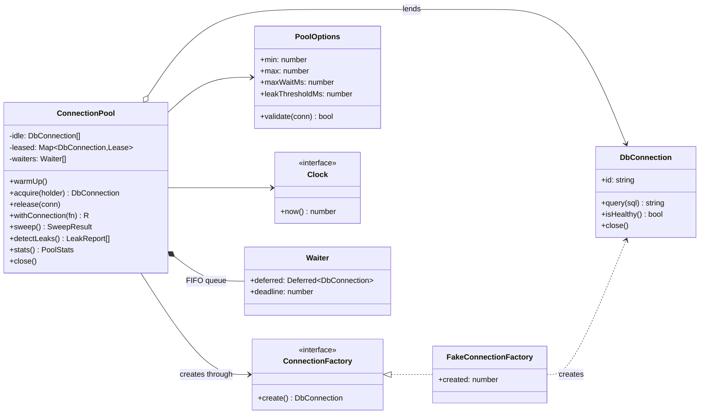
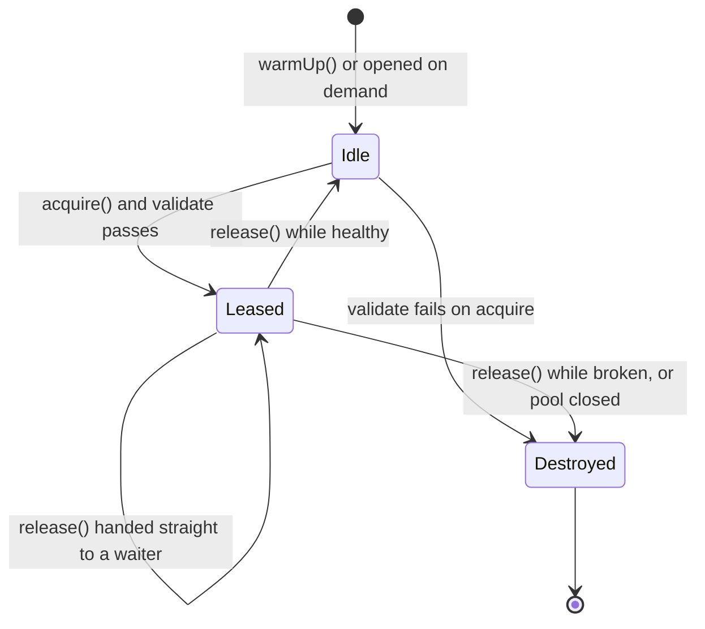

# Object Pool

**Category:** Modern · **Code:** [`object-pool.ts`](./object-pool.ts) · **Run:** `npm run demo -- object-pool` · `npx vitest run src/modern/object-pool`

## Intent

Keep a bounded set of expensive, reusable objects and lend them out instead of creating one for each use. The pool decides how many exist, who waits when all are busy, and what happens to the ones that break.

## The problem it solves

An invoicing API opens a new database connection on every request: TCP handshake, TLS, authentication, session setup, often more time than the query itself. Under load it gets worse. Postgres has a `max_connections` limit, so a traffic spike of 500 concurrent requests turns into 500 connection attempts and the database refuses the rest. A handler that throws before `conn.end()` leaks a connection, and after a few hours of small leaks the service stops answering. When the database fails over, the service keeps using connections to the old primary.

The smell: an expensive resource created per call, no upper bound, cleanup that depends on every code path remembering it, and no way to see who is holding what.

## The solution

A connection's life inside the pool:

| Participant | In this example |
|---|---|
| Pool (the manager) | `ConnectionPool`, holding idle connections, leases and a FIFO wait queue |
| Reusable object | `DbConnection` |
| Creator | `ConnectionFactory` / `FakeConnectionFactory`, which counts the expensive handshakes |
| Client | Request handlers that call `acquire()`/`release()`, or better `withConnection(fn)` |
| Policy | `PoolOptions`: `min`, `max`, `maxWaitMs`, `leakThresholdMs`, `validate` |

How the pieces work without a single timer:

- **Waiting** is a deferred promise: `acquire()` parks a `Deferred<DbConnection>` in the queue, and `release()` resolves the oldest one with the freed connection.
- **Max wait** uses the injected `Clock`: each waiter has a deadline, and expired waiters are rejected on every `acquire`, `release` and `sweep()`. The application calls `sweep()` from its own scheduler; tests just advance a `ManualClock`.
- **Validation** runs on acquire and on release, so a connection that died while idle is replaced and a broken one is never lent out.
- **Leak detection** records who acquired each connection and when; `detectLeaks()` lists leases older than the threshold, with the holder's name.
- **Counting connections still being opened** towards `max` stops a burst of concurrent `acquire()` calls from overshooting it.

The **idiomatic TypeScript form** is the loan pattern, `withConnection(async (conn) => ...)`, which releases in `finally`. That is how `pg.Pool` users are told to work, and with TypeScript's `await using` and `Symbol.asyncDispose` the same guarantee can be attached to a lease object.

## When to use it

- Creating the object is expensive and the object can be reset and reused: database and broker connections, HTTP keep-alive sockets, worker threads, browser instances for PDF rendering.
- A downstream system limits concurrency (database `max_connections`, an API that allows 10 parallel calls); the pool's `max` enforces it.
- You need back-pressure: callers should wait briefly, then fail fast, rather than pile up without limit.

## When not to use it

- Cheap objects. Pooling plain JS objects or buffers to "save GC" usually makes things slower and adds bugs from state that was not reset; modern garbage collectors handle short-lived objects well.
- The resource is not reusable or not safely resettable (a connection left in a transaction or with a changed `search_path`).
- Your client library already pools (`pg.Pool`, `mysql2`, undici, Prisma). Wrapping a pool in another pool double-counts limits.
- Serverless functions with one request per instance; there, use a proxy-side pool (PgBouncer, RDS Proxy) instead.

## Real-world sightings

- **node-postgres** `pg.Pool` with `max`, `idleTimeoutMillis` and `connectionTimeoutMillis`; `pool.query()` borrows and releases for you.
- **mysql2** `createPool` with `connectionLimit`, `waitForConnections` and `queueLimit`.
- **generic-pool** on npm (min/max, `acquireTimeoutMillis`, `testOnBorrow`), and **tarn.js**, the pool Knex uses.
- **HikariCP** on the JVM, whose `leakDetectionThreshold` is the same idea as `leakThresholdMs` here.
- Node's `http.Agent` with `keepAlive` and `maxSockets`, and undici's `Pool`, which reuse TCP sockets per origin.
- Worker pools: **Piscina** for `worker_threads`, and libuv's thread pool (`UV_THREADPOOL_SIZE`) behind `fs` and `crypto` in Node.
- Server-side: PgBouncer pools Postgres connections for many application instances.

## Related patterns

- **Flyweight**: shares immutable objects *simultaneously* among many clients. A pool lends mutable objects *exclusively*, one client at a time.
- **Singleton**: one shared instance for everyone. A pool is a bounded set lent out one at a time; the pool itself is often a singleton per process.
- **Factory Method**: the pool creates new objects through a factory; it adds lifecycle (reuse, validation, destruction) on top of creation.
- **Proxy**: many pools hand out a proxy whose `release()` or `end()` returns the connection to the pool instead of closing it.
- **Semaphore / Bulkhead**: limits concurrency without holding objects. A pool is a semaphore that also hands you the resource.

## Pitfalls

- **Leaks.** Every path must release, including errors. Prefer `withConnection` over manual acquire/release, and turn on leak detection in staging.
- **Dirty state.** A connection returned in the middle of a transaction, or with a session variable changed, poisons the next borrower. Reset or validate on release.
- **No timeout on acquire.** Without `maxWaitMs`, a saturated pool makes every request hang instead of failing fast with a clear error.
- **Pool too big.** `max` multiplied by instance count must stay below the database limit; more connections than CPU cores on the database often slows it down.
- **Deadlock by nested acquire.** A handler holding one connection that waits for a second from the same full pool can wait forever. Pass the connection down instead.
- **Stale connections after failover.** Validate on borrow (or on a cheap interval) so connections to a dead primary are dropped.

## Interview Q&A

**Q: Why pool database connections at all?**
Opening one costs a TCP and TLS handshake plus authentication, often more than the query, and the database caps the total. A pool pays the cost once, reuses connections, and enforces the cap.

**Q: What happens when the pool is exhausted?**
Callers queue in FIFO order with a deadline. A release hands the connection straight to the oldest waiter; a waiter past its deadline is rejected with a timeout error so the request can fail fast or shed load.

**Q: How do you detect a connection leak?**
Record the holder and acquire time of each lease and report leases older than a threshold, as HikariCP's `leakDetectionThreshold` does. Prevent leaks by making the loan pattern (`withConnection`) the only API most code sees.

**Q: Object Pool vs Flyweight?**
Flyweight shares one immutable instance among many users at the same time. A pool lends a mutable instance to one user at a time and takes it back.

**Q: How do you size the pool?**
Start from the database's limit divided by the number of application instances, then measure: the right size is usually small (a few times the database's CPU cores), because more connections add contention rather than throughput.
