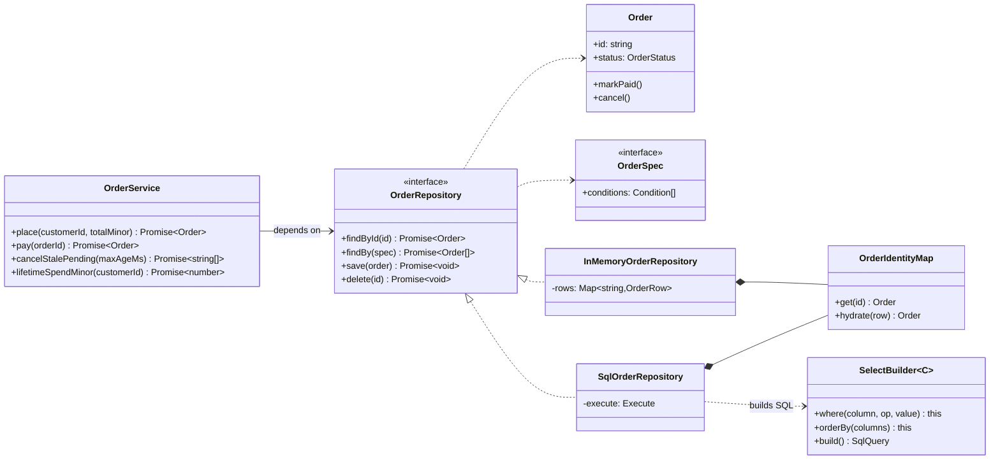

# Repository

**Category:** Modern · **Code:** [`repository.ts`](./repository.ts) · **Run:** `npm run demo -- repository` · `npx vitest run src/modern/repository`

## Intent

Give the domain a collection-like interface for one kind of aggregate (find, query by specification, save, delete) and hide how it is stored. Business code depends on that interface; SQL, an ORM or an in-memory map sit behind it and can be swapped.

## The problem it solves

An `OrderService` that builds SQL strings inline (`pool.query("SELECT ... WHERE customer_id = '" + id + "'")`) mixes three jobs: business rules (only pending orders can be paid), persistence (columns, placeholders, upserts) and mapping (snake_case rows to objects). Every test needs a database, the same `SELECT` is copy-pasted with small differences across services, string concatenation invites SQL injection, and moving from Postgres to another store means editing business code. The smell is `pool.query` appearing in files that should only know about orders.

## The solution

| Participant | In this example |
|---|---|
| Repository (port) | `OrderRepository`, declared next to the domain |
| Aggregate | `Order`, with its own rules (`markPaid`, `cancel`) and no persistence code |
| Specification / query object | `OrderSpec` built by `byCustomer`, `withStatus`, `createdBefore`, `allOf` |
| Concrete repositories (adapters) | `InMemoryOrderRepository`, `SqlOrderRepository` |
| Data mapper | `orderToRow` / `rowToOrder`, plus `OrderIdentityMap` |
| Infrastructure | `SelectBuilder`, `upsert`, `deleteFrom` and the injected `Execute` function |
| Client | `OrderService`, which only sees the interface |

Specifications are plain data, not callbacks, so each adapter can translate them: the in-memory repository filters rows with `matchesRow`, the SQL one turns them into `WHERE customer_id = $1 AND status = $2`. The SQL adapter takes a single `execute(sql, params)` function rather than a driver, so tests assert the exact statements and the production wiring passes something like `(sql, params) => pool.query(sql, params).then(r => r.rows)`.

## When to use it

- Domain logic with real rules that you want to test without a database.
- Several services load and save the same aggregate, so queries and mapping would otherwise be duplicated.
- You may change or split storage (Postgres to DynamoDB, a cache in front, a read replica for queries).
- A hexagonal or clean architecture, where the domain owns the ports and infrastructure provides adapters.

## When not to use it

- CRUD screens with no domain rules: the ORM or query builder is already a repository; wrapping it adds a layer that only forwards calls.
- Reporting and analytics queries with joins and aggregates across many tables: write SQL (or a read model) directly instead of forcing it through an aggregate-shaped interface.
- When the abstraction would hide things you need: bulk updates, streaming large result sets, database-specific locking.

## Real-world sightings

- TypeORM's `Repository<Entity>` and `DataSource.getRepository()`; MikroORM's `EntityRepository`.
- Spring Data repositories in Java, which inspired many TypeScript ports.
- NestJS projects commonly inject repositories (`@InjectRepository(Order)`) into services.
- In hexagonal and domain-driven design codebases: a `ports/` folder with repository interfaces and an `adapters/` folder with Postgres, DynamoDB and in-memory implementations.

## Related patterns

- **Data Mapper**: moves data between objects and rows. A repository usually uses a mapper (`rowToOrder`) and adds collection semantics and querying on top.
- **DAO (Data Access Object)**: table-oriented (`OrderDao.insertRow`). A repository is aggregate-oriented and speaks the domain's language.
- **Unit of Work**: tracks changes across several repositories and commits them in one transaction; repositories often get their connection from it.
- **Specification**: the query object passed to `findBy`; see `src/modern/specification`.
- **Identity Map**: guarantees one object per id within a repository or session, as `OrderIdentityMap` does here.

## Pitfalls

- A generic `Repository<T>` with `findAll()`, `update(partial)` and arbitrary `where` objects. It leaks the storage model; prefer one interface per aggregate with the queries the domain actually needs.
- Returning ORM entities or raw rows from the repository. Callers then depend on the storage shape again.
- An in-memory fake that stores live objects: tests pass because mutations "persist" without `save()`, then fail against SQL. Store snapshots.
- Building SQL by string concatenation of values. Only column names from a typed list go into the SQL text; values go into parameters.
- N+1 queries hidden behind a pretty interface (`for (const id of ids) await repo.findById(id)`). Add a batch method when the domain needs it.

## Interview Q&A

**Q: Repository vs DAO?**
A DAO wraps a table and exposes rows and CRUD. A repository wraps an aggregate and exposes the domain's queries (`findBy(withStatus('pending'))`), returning domain objects. The repository may use DAOs or a mapper underneath.

**Q: Where does the repository interface live, and why?**
In the domain layer, next to `Order`. The domain defines what it needs; infrastructure implements it. That keeps dependencies pointing inward and lets tests use an in-memory adapter.

**Q: How do you test a SQL repository without a database?**
Inject the executor (`execute(sql, params)`) and assert the statements and parameters, as these tests do, then run a smaller set of integration tests against a real database to catch dialect issues.

**Q: Isn't an ORM already a repository?**
Partly. It gives generic persistence. A domain-specific repository interface still helps when you want tests without the ORM, want to limit which queries exist, or might change the ORM. For simple CRUD apps, using the ORM directly is fine.

**Q: Why an identity map inside the repository?**
So the same id always yields the same object within a unit of work. Two copies of one order could be modified separately and the last save would silently overwrite the other.
