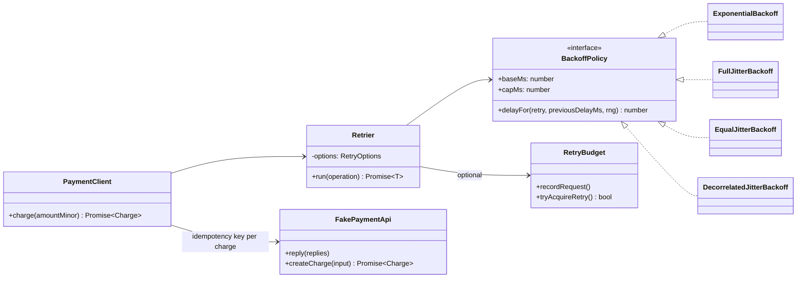
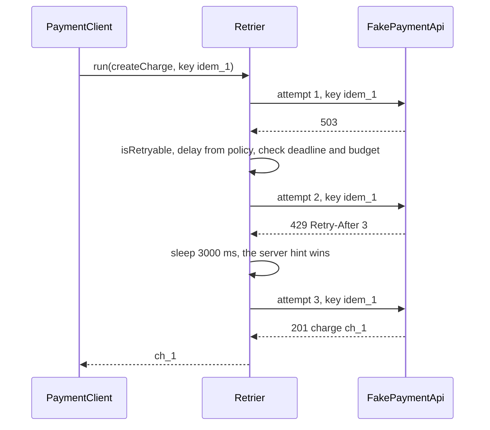

# Retry with Backoff

**Category:** Modern (resilience) · **Code:** [`retry-with-backoff.ts`](./retry-with-backoff.ts) · **Run:** `npm run demo -- retry-with-backoff` · `npx vitest run src/modern/retry-with-backoff`

## Intent

Re-run an operation that failed for a transient reason, waiting longer between attempts and adding randomness to the wait, within limits on attempts, delay and total time, so that a brief blip is absorbed without turning a struggling dependency into a dead one.

## The problem it solves

A checkout creates charges on a payment API. Under load the API answers `503` or `429 Too Many Requests` for a few seconds. The first version wraps the call in `for (let i = 0; i < 5; i++) try { return await api.createCharge(...) } catch {}`:

- it retries a `402 Payment Required` five times (the card will not become valid);
- it retries immediately, so a thousand checkouts that failed at the same moment come back at the same moment, five times over;
- it ignores the `Retry-After: 3` the API sent;
- it has no bound on total time, so the HTTP request from the browser times out first and the user clicks "Pay" again;
- a timeout after the charge was committed is retried with a fresh request, and the customer is charged twice.

## The solution

`Retrier` owns the loop. It asks an `isRetryable` predicate whether the error is transient, a `BackoffPolicy` how long to wait, a `retryAfterMs` extractor whether the server asked for a specific wait, and checks `maxAttempts`, an overall `deadlineMs` and an optional `RetryBudget` before every sleep. `sleep`, `rng` and `clock` are injected, so tests run instantly and see exact delays.

The four policies follow Marc Brooker's AWS Architecture Blog post "Exponential Backoff And Jitter" (`retry` is 0 for the first retry):

| Policy | Delay | Character |
|---|---|---|
| `ExponentialBackoff` | `min(cap, base * 2^retry)` | No jitter: synchronised clients stay synchronised |
| `FullJitterBackoff` | `random(0, min(cap, base * 2^retry))` | Spreads load best; can wait almost 0 |
| `EqualJitterBackoff` | `t/2 + random(0, t/2)` with `t = min(cap, base * 2^retry)` | Always waits at least half the ceiling |
| `DecorrelatedJitterBackoff` | `min(cap, random(base, previous * 3))` | Grows from the previous delay rather than the attempt count |

| Participant | In this example |
|---|---|
| Retry policy / executor | `Retrier` (classic) and `withRetry(fn, options)` (functional decorator) |
| Backoff strategies | `ExponentialBackoff`, `FullJitterBackoff`, `EqualJitterBackoff`, `DecorrelatedJitterBackoff` behind `BackoffPolicy` |
| Delay schedule | `backoffDelays(policy, rng)`: an infinite generator, the idiomatic way to expose a sequence |
| Retryable predicate | `isTransient`: network resets, 408, 429, 500, 502, 503, 504 |
| Server hint | `retryAfterFromHttp` / `parseRetryAfter`: delay-seconds or HTTP-date |
| Retry budget | `RetryBudget`: retries allowed as a share of requests |
| Client | `PaymentClient`, which generates one idempotency key per logical charge |

### Why retries need idempotency

A timeout does not tell you whether the server did the work. If the charge was committed and only the response was lost, a naive retry creates a second charge. Retries are only safe for idempotent operations: reads, `PUT` of a full resource, deletes, or writes carrying an **idempotency key** that the server uses to return the first result again. `PaymentClient` creates the key *once*, outside the loop, and every attempt sends it; the `lost-response` test proves the customer is charged once.

### Retry storms and budgets

Retries multiply load exactly when the dependency can least afford it. With 3 attempts at each of 4 layers of a call chain, one user request can become 3^4 = 81 requests at the bottom. Defences, all in this example or its README:

- **Jitter**, so clients that failed together do not retry together.
- **Retry at one layer only**, usually the one closest to the user or the one that owns the idempotency key.
- **A retry budget**: allow retries only up to a ratio of normal traffic (`RetryBudget(0.1)` is about 10 %). When the dependency is really down, the budget runs out and callers fail fast instead of tripling the load.
- **A deadline** that matches the caller's timeout, so you never keep retrying for a client that has gone away.
- **A circuit breaker** outside the retry loop, which stops retries entirely once failure is the norm.

## When to use it

- Network calls that fail transiently: connection resets, 503 during a deploy, 429 throttling, leader elections, lock timeouts, optimistic-concurrency conflicts.
- The operation is idempotent or can be made so with a key.
- Queue consumers and background jobs, where waiting is cheap and success later is still useful.

## When not to use it

- Errors that will not change on their own: validation (400/422), auth (401/403), not found, insufficient funds.
- Non-idempotent writes without an idempotency key.
- Latency-critical paths where the user would rather get a fast error or a fallback.
- When the dependency is clearly down: that is the circuit breaker's job, and retrying only adds load.
- At every layer of a call chain at once.

## Real-world sightings

- **AWS SDKs** (including JavaScript v3): `standard` and `adaptive` retry modes with exponential backoff, jitter and a retry quota (a token bucket that limits retries when many calls fail).
- **got** (Node HTTP client): built-in retry with a limit, honours `Retry-After`, and by default retries only idempotent methods.
- **p-retry** (Node): wraps an async function; throwing its `AbortError` marks an error as non-retryable.
- **gRPC** retry policy in service config: `maxAttempts`, `initialBackoff`, `maxBackoff`, `backoffMultiplier`, `retryableStatusCodes`, plus retry throttling.
- **Stripe**: `Idempotency-Key` header on POST requests, and the official SDKs retry network failures with an idempotency key.
- **Finagle** `RetryBudget` and the Google SRE book chapter on handling overload both describe retry budgets as a ratio of requests.

## Related patterns

- **Circuit breaker**: retry bets the failure is brief; the breaker assumes it is not. Retry inside, breaker outside.
- **Bulkhead**: retries consume concurrency slots; a bulkhead caps how much damage a retrying dependency can do.
- **Strategy**: each backoff policy is a strategy; the retrier is the context.
- **Decorator**: `withRetry(fn)` decorates a function with retry behaviour without changing its signature.
- **Transactional outbox / queues**: for writes that must eventually happen, a durable queue with redelivery is a retry that survives a process crash.

## Pitfalls

- Retrying non-idempotent operations, or generating a new idempotency key on each attempt (which defeats it).
- Retrying everything, including 4xx and programming errors; the predicate is the most important line.
- No jitter, or jitter on a delay that is never capped (`base * 2^20` is about 29 hours with base 100 ms).
- `maxAttempts` without a deadline: five attempts of a 10-second timeout is a minute the caller is not waiting for.
- Ignoring `Retry-After` on 429/503: the server told you exactly when to come back.
- Swallowing the last error: keep it as `cause` so logs show why the call finally failed.
- Real timers in library code, which make tests slow and flaky. Inject `sleep`, `rng` and `clock`.

## Interview Q&A

**Q: Why add jitter to exponential backoff?**
Without it, every client that failed at the same moment retries at the same moments, producing synchronised spikes. Jitter spreads the retries; Brooker's simulation shows full jitter cutting total calls and completion time sharply compared to plain exponential backoff.

**Q: Full, equal or decorrelated jitter?**
Full jitter spreads load best and is a good default. Equal jitter guarantees a minimum wait (half the ceiling), useful when an immediate retry is pointless. Decorrelated jitter grows from the previous delay, giving a similar spread with less dependence on the attempt counter.

**Q: How do you make a payment retry safe?**
An idempotency key generated once per logical operation and sent on every attempt; the server stores the first result per key and returns it for repeats. Without that, a timeout after commit plus a retry is a double charge.

**Q: What is a retry storm and how do you prevent it?**
Retries at several layers multiplying load during an outage. Retry at one layer, use jitter, cap retries with a budget (for example 10 % of requests), use deadlines, and put a circuit breaker around the retry loop.

**Q: What should you do with Retry-After?**
Use it instead of your computed delay (it is the server's explicit signal), but still apply your deadline: if the hinted wait would exceed it, fail now.
