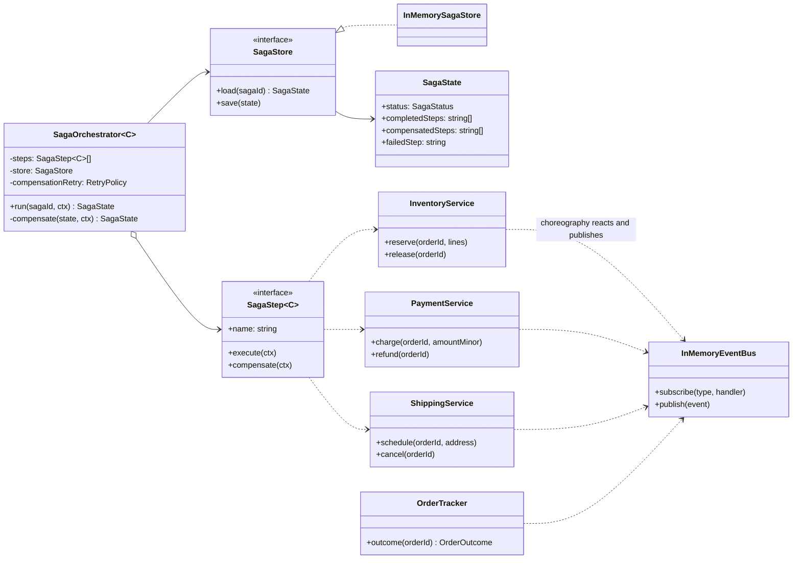
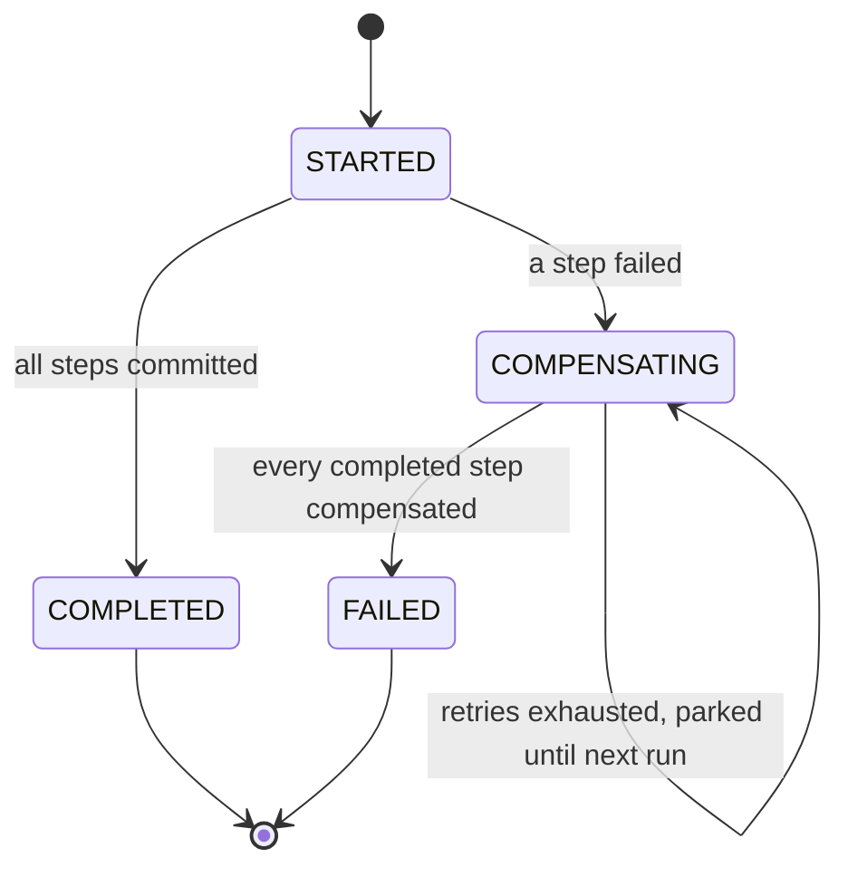
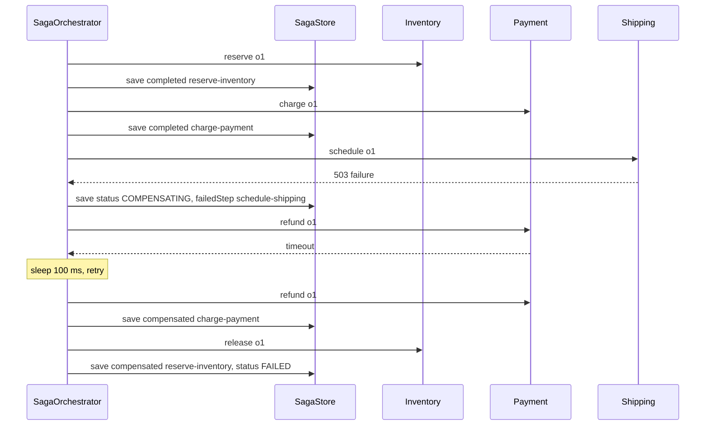

# Saga

**Category:** Modern · **Code:** [`saga.ts`](./saga.ts) · **Run:** `npm run demo -- saga` · `npx vitest run src/modern/saga`

## Intent

Keep data consistent across services without a distributed transaction: split the business transaction into local steps, give each step a compensating action, and when a step fails, run the compensations of the steps that already committed, in reverse order.

## The problem it solves

Placing an order touches three services, each with its own database: Inventory reserves stock, Payment charges the card, Shipping books a courier. In a monolith this was one `BEGIN ... COMMIT`. After the split, the checkout handler calls the three APIs in a row, and when Shipping returns a 503 the customer has been charged for an order that will never ship and the stock is locked forever. Two-phase commit is not on the table (the payment gateway does not take part in your XA transaction, and 2PC blocks everyone when the coordinator dies). The smell is a `try/catch` around each call with hand-written rollbacks that are themselves not retried, not idempotent and not persisted: a crash halfway through the rollback leaves the system in a state nobody can reconstruct.

## The solution

Each step is a local transaction plus a compensation that semantically undoes it (release stock, refund the charge, cancel the booking). Two ways to coordinate them, both in `saga.ts`:

- **Orchestration**: a `SagaOrchestrator` knows the ordered steps, runs them, and on failure runs the compensations backwards. Its progress is a persisted state machine, so a restarted coordinator resumes rather than starting over.
- **Choreography**: no coordinator. Each service subscribes to the previous service's events and publishes its own; failure events (`ShipmentFailed`, `PaymentFailed`) flow backwards and trigger compensations.

The persisted state machine of an orchestrated saga:

A compensation, when Shipping fails and the first refund attempt times out:

| Participant | In this example |
|---|---|
| Saga (the business transaction) | Placing an order: `OrderContext` carries the data every step needs |
| Step / local transaction | `SagaStep` objects from `orderSagaSteps()`: reserve, charge, schedule |
| Compensating transaction | Each step's `compensate`: `release`, `refund`, `cancel` |
| Orchestrator | `SagaOrchestrator`, with `TRANSITIONS` as its state machine |
| Saga log | `SagaStore` / `InMemorySagaStore` holding `SagaState` after every step |
| Participants | `InventoryService`, `PaymentService`, `ShippingService` (idempotent by `orderId`) |
| Choreography channel | `InMemoryEventBus` and the `OrderEvent` discriminated union |
| Choreography observer | `OrderTracker`, the order service deriving the outcome from events |

Steps are plain object literals rather than one class per step: in TypeScript an object with `execute` and `compensate` satisfies `SagaStep<C>` without ceremony, and the event bus uses `Extract<OrderEvent, { type: T }>` so each handler receives a narrowed event.

## When to use it

- One business operation writes to several services or databases that cannot share a transaction (microservices, third-party APIs, a payment gateway).
- Every step has a meaningful business undo: refund, release, cancel, credit note.
- The operation is long-running (seconds to days: bookings, onboarding, loan approval) and holding locks across it is impossible.
- Pick **orchestration** when the flow has many steps, branches or a timeout policy you want in one readable place; **choreography** for two or three services with a simple linear flow and teams that should not depend on a central coordinator.

## When not to use it

- Everything lives in one database: use a local transaction. A saga gives up isolation, which you would be trading away for nothing.
- A step cannot be compensated (an email has been sent, money left the bank by wire). Move it last, after the point of no return, or redesign it to be a reservation that is confirmed later.
- You need the intermediate states to be invisible to readers. Sagas are ACD without the I: other requests see the reserved stock and the captured charge before the saga finishes.
- The flow is a single call with a retry: a saga is the wrong weight for it.

## Real-world sightings

- The pattern comes from Garcia-Molina and Salem's 1987 paper "Sagas", written for long-lived database transactions.
- Temporal (including its TypeScript SDK) and AWS Step Functions both document the saga pattern: workflow code runs steps and registers compensations to run on failure.
- Chris Richardson's microservices.io catalogue and the Eventuate Tram Sagas framework describe orchestration vs choreography in these terms.
- MassTransit and NServiceBus (.NET) and Axon (Java) ship saga support as persisted state machines driven by messages.
- Travel booking (flight, hotel, car), e-commerce checkout and fintech onboarding are the textbook use cases.

## Related patterns

- **Two-phase commit**: atomic and isolated, but blocking and requires every participant to support prepare/commit. A saga is non-blocking and eventually consistent, and needs compensations instead.
- **Transactional Outbox**: how each saga step reliably publishes its event in the same local transaction as its write. Without it choreography loses events.
- **Command**: each step plus its compensation is a command with an undo; the orchestrator is the invoker keeping history.
- **State**: the orchestrator's `SagaStatus` transitions are a small state machine; process managers generalise this.
- **Event Sourcing / CQRS**: often used together (the saga reacts to domain events), but neither requires the other.

## Pitfalls

- **Non-idempotent steps.** Message brokers deliver at least once and the orchestrator retries; a second `charge` must not charge twice. Key every operation by saga or order id, as the fake services here do.
- **Compensations that can fail and are not retried.** A rollback is the most important code path in the saga. Retry it with backoff, persist progress, and park the saga (here: stays `COMPENSATING`) for an operator when it keeps failing.
- **Compensating in the wrong order**, or compensating the step that failed (it did not commit). Undo only the completed steps, newest first.
- **Commutative messages**: in choreography a `release` can arrive before the `reserve` it undoes. Real systems record a tombstone so the late `reserve` is rejected.
- **Lack of isolation**: another order can read the stock that this saga will release a second later. Counter-measures are semantic locks (a `PENDING` flag), reordering steps so the riskiest comes first, and re-reading values.
- **Choreography sprawl**: with five or more services nobody can see the whole flow, and cyclic event dependencies appear. That is the moment to introduce an orchestrator.

## Interview Q&A

**Q: Why not use a distributed transaction (2PC) instead?**
2PC holds locks across services until the coordinator decides, blocks everyone if the coordinator dies, and needs every participant (including a payment gateway) to support prepare. A saga commits each step locally and restores consistency later through compensations: available and scalable, at the cost of isolation.

**Q: Orchestration or choreography?**
Orchestration puts the flow in one place, which makes it easy to read, test, time out and monitor, at the cost of a central component. Choreography keeps services decoupled and has no coordinator, but the flow is implicit in subscriptions and gets hard to follow beyond a few steps. Many teams start choreographed and move to orchestration as the flow grows.

**Q: What happens if the orchestrator crashes mid-saga?**
It persisted its state after every step, so on restart it loads the saga, skips the completed steps and continues forward, or continues compensating if it was rolling back. That only works because steps and compensations are idempotent.

**Q: What if a compensation itself keeps failing?**
Retry with backoff first, since most failures are transient. If retries run out, keep the saga in a visible "compensating" state with the error, alert, and let an operator or a later run resume. Never silently drop it.

**Q: How do you handle a step that cannot be undone, like sending a confirmation email?**
Order the steps so irreversible ones come after the last step that can fail (the pivot transaction), or make them reversible in business terms (a follow-up "order cancelled" email).
