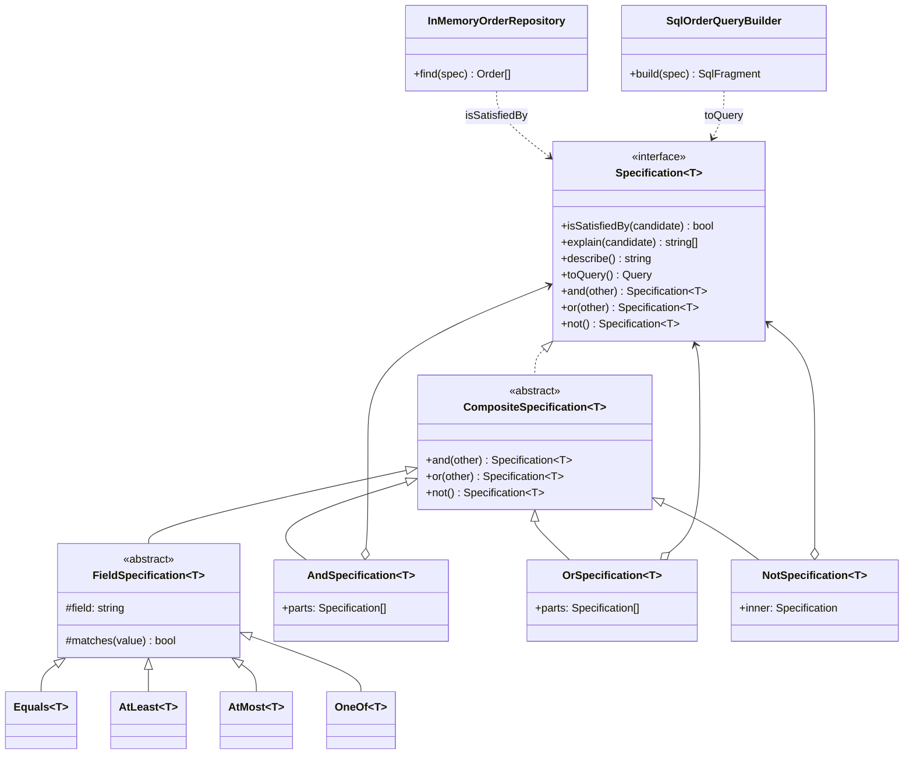

# Specification

**Category:** Modern · **Code:** [`specification.ts`](./specification.ts) · **Run:** `npm run demo -- specification` · `npx vitest run src/modern/specification`

## Intent

Put each business rule in a small object that answers `isSatisfiedBy(candidate)`, and build policies by combining those objects with `and`, `or` and `not`. Because each rule is a value, it can also be translated into a database query and asked to explain why a candidate failed.

## The problem it solves

A lending team asks for a "buy now, pay later" credit line: the customer must be KYC-verified, have no overdue invoices, live in India or Singapore, and have either a credit score of 700+ or an income of Rs 12 lakh on an account older than a year. The first version is an `if` chain inside `CreditService.isEligible()`. Then:

- the ops dashboard needs "every eligible customer", so someone writes the same rule again as SQL in the repository, and the two drift (the SQL forgets the KYC check);
- support asks *why* a customer was rejected, and the function only returns `false`;
- marketing wants a "VIP" segment that reuses the credit-score check, so it gets copy-pasted.

The smell: one rule written in several places (service, SQL, report), and no record of which rule failed.

## The solution

| Participant | In this example |
|---|---|
| Specification (interface) | `Specification<T>` with `isSatisfiedBy`, `explain`, `describe`, `toQuery` and the combinators |
| Composite base | `CompositeSpecification<T>`, which gives every rule `and/or/not` |
| Leaf specifications | `Equals`, `AtLeast`, `AtMost`, `OneOf` (via `FieldSpecification`), named in `CustomerRules` and `OrderRules` |
| Composite specifications | `AndSpecification`, `OrSpecification`, `NotSpecification` |
| Query model | The `Query` discriminated union, translated by `toSql`, `toMongo` and `evaluateQuery` |
| Consumers | `InMemoryOrderRepository.find(spec)` and `SqlOrderQueryBuilder.build(spec)`; `creditLineEligibility()` is a policy built from leaves |

`toQuery()` produces a small AST rather than SQL directly, so one rule has several backends: a parameterised SQL `WHERE` (`$1, $2`), a Mongo filter, and an in-memory evaluator that the tests use to prove the query means the same thing as `isSatisfiedBy`. `explain()` reports every failed leaf with its actual value, and an `OR` reports each branch.

The end of `specification.ts` shows the **functional form**: `Predicate<T> = (c) => boolean` with `allOf`, `anyOf`, `negate`. It is the idiomatic TypeScript when the rule only runs in memory, but a function cannot describe itself, explain a failure or become SQL, which is why the class form wins here.

## When to use it

- The same business rule must run in more than one place: validation, a database query, a report, a UI badge.
- Rules are combined in many ways (segments, eligibility, routing, feature targeting) and you keep copying conditions.
- Someone needs to know *which* rule failed (support, audit, a rejection email).
- Rules are assembled from configuration (an admin builds a segment from building blocks).

## When not to use it

- A single `if` used in one place. `order.status === 'paid'` does not need a class hierarchy.
- The filter is pure SQL with joins, window functions or full-text search: a query builder or a view expresses it better than a boolean tree.
- Your ORM's `where` object (Prisma, TypeORM) already composes and you never evaluate the rule in memory; adding an AST on top is a second query language to maintain.

## Real-world sightings

- Eric Evans and Martin Fowler described it in the *Specifications* paper, and it is a building block of Domain-Driven Design.
- **Ardalis.Specification** (.NET) is a widely used library of query specifications passed to repositories.
- **Prisma** `where` inputs compose with `AND`, `OR` and `NOT`; MongoDB filters with `$and`, `$or`, `$nor`; Elasticsearch `bool` queries with `must`, `should`, `must_not`. All are query objects in the same spirit.
- **CASL** authorization rules are checked in memory with `ability.can()` and translated into database queries by `accessibleBy` in `@casl/mongoose` and `@casl/prisma`: one rule, two backends, as here.
- Credit and fraud rules, customer segments, coupon eligibility, and shipping restrictions in e-commerce back offices.

## Related patterns

- **Composite**: `And/Or/Not` are composites of specifications; Specification is Composite applied to boolean rules.
- **Interpreter**: the `Query` AST and its translators are an interpreter with three back ends (SQL, Mongo, in memory).
- **Strategy**: a lone specification is a predicate strategy. Specification adds composition, self-description and query translation.
- **Repository**: repositories take specifications (`find(spec)`) so callers express *what* they want without the repository growing a `findByXAndY` method for every combination.
- **Query Object** (Fowler): an object that represents a database query. A specification that implements `toQuery()` is one, and it can also be evaluated in memory.

## Pitfalls

- **Semantic drift between memory and SQL.** Nulls, case-insensitive collations, time zones and decimal rounding behave differently in the database. Keep an equivalence test like `evaluateQuery(spec.toQuery(), x) === spec.isSatisfiedBy(x)`.
- **Leaves that cannot be translated.** A rule that only works in memory forces loading the whole table. Make `toQuery()` part of the interface so a missing translation fails at compile time.
- **Field names into SQL.** Values are bound parameters, but column names are interpolated. Only allow names from typed keys or a whitelist, never from request input.
- **Explanations for `OR` and `NOT`.** "Failed" is easy for a leaf; for an `OR` you must report every branch, and for a `NOT` you can only say what it must not be.
- **Over-engineering.** A specification framework for three fixed filters is ceremony. Introduce it when a rule appears in a second place.

## Interview Q&A

**Q: What does Specification give you over a plain boolean method on the entity?**
The rule becomes a value: it can be combined with other rules, reused across policies, passed to a repository, translated into a query, and asked why it failed. A method on the entity can only be called.

**Q: How do you keep the in-memory rule and the SQL in sync?**
Generate both from one place. Each leaf implements `isSatisfiedBy` and `toQuery` together, composites translate structurally, and a property-style test checks that the evaluated query and `isSatisfiedBy` agree on a set of fixtures.

**Q: How would you make `explain()` useful for an `OR`?**
An `OR` fails only when every branch fails, so report each branch's own failures: "needs one of: [credit score >= 700 (was 650)] or [account age >= 365 days (was 100)]". That tells the user the cheapest way to qualify.

**Q: Specification vs Repository methods like `findActivePremiumCustomersInIndia()`?**
Named finder methods multiply with every combination and duplicate conditions. Specifications let the repository expose one `find(spec)` and the domain compose the criteria; keep a few named finders only for queries that need joins or tuning.

**Q: Is SQL injection a concern?**
Not for values, which are bound as `$n` parameters. Column names are the risk: they come from typed keys in this design, and in a dynamic rule builder they must be checked against a whitelist.
