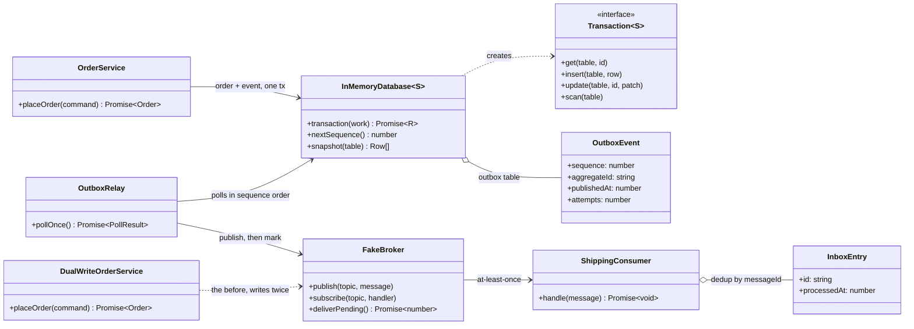
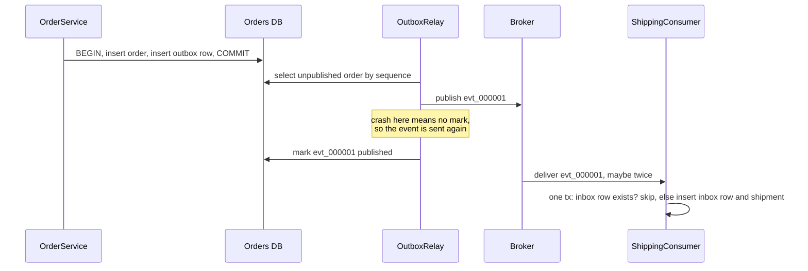

# Transactional Outbox

**Category:** Modern (messaging) · **Code:** [`transactional-outbox.ts`](./transactional-outbox.ts) · **Run:** `npm run demo -- transactional-outbox` · `npx vitest run src/modern/transactional-outbox`

## Intent

Make "change the database" and "announce the change" atomic without a distributed transaction: write the event into an *outbox* table in the same local transaction as the business data, and let a separate relay publish outbox rows to the message broker afterwards. Pair it with an *inbox* on the consumer so at-least-once delivery becomes effectively-once processing.

## The problem it solves

The order service must tell shipping about every new order. The first version does a **dual write**:

```ts
// before: DualWriteOrderService.placeOrder
const order = await db.transaction((tx) => tx.insert('orders', row)); // 1. commit
await broker.publish('orders', orderPlaced(order));                    // 2. publish
```

Every failure between or during the two writes leaves them disagreeing:

- the broker is down or times out after step 1: the order exists, shipping never hears about it, and nothing remembers that an event is owed;
- the process is killed (deploy, OOM) between 1 and 2: same result, silently;
- swap the order (publish first, then commit) and a failed commit sends shipping an event for an order that does not exist.

There is no shared transaction between Postgres and Kafka, and two-phase commit across them is rarely available and costly. The smell: two systems written in sequence and treated as if they were one.

## The solution

`OrderService.placeOrder` inserts the order **and** an `OutboxEvent` row in one transaction of `InMemoryDatabase` (a fake with all-or-nothing, serialized transactions). Either both rows exist or neither does. `OutboxRelay.pollOnce()` reads unpublished events in `sequence` order (paged through the `unpublishedEvents` async generator), publishes each to `FakeBroker`, then marks it `publishedAt`. If the broker refuses an event the poll stops there, so later events never overtake it. If the relay dies between publish and mark, the next poll publishes the event again: delivery is **at-least-once**. `ShippingConsumer` records each `messageId` in an `inbox` table in the same transaction as its side effect, so a duplicate finds its inbox row and is skipped.





| Participant | In this example |
|---|---|
| Business service (writer) | `OrderService`: one transaction, two inserts, no broker call |
| Transactional store | `InMemoryDatabase` with `StagedTransaction` (all-or-nothing, serialized, `UniqueViolationError`) |
| Outbox | the `outbox` table of `OutboxEvent` rows with `sequence`, `publishedAt`, `attempts`, `lastError` |
| Message relay (polling publisher) | `OutboxRelay` and the `unpublishedEvents` async generator |
| Broker | `FakeBroker`: publishing and delivery are decoupled; `available` simulates an outage |
| Idempotent consumer with inbox | `ShippingConsumer` with the `inbox` table in its own database |
| The anti-pattern | `DualWriteOrderService` |

## When to use it

- A service owns a database and must publish events about its changes (order placed, payment captured, user deleted) to Kafka, RabbitMQ, SQS or webhooks.
- Losing an event is a business bug (an order never shipped) and sending an event for a rolled-back change is too.
- You are moving off a monolith and need other services to follow changes reliably.

## When not to use it

- The event is best-effort telemetry (analytics, cache warm-ups) where an occasional loss is fine.
- The broker *is* your source of truth (event sourcing with the log as the database), so there is only one write.
- The database and the queue share a transaction already (a job table in the same Postgres the job runner reads, such as pg-boss or graphile-worker).
- You need the consumer to see the effect synchronously: an outbox adds latency (poll interval or CDC lag).

## Real-world sightings

- **microservices.io** (Chris Richardson) catalogues *Transactional outbox*, with *Polling publisher* and *Transaction log tailing* as the two relay styles.
- **Debezium**'s outbox event router reads the outbox table from the database's change log (CDC) and routes rows to Kafka topics, replacing the polling relay.
- **NServiceBus** and **MassTransit** ship outbox features; NServiceBus's also deduplicates incoming messages, the inbox half.
- **Eventuate Tram** implements outbox-based messaging for Java services.
- Relays polling Postgres often use `SELECT ... FOR UPDATE SKIP LOCKED` so several relay instances can share the work without double-claiming rows.

## Related patterns

- **Unit of Work**: groups changes into one commit; the outbox is "put the event inside that unit of work".
- **Idempotent consumer / inbox**: the other half. The outbox guarantees at-least-once; only consumer dedup turns that into effectively-once.
- **Saga**: a saga's steps communicate through events; each step publishes reliably via an outbox.
- **Event sourcing**: the event log *is* the state, so there is no dual write to fix; the outbox keeps a state-based model and adds an event log beside it.
- **Retry**: the relay is a durable retry. Unlike an in-process retry loop it survives the process dying.

## Pitfalls

- Expecting exactly-once delivery. The relay can always crash after publish and before mark; consumers **must** be idempotent.
- Deduplicating on something unstable (a new UUID per publish) instead of the outbox event id.
- Ordering: sequences can commit out of order under concurrent transactions on a real database (sequence 8 commits before 7, the relay skips 7 for a moment). Order only per aggregate key, use log tailing, or let the relay wait for gaps to settle.
- Skipping a failed event to "keep the queue moving" breaks per-key ordering; this relay stops instead. Move poison events to a dead-letter table deliberately.
- An outbox table that grows forever: delete or archive published rows on a schedule, and index `(published_at, sequence)`.
- Doing the inbox check and the side effect in separate transactions, which reopens the duplicate window on the consumer side.
- Several relay instances without row claiming (`SKIP LOCKED` or a leader), multiplying duplicates.

## Interview Q&A

**Q: What is the dual-write problem?**
Updating a database and publishing to a broker as two separate operations. Any failure between them leaves them inconsistent: a committed change with no event, or an event for a change that rolled back. There is no shared transaction to make both happen or neither.

**Q: How does the outbox fix it?**
The event becomes a row written in the same local transaction as the business data, so atomicity comes from the database. Publishing moves to a relay that retries until the broker accepts it and only then marks the row sent.

**Q: Is delivery exactly-once?**
No, at-least-once. If the relay publishes and crashes before marking, it publishes again. Consumers dedupe with an inbox (processed message ids stored in the same transaction as the effect), which gives effectively-once processing.

**Q: Polling relay or CDC?**
Polling is simple, works on any database and is easy to reason about, at the cost of poll latency and query load. CDC (Debezium reading the WAL or binlog) has lower latency and no polling queries, but adds Kafka Connect and Debezium to operate.

**Q: How do you keep events in order?**
Publish in sequence order, stop at the first failure rather than skipping, use the aggregate id as the partition key so the broker keeps per-order ordering, and run one active relay per partition of the outbox (or claim rows with `SKIP LOCKED` and order only per key).
