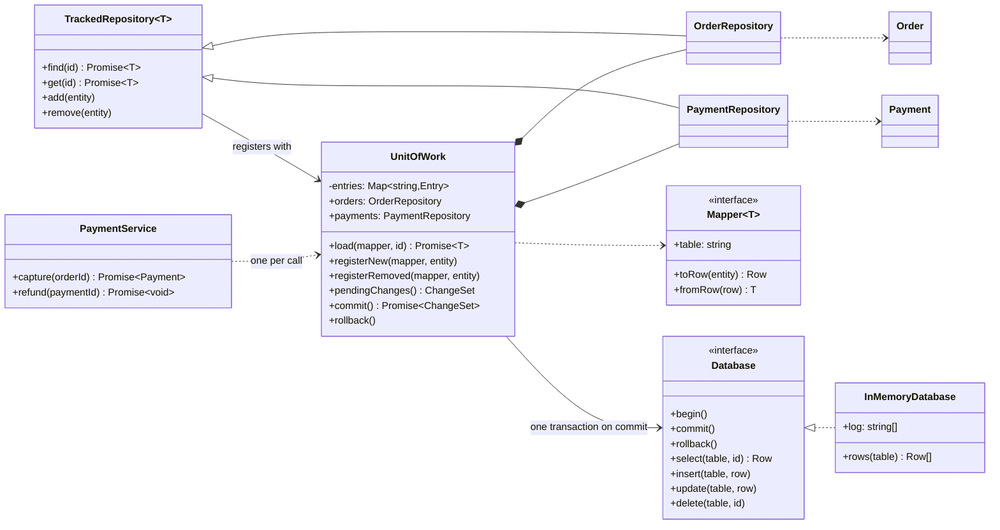
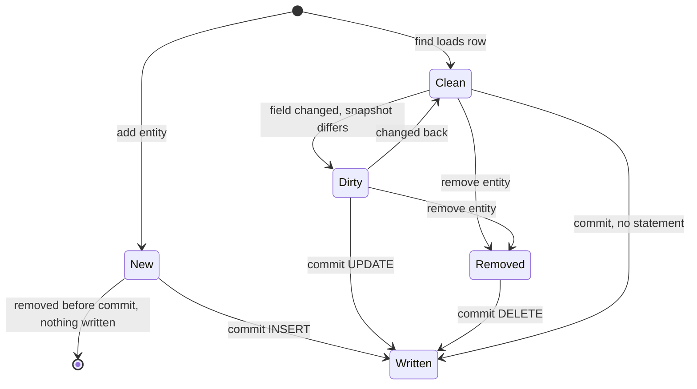

# Unit of Work

**Category:** Modern · **Code:** [`unit-of-work.ts`](./unit-of-work.ts) · **Run:** `npm run demo -- unit-of-work` · `npx vitest run src/modern/unit-of-work`

## Intent

Keep track of every object a business transaction reads, creates, changes or deletes, and write all of those changes to the database together at the end, in one transaction and in a safe order.

## The problem it solves

Capturing a payment means marking the order paid **and** inserting a payment row. Refunding means marking the payment refunded **and** cancelling the order. If each repository saves immediately (`await orders.save(order); await payments.save(payment);`), a crash or constraint error between the two leaves an order marked paid with no payment. Wrapping calls in `BEGIN/COMMIT` by hand spreads transaction handling through every service, passes connections through every function signature, and still writes an object twice when two code paths both call `save()`. Loading the same order twice in one request gives two copies, and the last save silently wins.

## The solution

Each tracked object moves through these states inside one unit:

| Participant | In this example |
|---|---|
| Unit of Work | `UnitOfWork`: identity map, change tracker and commit, in one `entries` map |
| Repositories scoped to the unit | `OrderRepository`, `PaymentRepository` (via `TrackedRepository<T>`): reads go through the identity map, writes only register intent |
| Data mappers | `orderMapper`, `paymentMapper`: rows to objects and back, and the snapshot used for dirty checking |
| Transactional resource | `Database` port with `begin/commit/rollback`; `InMemoryDatabase` is the fake with failure injection |
| Domain objects | `Order`, `Payment` (no persistence code) |
| Client | `PaymentService`, which opens one unit per business operation through `withUnitOfWork` |

Two design choices worth defending in an interview. **Dirty checking by snapshot**: the unit stores each row as loaded and compares at commit, so callers cannot forget a `registerDirty()` call (Fowler's original version has callers register dirty objects explicitly; ORMs such as Hibernate and MikroORM do snapshot comparison). **Ordering**: inserts and updates run parent table first (`orders` before `payments`) and deletes run in reverse, so foreign keys hold at every statement.

`withUnitOfWork(db, async (uow) => ...)` is the **TypeScript-idiomatic form**: a scope function where returning commits and throwing discards. Services never see `begin` or `commit`.

## When to use it

- One business operation changes several aggregates or tables that must stay consistent (order and payment, ledger entries, inventory and reservations).
- Several code paths may touch the same object during a request and you want each change written once.
- You want services free of transaction plumbing and connection passing.
- You need an identity map so that one id is one object for the whole operation.

## When not to use it

- Single-row writes (`UPDATE users SET last_login = now()`): a direct statement is clearer.
- Your ORM already is one (TypeORM's `EntityManager.transaction`, MikroORM's `EntityManager`, Prisma interactive transactions). Use it rather than wrapping it in another layer.
- Changes span services or databases. A local transaction cannot cover them; use an outbox, sagas or idempotent retries instead.
- Long-running workflows where holding tracked state for minutes or hours is a liability.

## Real-world sightings

- MikroORM implements Unit of Work and Identity Map explicitly: `em.persist()` registers, `em.flush()` computes the change set and writes it in a transaction.
- TypeORM's `dataSource.transaction(async (manager) => ...)` and Prisma's `prisma.$transaction(async (tx) => ...)` are the scope-function form used by `withUnitOfWork`.
- Hibernate's `Session` and Entity Framework's `DbContext.SaveChanges()` in Java and .NET, where snapshot-based dirty checking is the default.
- Backend services that write domain changes and an outbox event in one transaction, so the event is published if and only if the change commits.

## Related patterns

- **Repository**: gives per-aggregate access; Unit of Work coordinates several repositories so their changes commit together. Here the repositories are created by, and scoped to, the unit.
- **Identity Map**: one object per id within a session. The unit's `entries` map is the identity map.
- **Transaction Script**: opens a transaction and runs statements in order inside it. Simple, but the statements and their order are hand-written in each script.
- **Command**: each tracked change could be modelled as a command; the unit's change set is a batch of them executed at commit.
- **Saga**: what to use when the "transaction" spans services and cannot be one database transaction.

## Pitfalls

- Sharing one unit across requests or keeping it as a singleton: its identity map grows and serves stale objects. Create one per request or job.
- Loading happens outside the commit transaction, so another request can change a row in between. Add a version column and check it in `UPDATE ... WHERE version = $n` (optimistic locking) when lost updates matter.
- After a failed commit the in-memory objects still hold the new values. Discard them with the unit; do not retry with the same objects.
- Doing side effects (sending email, calling a payment gateway) inside the unit and assuming rollback undoes them. Only database writes are rolled back; use an outbox for the rest.
- Large units: tracking ten thousand rows makes dirty checking and memory expensive. Batch work into several units.

## Interview Q&A

**Q: What does a Unit of Work track, and when does it write?**
New, dirty and removed objects from the moment they are loaded or added. It writes nothing until `commit()`, then issues every insert, update and delete in one transaction and rolls back if any of them fails.

**Q: How does it know an object is dirty?**
Either callers register it explicitly (`registerDirty`), or the unit keeps a snapshot of each loaded row and compares at commit. Snapshot comparison is what most ORMs do because it cannot be forgotten.

**Q: Unit of Work vs a plain database transaction?**
A transaction guarantees atomicity of the statements you send. A Unit of Work decides which statements to send: it collects changes, removes duplicates and no-ops, orders them for foreign keys, and only then opens a short transaction.

**Q: How does it relate to the Repository pattern?**
Repositories give the domain collection-like access; the unit sits behind them. Repositories register intent with the unit, and one `commit()` persists what every repository in the operation changed.

**Q: How do you handle a change that also has to publish an event?**
Write the event to an outbox table inside the same unit, so it commits atomically with the change, and let a separate relay publish it. Publishing directly from inside the unit can send events for changes that were rolled back.
