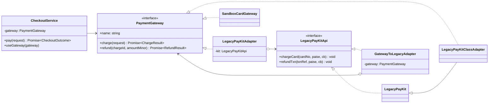
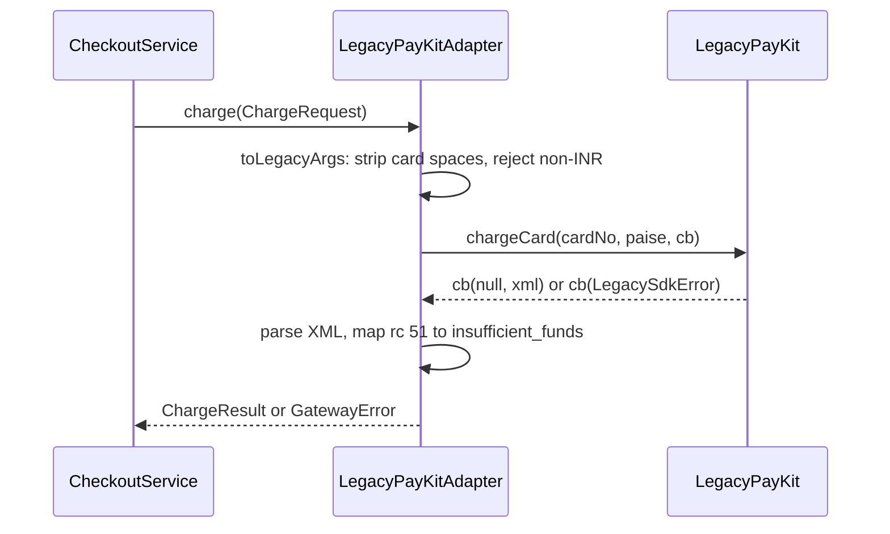

# Adapter

**Category:** Structural · **Code:** [`adapter.ts`](./adapter.ts) · **Run:** `npm run demo -- adapter` · `npx vitest run src/structural/adapter`

## Intent

Make an existing class usable through an interface it was not written for. The adapter translates calls, arguments, results and errors in both directions so neither side has to change.

## The problem it solves

The application talks to payment providers through a promise-based `PaymentGateway` with typed results. The bank's old SDK, which we cannot modify, exposes `chargeCard(cardNo, paise, cb)`, calls back with a Node-style `(err, xml)` pair, returns response codes such as `51` inside an XML-ish string, and throws its own `LegacySdkError` codes.

Without an adapter every caller does the translation itself: checkout wraps the callback in a `Promise`, refunds parse the XML with their own regex, and the retry job compares `err.sdkCode === 'E_NET'`. The SDK's vocabulary leaks into every module, the three copies drift, and replacing the bank means touching all of them.

## The solution

One class translates PayKit to `PaymentGateway`. Everything downstream depends on the target interface only.

| Participant | In this example |
|---|---|
| Target | `PaymentGateway`: promise-based, typed `ChargeResult`, only `GatewayError` escapes |
| Adaptee | `LegacyPayKit` (`LegacyPayKitApi`): callbacks, positional args, XML replies, `LegacySdkError` |
| Object adapter | `LegacyPayKitAdapter`, which holds a PayKit and delegates |
| Class adapter | `LegacyPayKitClassAdapter`, which *extends* `LegacyPayKit` and implements the target |
| Client | `CheckoutService`, which never imports anything PayKit-specific |
| Reverse adapter | `GatewayToLegacyAdapter`: a `PaymentGateway` presented as `LegacyPayKitApi` |

One charge through the adapter:

The adapter does four kinds of translation, each a small exported function so it can be tested alone: **parameters** (`toLegacyArgs`), **results** (`toChargeResult`), **errors** (`translateSdkError`) and **protocol** (callback to `Promise` in `callLegacy`, which also hides the fact that the SDK sometimes calls back synchronously).

`adaptPayKit(kit)` is the **idiomatic TypeScript form**: a function that closes over the adaptee and returns an object literal satisfying `PaymentGateway`. No class, same contract. For a plain callback API with no result mapping, `util.promisify` is often all the adapter you need.

**Two-way adapters.** During a migration the old modules still call `chargeCard(cb)` while new code calls `charge()`. `GatewayToLegacyAdapter` covers the reverse direction: legacy callers keep their interface while the money moves through a modern gateway. A true *two-way adapter* is a single class implementing both `PaymentGateway` and `LegacyPayKitApi`, so the same object can be handed to old and new code. Keep the two directions in separate classes unless one object really must be shared: the mappings are not always symmetric (here `unknown` maps to code `96`, but codes `96`, `99` and anything else all map back to `unknown`).

## When to use it

- A third-party SDK, legacy module or generated client does the right thing behind the wrong interface.
- You want one seam where a vendor's vocabulary (codes, XML, callback errors) is translated to your domain: the anti-corruption layer of DDD.
- You need several providers behind one interface (one adapter per payment processor, SMS provider or storage backend).
- Migrating gradually: adapt the old system to the new interface, or the new to the old, and switch callers one by one.

## When not to use it

- You own both sides. Change one of the interfaces instead of adding a translation layer.
- The interfaces differ only in name (`chargeCard` vs `charge` with identical semantics). A rename or a re-export is enough.
- You want a *simpler* interface over a whole subsystem rather than a *different* interface over one class: that is **Facade**.
- The "adapter" starts to add caching, retries and logging. Those are **Decorators**; keep translation and cross-cutting behaviour in separate wrappers.

## Real-world sightings

- `util.promisify` in Node adapts any `(err, value)` callback function to a promise-returning one; `util.callbackify` adapts the other way.
- `stream.Readable.toWeb()` / `Readable.fromWeb()` adapt Node streams to WHATWG web streams and back.
- Database query builders such as Knex keep one dialect client per database driver (pg, mysql2, sqlite3) behind a single query interface.
- Serverless HTTP adapters (for example `@vendia/serverless-express`) translate an AWS Lambda event into the request/response objects an Express app expects.
- Payment orchestration platforms keep one connector per processor that maps the processor's API and decline codes to a common model.

## Related patterns

- **Facade**: defines a new, simpler interface over many classes. Adapter makes one existing interface match another existing one.
- **Decorator**: keeps the *same* interface and adds behaviour. Adapter changes the interface and adds no behaviour.
- **Proxy**: same interface as the subject, controls access (lazy loading, auth, remoting). Adapter's whole point is a different interface.
- **Bridge**: designed up front so abstraction and implementation vary independently. Adapter is retrofitted to make existing pieces fit.
- **Strategy**: each adapter is often registered as a strategy (`PaymentGateway` per provider); Adapter explains how a foreign API became one.

## Pitfalls

- **Leaky translation.** Letting `LegacySdkError` or raw response codes escape means callers learn the SDK anyway. Translate every error at the boundary; the test asserts nothing PayKit-specific gets out.
- **Silent unit mismatches.** Paise vs. rupees, cents vs. dollars, seconds vs. milliseconds. Reject what the adaptee cannot represent (the adapter refuses USD) instead of passing a number through.
- **Lossy mapping.** Collapsing every decline into `failed` throws away `retryable`. Map the codes the business acts on and keep an explicit `unknown`.
- **Sync/async mixing ("Zalgo").** An SDK that sometimes calls back synchronously breaks callers that assume async. Wrapping in a `Promise` makes timing consistent.
- **Class adapter leaks.** `LegacyPayKitClassAdapter` still exposes `chargeCard` and couples you to one concrete class. Prefer the object adapter, which also works with any `LegacyPayKitApi`, including test doubles.

## Interview Q&A

**Q: Object adapter or class adapter?**
Object adapter by default: it composes, so it works with any implementation of the adaptee (including mocks), hides the adaptee's API, and does not need multiple inheritance. A class adapter can override adaptee behaviour directly, but it binds you to one concrete class and exposes both interfaces.

**Q: Adapter vs Facade?**
Adapter converts one interface into another that a client already expects. Facade invents a new, simpler interface over a subsystem. An adapter is driven by the target interface; a facade is driven by simplifying usage.

**Q: Where should error translation live?**
In the adapter, at the boundary. Callers should only see domain errors (`GatewayError` with `retryable`), so retry policies and alerts do not need to know the vendor's codes, and swapping the vendor does not ripple.

**Q: How does Adapter help you avoid vendor lock-in?**
The domain depends on `PaymentGateway`, never the SDK. Replacing the bank means writing one new adapter and changing one line of wiring; the tests show `CheckoutService` running unchanged on a different gateway.

**Q: Adapter, Decorator, Proxy: same wrapper shape, what differs?**
Adapter changes the interface. Decorator keeps it and adds behaviour. Proxy keeps it and controls access to the real object.
