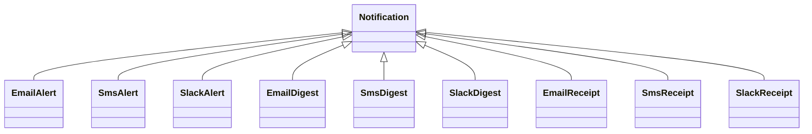
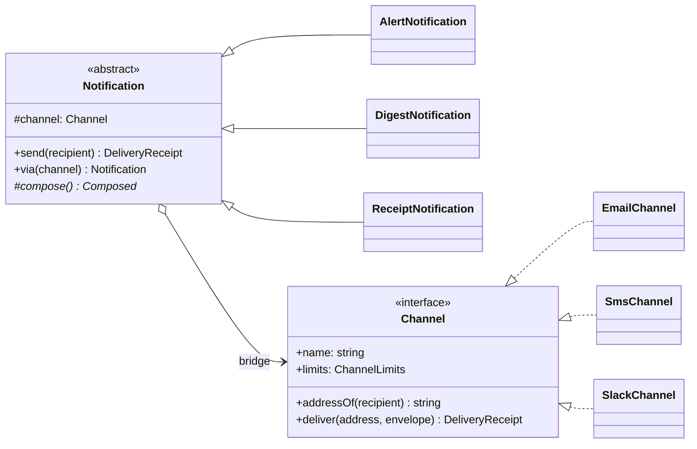

# Bridge

**Category:** Structural · **Code:** [`bridge.ts`](./bridge.ts) · **Run:** `npm run demo -- bridge` · `npx vitest run src/structural/bridge`

## Intent

Separate an abstraction from its implementation so the two can vary independently. The abstraction holds a reference to an implementor interface (the "bridge") instead of inheriting from a concrete implementation.

## The problem it solves

A notification service sends three kinds of message (incident alerts, weekly digests, payment receipts) over three channels (email, SMS, Slack). The first version models each combination as a subclass:

That is N x M = 9 classes. Adding WhatsApp means three more; adding a "password reset" kind means another three. The SMS truncation rule is copied into every `Sms*` class, the alert wording into every `*Alert` class, and a fix to one copy misses the others. Two independent reasons to change (what we say, how we deliver it) are welded into one hierarchy.

## The solution

Split the hierarchy in two and connect them with composition: N + M = 6 classes, and each new kind or channel is one class.

| Participant | In this example |
|---|---|
| Abstraction | `Notification`: owns `send()`, which fits the composed text to the channel's limits |
| Refined abstractions | `AlertNotification`, `DigestNotification`, `ReceiptNotification`: decide *what* to say |
| Implementor | `Channel`: low-level primitives `addressOf()` and `deliver()`, plus `limits` |
| Concrete implementors | `EmailChannel`, `SmsChannel`, `SlackChannel`, and the functional `createWebhookChannel()` |
| Client | The demo / `sendWithFallback`, which pairs a notification with a channel at runtime |

Two details make this a Bridge rather than "an interface with some classes":

- **The implementor interface is primitive, not a mirror of the abstraction.** `Channel` has no `sendAlert()`; it resolves an address and delivers an envelope. That is why one channel serves every notification kind.
- **Refined abstractions adapt to the implementor through its interface.** `DigestNotification` drops per-topic lines when `limits.maxBodyChars < 500`, and `Notification.send()` inlines the subject when `supportsSubject` is false. Neither checks *which* channel it is talking to, so a new push channel with a 240-character limit just works.

The pairing is chosen at runtime: `via(channel)` swaps the implementor, and `sendWithFallback()` tries Slack, then email, then SMS for a user who lacks some addresses. `createWebhookChannel()` shows the **idiomatic TypeScript** implementor: a factory returning an object literal, no class required.

## When to use it

- Two dimensions vary independently and you can feel the N x M explosion coming (message kind x channel, report x export format, shape of query x database dialect).
- You want to choose or switch the implementation at runtime (user preferences, fallback, per-tenant provider).
- Implementations are platform- or vendor-specific and the high-level logic should not be recompiled or retested when one changes.
- Different teams own the two sides (product owns notification copy, platform owns delivery).

## When not to use it

- Only one dimension really varies. With one channel, `AlertNotification` can just send email; an implementor interface with one class is ceremony.
- The "two dimensions" are not independent: if every receipt must go by email and every alert by Slack, there is no matrix to tame.
- You are retrofitting two existing interfaces to fit together. That is **Adapter**.
- The implementor interface would need a method per abstraction (`sendAlert`, `sendDigest`). Then the split is in the wrong place; find the primitive operations first.

## Real-world sightings

- winston: a `Logger` (levels, formats, child loggers) delegates to independently pluggable transports (`Console`, `File`, `Http`).
- Nodemailer: the `Mail` object composes the message, and the transport (`SMTP`, `SES`, `sendmail`, `stream`) is passed to `createTransport()`.
- Knex and similar query builders: the query-building API is one hierarchy, the dialect clients that compile and execute SQL are another.
- JDBC / ODBC drivers: application code is written against the driver API while each database ships its own implementation.
- Notification platforms that model "workflows" (what to send) separately from "providers" (SendGrid, Twilio, Slack) are this pattern at the service level.

## Related patterns

- **Adapter**: applied after the fact to make an existing class fit an interface. Bridge is designed up front to keep two hierarchies apart. A concrete implementor is often *implemented* as an adapter over a vendor SDK.
- **Strategy**: structurally similar (an object holding an interface). Strategy swaps one algorithm inside a context; Bridge splits a whole abstraction hierarchy from an implementation hierarchy, and both sides are expected to grow.
- **Abstract Factory**: can create and configure a matching implementor (for example per tenant) for the abstraction to use.
- **Decorator**: wraps a channel to add retries or logging without changing the bridge: `new AlertNotification(new LoggingChannel(new SmsChannel()), ...)`.

## Pitfalls

- **Leaky implementor interface.** Adding `sendAlert()` to `Channel` because "alerts are special" turns the bridge back into a matrix. Push the difference into the envelope (`priority`) instead.
- **Lowest common denominator.** A primitive interface can hide channel strengths (Slack blocks, email HTML). Expose capabilities (`limits`) and let abstractions opt in, rather than adding channel-specific methods.
- **Premature bridging.** Splitting one class into two hierarchies costs indirection. Wait until the second dimension actually appears.
- **Hidden coupling through `instanceof`.** If a refined abstraction checks `channel instanceof SmsChannel`, adding a channel means editing abstractions again. Ask the interface (`limits`), as `DigestNotification` does.
- **Shared mutable implementors.** A channel instance shared by many notifications must be safe to share (no per-message state).

## Interview Q&A

**Q: What problem does Bridge solve, in one line?**
It replaces an N x M inheritance matrix with N + M classes by composing an abstraction hierarchy with an implementation hierarchy.

**Q: Bridge vs Adapter?**
Same shape (one object delegating to another interface), different timing and intent. Bridge is designed in advance so both sides can evolve; Adapter is retrofitted to make an existing, incompatible interface fit.

**Q: Bridge vs Strategy?**
Strategy varies one algorithm of a context. Bridge separates two whole hierarchies; the abstraction side has its own subclasses (`Alert`, `Digest`, `Receipt`) that all use the same implementor interface.

**Q: How do you design the implementor interface?**
Make it the smallest set of primitives every abstraction can be built from (`addressOf`, `deliver`, capability flags), not one method per abstraction. If adding an abstraction forces a new implementor method, the boundary is wrong.

**Q: How would you add WhatsApp?**
Write `WhatsAppChannel implements Channel` with its address lookup, limits and delivery. No notification class changes; all three kinds can use it immediately, which the "adding a channel" test demonstrates.
