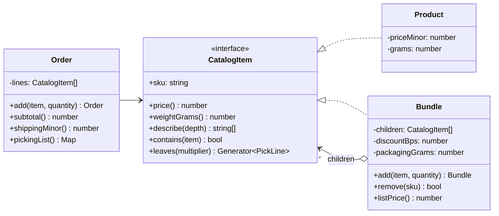

# Composite

**Category:** Structural · **Code:** [`composite.ts`](./composite.ts) · **Run:** `npm run demo -- composite` · `npx vitest run src/structural/composite`

## Intent

Arrange objects in a tree and give single objects and groups of objects the same interface, so client code can work with either without asking which one it has.

## The problem it solves

An online store sells products and kits: a "Home office kit" contains a laptop stand, a webcam and a "Cable pack", which is itself a kit of two USB-C cables and an HDMI cable. Kits carry their own discount and their own box.

Without Composite, every consumer of an order walks the tree by hand: the cart total does `if (line.type === 'bundle') { for (const child of line.children) { if (child.type === 'bundle') ... } }`, the shipping calculator repeats the same recursion for weight, and the warehouse picking list does it a third time. Each copy handles nesting to a different depth, kit discounts are applied in one place and forgotten in another, and adding a "subscription box" type means editing all three.

## The solution

`Product` and `Bundle` implement one `CatalogItem` interface. A bundle's `price()` is the sum of its children's `price()` minus its discount; it does not care whether a child is a product or another bundle. Recursion lives in the composite, once.



| Participant | In this example |
|---|---|
| Component | `CatalogItem`: `price()`, `weightGrams()`, `describe()`, `contains()`, `leaves()` |
| Leaf | `Product`: answers from its own fields |
| Composite | `Bundle`: stores children with quantities, delegates and aggregates (discount, packaging) |
| Client | `Order`: subtotal, shipping, picking list and invoice lines, with no `instanceof` anywhere |

Three details worth pointing at in the code:

- **Child management lives on `Bundle`, not on `CatalogItem`.** GoF discusses putting `add()` on the component for "transparency"; here it is on the composite for *safety*, so `product.add()` does not compile.
- **Cycle prevention.** `Bundle.add()` refuses an item that already contains the bundle (`item.contains(this)`), which would otherwise make `price()` recurse forever. Sharing one product between two kits is allowed: the structure is a DAG, not necessarily a tree.
- **Generators for traversal.** `leaves()` is a recursive generator (`yield*`), the idiomatic TypeScript way to flatten a tree lazily; the picking list multiplies quantities down the path and aggregates by SKU.

The second half of `composite.ts` shows the **discriminated-union form**: the same tree as plain JSON-friendly data (`{ kind: 'product' } | { kind: 'bundle', children }`) with recursive `priceOf()` and `weightOf()` functions. That is natural when a catalog service ships the tree as JSON; the class form is better when nodes carry behaviour and invariants. A test asserts both forms price the same kit identically.

### Variant: a permission tree

The same shape models role-based access, where a role can include permissions and other roles:

```ts
interface Grant { allows(action: string): boolean }
class Permission implements Grant {
  constructor(private readonly pattern: string) {}            // 'invoices:read', 'invoices:*'
  allows(action: string) {
    return this.pattern.endsWith(':*') ? action.startsWith(this.pattern.slice(0, -1)) : action === this.pattern;
  }
}
class Role implements Grant {
  constructor(readonly name: string, private readonly grants: Grant[] = []) {}
  allows(action: string) { return this.grants.some((g) => g.allows(action)); }
}
const accountant = new Role('accountant', [new Permission('invoices:*'), new Role('viewer', [new Permission('reports:read')])]);
accountant.allows('reports:read'); // true, via the nested role
```

Pricing rules compose the same way: a `RuleGroup` that applies "best of" or "all of" its child rules is itself a rule.

## When to use it

- The domain is naturally part-whole and nests to arbitrary depth: kits and bundles, org charts, folders, menu trees, roles that include roles, rule groups.
- Clients should not distinguish a single item from a group (an order total, an access check, a render call).
- Several operations need to recurse over the same structure and you want each recursion written once, inside the node type.

## When not to use it

- The structure is flat or has a fixed depth (an order with line items and nothing nested). A plain array is clearer.
- Leaves and composites genuinely need different operations; forcing a shared interface leads to methods that throw "not supported" on half the nodes.
- You keep adding *operations* rather than *node types*. Then a Visitor, or functions over a discriminated union, keeps each operation in one place.
- The data lives in a relational table with `parent_id`, and a recursive SQL query (`WITH RECURSIVE`) can answer the question without materialising the tree in memory.

## Real-world sightings

- The DOM: `Element` and `Text` are both `Node`s, and `Element` holds `childNodes`; `textContent` aggregates over the subtree.
- Express: a `Router` is itself middleware, so `app.use('/api', router)` mounts a tree of routers and handlers that are invoked through one `(req, res, next)` interface.
- React component trees: a component renders elements or other components, and the renderer treats them uniformly.
- The TypeScript compiler AST: every `ts.Node` can be walked with `forEachChild`, whether it is a leaf identifier or a whole source file.
- AWS CDK: every construct, from a single bucket to a whole stack or app, is a `Construct` with `node.children`.
- Test runners such as vitest and jest: a `describe` block contains tests and other `describe` blocks, and the runner reports on suites and tests the same way.

## Related patterns

- **Decorator**: also recursive composition, but a decorator has exactly one child and adds behaviour; a composite has many children and aggregates them.
- **Iterator**: traverses a composite without exposing its structure (`leaves()` is a generator-based iterator).
- **Visitor**: adds operations over a composite tree without adding methods to every node type.
- **Chain of Responsibility**: often runs along a composite's parent links (an event bubbling up the DOM).
- **Flyweight**: shares leaf objects across many composites (the same `Product` instance in many kits).

## Pitfalls

- **Cycles.** A bundle that contains itself, directly or indirectly, makes every recursive method overflow the stack. Check on `add()`, as here, or validate trees loaded from a database.
- **Transparency vs safety.** Putting `add()`/`remove()` on the component makes all nodes look alike but lets callers try to add children to a leaf. Decide deliberately; this repo chooses safety.
- **Repeated recomputation.** Deep trees recompute totals on every call. Cache in the composite and invalidate on `add()`/`remove()` if profiling shows it matters; do not cache prematurely.
- **Rounding at each level.** Discounts applied per level round per level. That is a business decision (here: round each kit's discount), so make it explicit and test it rather than summing floats.
- **Over-general components.** If `CatalogItem` grows methods only bundles implement meaningfully, the uniform interface is leaking. Keep the component interface to what clients actually treat uniformly.

## Interview Q&A

**Q: What is the core promise of Composite?**
Clients treat a single object and a group of objects through the same interface. `Order.subtotal()` calls `item.price()` and never asks whether the item is a product or a kit.

**Q: Where do `add()` and `remove()` belong, component or composite?**
On the component gives transparency (uniform type) but allows nonsense like adding to a leaf. On the composite gives type safety but clients must know they hold a composite to build the tree. Most TypeScript code prefers safety: building the tree is a different concern from using it.

**Q: How do you prevent cycles?**
Before adding child `c` to node `n`, check that `c` does not already contain `n` (including `c === n`). The check is a subtree walk; for very large trees keep parent pointers or a depth bound.

**Q: Composite vs Decorator?**
Both are recursive structures over one interface. Decorator wraps exactly one component to add behaviour; Composite holds many children and combines their results.

**Q: When would you model the tree as a discriminated union instead of classes?**
When the tree is data that crosses a boundary (JSON from a catalog API, rows from a DB) and you mainly need a few pure functions over it. The compiler then checks every `switch` covers every node kind. Classes win when nodes enforce invariants or carry varied behaviour.
