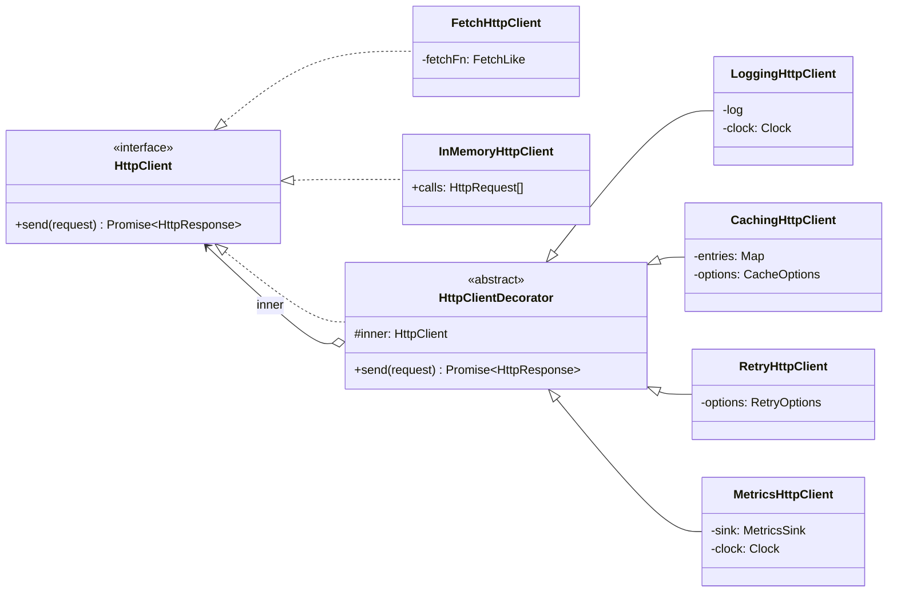
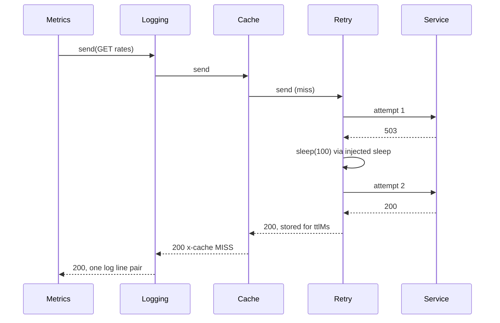

# Decorator

**Category:** Structural · **Code:** [`decorator.ts`](./decorator.ts) · **Run:** `npm run demo -- decorator` · `npx vitest run src/structural/decorator`

## Intent

Add behaviour to an individual object at runtime by wrapping it in another object that has the same interface. Wrappers delegate to the object they wrap, so they can be stacked in any order and combined per instance.

## The problem it solves

Every service calls other services over HTTP, and every call needs some mix of logging, caching, retries and metrics. The first attempt subclasses: `LoggingHttpClient extends FetchHttpClient`, then `CachingLoggingHttpClient extends LoggingHttpClient`, then someone needs retries without caching for the payments API and caching without logging for the FX-rate lookup.

With four optional concerns that is up to 2^4 = 16 subclasses, before you even consider *order* (does the cache sit inside or outside the retry?). The alternative, one `HttpClient` with `if (options.cache)`, `if (options.retry)` flags, becomes a 300-line `send()` that every team edits and no one can test one concern of in isolation.

## The solution

Each concern is one class that implements `HttpClient` and holds another `HttpClient`. The caller builds the stack it needs: `decorate(base, metrics, logging, cache, retry)`.

| Participant | In this example |
|---|---|
| Component | `HttpClient` with one method, `send()` |
| Concrete components | `FetchHttpClient` (wraps `fetch`), `InMemoryHttpClient` (tests and demo) |
| Decorator (base) | `HttpClientDecorator`: holds `inner` and forwards by default |
| Concrete decorators | `LoggingHttpClient`, `CachingHttpClient` (TTL, injected clock), `RetryHttpClient` (backoff, injected sleep), `MetricsHttpClient` |
| Client | Whoever calls `send()`; it cannot tell a bare client from a stack of five |

The demo's stack, `Metrics -> Logging -> Cache -> Retry -> service`, on a cache miss where the service fails once:

**Order is part of the design**, and the tests pin it down:

- Logging *outside* Retry logs one request; *inside* Retry it logs every attempt. Both are useful (one is the caller's view, the other the wire's view).
- Metrics *outside* the cache count every call including hits; *inside* they count only real network calls.
- Cache *outside* Retry means a hit skips the retry loop entirely; Retry outside Cache would retry cache misses only, which is the same here but differs once the cache can fail.

All time is injected (`clock`, `sleep`), so the library code never calls `setTimeout` and tests run instantly and deterministically.

The second half of `decorator.ts` shows the **functional form**: a client is a `Send = (req) => Promise<res>` function and a decorator is a `Middleware = (next: Send) => Send`. `pipe(send, withLogging(log), withHeader('authorization', token))` composes them; `fromClient` and `toClient` convert between the two forms. This is how most JavaScript middleware is written.

### Why not TypeScript's `@decorator` syntax?

TypeScript 5 supports standard ECMAScript decorators (`@logged method() {}`), and the older `experimentalDecorators` flavour is still used by NestJS, TypeORM and Angular. Both are applied **when the class is defined**: every instance of the class gets the behaviour, the order is fixed in source, and you need a class member to attach to. The GoF Decorator is applied **to an instance at runtime**: tests use a bare client, production adds metrics and retries, and the payments client skips the cache. That is why this example wraps objects. Syntax decorators fit behaviour that is truly always-on for a class, such as a `@traced` method or a framework's routing metadata.

## When to use it

- Cross-cutting concerns around one interface: logging, caching, retries, metrics, auth headers, rate limiting, circuit breaking, encryption, compression.
- Combinations vary per instance or per environment, and subclassing every combination would explode.
- You want each concern tested in isolation against a fake inner component.
- You cannot or should not modify the wrapped class (third-party SDK, generated client).

## When not to use it

- The behaviour is always needed and has one obvious place: put it in the class.
- The interface is wide (20 methods). Each decorator must forward all of them; a JS `Proxy` or a narrower interface may be better.
- Callers depend on the concrete type (`instanceof FetchHttpClient`, extra methods): a wrapper hides them.
- You need to change the *interface*, not add behaviour: that is **Adapter**.
- Ordering is fragile and decorators depend on each other's internals; that is a sign they want to be one component or a pipeline with explicit stages.

## Real-world sightings

- AWS SDK for JavaScript v3: each client has a `middlewareStack`; every middleware receives `next` and returns a handler that wraps it (retry, signing, logging are all middleware).
- `opossum`: `new CircuitBreaker(asyncFn, options)` wraps a function with circuit-breaker behaviour behind `breaker.fire()`.
- `p-retry` and `lodash.memoize`: function-level decorators that add retries or caching to an existing function.
- NestJS interceptors wrap a route handler (`next.handle()`) to add logging, caching or response mapping.
- The textbook case from Java: `new BufferedReader(new InputStreamReader(new FileInputStream(path)))`.

## Related patterns

- **Proxy**: same interface and the same wrapping shape, but controls *access* to the subject (lazy creation, authorisation, remoting) rather than adding features. Many caching wrappers are described as either.
- **Adapter**: changes the interface. Decorator keeps it identical, which is what lets decorators stack.
- **Chain of Responsibility**: a chain of handlers where any one may stop the request. Decorators normally always delegate; a cache hit is the exception that makes the two look alike.
- **Composite**: also recursive composition, but with many children. A decorator is a degenerate composite with exactly one child.
- **Strategy**: changes the *guts* of an object (swap the algorithm inside); Decorator changes the *skin* (wrap the outside).

## Pitfalls

- **Order bugs.** Retrying outside a rate limiter multiplies traffic; caching outside auth can serve one user's response to another. Make the order explicit in one composition root (`decorate(...)`) and test it.
- **Retrying non-idempotent requests.** A retried `POST /charges` can charge twice. `RetryHttpClient` only retries GET, HEAD, PUT and DELETE; for POST, send an idempotency key and opt in explicitly.
- **Caching errors or shared mutable objects.** Caching a 503 prolongs an outage; returning the cached object itself lets one caller mutate everyone's response. Cache successes only and hand out copies.
- **Identity and type loss.** `wrapped instanceof FetchHttpClient` is false, and extra methods on the concrete class disappear behind the interface.
- **Real timers in library code.** A `setTimeout` inside retry makes tests slow and flaky. Inject `sleep` and `clock`.
- **Cache stampede.** Many concurrent misses for the same key all hit the service. Production caches coalesce in-flight requests; this example does not.

## Interview Q&A

**Q: Decorator vs inheritance for adding logging and caching?**
Inheritance fixes the combination at compile time and multiplies subclasses (2^n for n optional features). Decorators compose per instance at runtime, each concern is one class, and order is a wiring decision.

**Q: Does the order of decorators matter?**
Yes. Logging outside retry shows one call, inside shows every attempt. Metrics outside a cache count hits, inside count only network calls. Choose the order deliberately and test it, as this example does.

**Q: Decorator vs Proxy?**
Same structure. Decorator adds responsibilities and is usually stacked by the client; Proxy controls access to one subject (lazy loading, permission checks, remote calls) and often manages the subject's lifecycle.

**Q: How do you test a decorator?**
Wrap a fake component that records calls and returns scripted responses, inject the clock and sleep, and assert on both the result and the inner calls: "a cache hit does not call inner", "retry calls inner three times and sleeps 100 then 200".

**Q: Why not just use `@decorator` syntax in TypeScript?**
Syntax decorators apply at class definition to every instance with a fixed order. The pattern needs per-instance, runtime composition (tests without retry, production with metrics), which wrapping objects or functions gives you.
