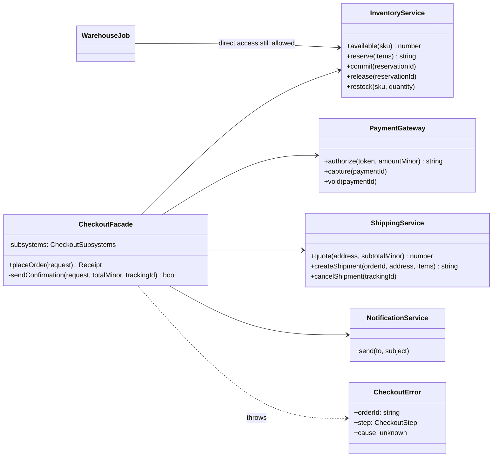

# Facade

**Category:** Structural · **Code:** [`facade.ts`](./facade.ts) · **Run:** `npm run demo -- facade` · `npx vitest run src/structural/facade`

## Intent

Give a set of subsystems one simple, task-shaped entry point. The facade knows the order of calls and the rollback rules; clients that only want "place this order" no longer need to know either.

## The problem it solves

Placing an order touches four services: quote shipping, reserve stock, authorise the card, create a shipment, capture, commit the reservation, email the customer. Without a facade, every caller (the web checkout, the mobile API, the "reorder" button, the B2B bulk importer) writes this itself:

```ts
const shippingMinor = shipping.quote(address, subtotal);
const reservationId = inventory.reserve(items);
let paymentId: string;
try {
  paymentId = payments.authorize(token, subtotal + shippingMinor);
} catch (e) {
  inventory.release(reservationId); // remembered here...
  throw e;
}
try {
  const trackingId = shipping.createShipment(orderId, address, items);
  payments.capture(paymentId);
  inventory.commit(reservationId);
  notifications.send(email, `Order ${orderId} confirmed`); // ...and should a failed email fail the order?
} catch (e) {
  payments.void(paymentId); // ...forgotten in the importer, so stock leaks
  inventory.release(reservationId);
  throw e;
}
```

Four copies of this drift apart. One forgets to void the authorisation, another captures before the shipment exists, a third fails the whole order when SMTP is down. Every caller also depends on four subsystem APIs, so changing the carrier integration means touching all of them.

## The solution



| Participant | In this example |
|---|---|
| Facade | `CheckoutFacade.placeOrder()`, plus `createCheckoutModule()` as the module-style variant |
| Subsystem classes | `InventoryService`, `PaymentGateway`, `ShippingService`, `NotificationService` |
| Client | The demo, an HTTP handler, a reorder job: anything that wants "place an order" |
| Other clients | A warehouse job or back-office tool that still calls a subsystem directly (`WarehouseJob` in the diagram is illustrative) |

What the facade adds beyond forwarding:

- **Ordering**: the side-effect-free quote goes first; money is captured only after the shipment exists.
- **Compensation**: each successful step pushes its undo (`release`, `void`, `cancelShipment`); a failure runs them newest first.
- **One error type**: any subsystem failure becomes a `CheckoutError` with the failed `step` and the original error as `cause`.
- **Policy**: the confirmation email is best-effort, so a down email provider sets `confirmationSent: false` instead of cancelling a paid order.

The subsystems remain public. `inventory.restock()` and `payments.void()` are called directly in the tests; the facade is the easy road, not the only road.

The **idiomatic TypeScript form** is a module whose exports are the facade (a `checkout/index.ts` that exports `placeOrder` and keeps the clients private). `createCheckoutModule()` shows that shape with a closure returning a frozen object of two functions.

## When to use it

- Several services must be called in a fixed order with rollback, and more than one caller needs that flow.
- You want to give most of the codebase a small, stable API over a large or volatile one (a payment SDK, a cloud provider SDK, a legacy system).
- Layering: an application service in front of domain and infrastructure code, or a "backend for frontend" that composes several microservices for one screen.
- You want to test callers against one narrow interface instead of mocking four.

## When not to use it

- There is only one subsystem and the "facade" would forward each method one to one: that is just indirection.
- The facade starts to accumulate every method of every subsystem. A god object that mirrors its dependencies hides nothing; split it by use case (`CheckoutFacade`, `ReturnsFacade`).
- The workflow spans services with their own databases and must survive crashes mid-way. In-memory compensation is not enough: you need a persisted **Saga** or workflow engine.
- Callers genuinely need fine control (custom retry per step, partial shipments). Let them use the subsystems; do not force every case through the facade.

## Real-world sightings

- jQuery's `$.ajax` and `$(selector)` hid browser differences in XHR and DOM APIs behind one call.
- `fetch` is a facade over connection pooling, TLS, redirects and HTTP framing; Axios plays the same role over Node's `http` module.
- Prisma Client and other ORMs: `prisma.order.create()` hides connection management, query building and result mapping.
- Express's `res.json()` sets the header, serialises and ends the response in one call.
- NestJS application services and "backend for frontend" (BFF) gateways that compose several downstream calls into one endpoint.
- Payment orchestration SDKs that wrap authorise, capture and webhook handling behind a single "checkout session" API.

## Related patterns

- **Adapter**: changes an interface so an existing object fits one the client expects. A facade *defines a new, simpler* interface over many objects. An adapter usually wraps one object; a facade usually wraps several.
- **Mediator**: also centralises interaction, but colleagues know the mediator and talk *through* it in both directions. Subsystems behind a facade do not know the facade exists.
- **Proxy**: has the *same* interface as its subject and controls access to it. A facade has a *different*, smaller interface.
- **Saga**: the distributed, persisted version of the compensation the facade does in memory.
- **Singleton**: facades are often created once per application, but nothing about the pattern requires it; inject it.
- **Abstract Factory**: can supply the subsystem objects a facade uses, so the facade works across providers.

## Pitfalls

- Turning the facade into a god class that knows every rule of every subsystem. It should orchestrate, not reimplement.
- Leaking subsystem errors and types through the facade's API, so clients depend on the subsystems anyway. Translate errors (here `CheckoutError` with `step` and `cause`).
- Forgetting compensation, or running it in the wrong order. Push the undo right after each step succeeds and run them newest first.
- Treating best-effort steps (emails, analytics) as critical and failing the business operation because of them.
- Making the facade the only way in. Admin tools and batch jobs legitimately need the subsystems; forbidding that leads to the facade growing an option for every special case.
- Hiding latency: one friendly call may make many network calls. Name and document it so callers do not loop over it.

## Interview Q&A

**Q: Facade vs Adapter?**
An adapter makes one existing interface match another one that the client already expects, without adding behaviour. A facade invents a new, simpler interface over several subsystems and usually adds orchestration. Adapter is about compatibility, Facade about simplicity.

**Q: Does a facade stop clients from using the subsystems directly?**
No. It offers a convenient path for the common case. Clients that need more control can still use the subsystems, which is why the facade should not be the place where invariants are enforced; those belong in the subsystems themselves.

**Q: What should happen when step three of five fails?**
Undo the steps that succeeded, newest first (void the authorisation, release the stock), then report one error that says which step failed and carries the cause. Steps that are best-effort, like the confirmation email, should not trigger rollback at all.

**Q: How is a facade different from a microservice API gateway?**
A gateway is a facade at the network edge: it routes, authenticates and sometimes aggregates calls for clients. In-process, a facade does the same for classes. A BFF is the closest match, because it composes several services into one task-shaped endpoint.

**Q: When would you replace this facade with something else?**
When the steps live in different services and the process can crash between them. Then the compensation needs to be persisted and retried, which is a saga or a workflow engine, not an in-memory try/catch.
