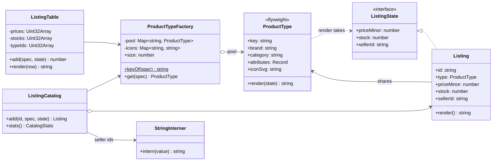

# Flyweight

**Category:** Structural · **Code:** [`flyweight.ts`](./flyweight.ts) · **Run:** `npm run demo -- flyweight` · `npx vitest run src/structural/flyweight`

## Intent

Support a very large number of fine-grained objects cheaply by sharing the part of their state that is identical (intrinsic state) and keeping the part that varies (extrinsic state) outside the shared object.

## The problem it solves

A marketplace loads a million seller listings into a search or pricing worker. Each listing object carries its own brand, category, attribute map and an inline SVG icon, although 4,000 sellers are selling the same few dozen product types. The worker spends most of its heap on identical copies of "Assam Gold, Tea, 250g, pouch" and the same icon string, GC pauses grow with the copies, and a bulk "rename this brand" job has to touch a million objects and still misses some.

The smell: memory grows with the number of *rows*, while the number of *distinct values* is tiny.

## The solution

| Participant | In this example |
|---|---|
| Flyweight | `ProductType`: frozen brand, category, attributes and icon |
| Flyweight factory | `ProductTypeFactory.get(spec)`, keyed by a canonical `keyOf(spec)` |
| Extrinsic state | `ListingState`: price, stock, seller |
| Context | `Listing` (object form) or a row of `ListingTable` (columnar form) |
| Client | `ListingCatalog`, which never constructs a `ProductType` itself |

Key details in the code:

- **Canonical keys.** `keyOf` lower-cases and sorts attributes, so `{size, pack}` and `{pack, size}` share one flyweight. A sloppy key is the usual reason a flyweight pool quietly holds duplicates.
- **Immutability.** `ProductType` and its attributes are `Object.freeze`d. A shared object that can be mutated is a bug that edits every listing at once.
- **Operations take extrinsic state as a parameter.** `ProductType.render(state)` never stores the price.
- **Two levels of sharing.** Icons are pooled per category inside the factory, below the product-type pool.

The demo counts what this buys: 100,000 listings on 180 flyweights, with intrinsic state measured in kilobytes instead of tens of megabytes.

**Idiomatic JavaScript at a million rows.** Even a small `Listing` object per row has a header and hidden-class overhead. `ListingTable` goes columnar: extrinsic state lives in `Uint32Array`s, a listing is just a row number, and a `typeIds` column points into the flyweight table. This is how analytics engines and game engines do it.

**String interning and `Symbol.for`.** JavaScript compares strings by value, so interning is about memory, not equality. V8 internalizes literals and property names, but strings built at runtime (concatenated, read from a socket or a file) are not guaranteed to be shared; `StringInterner` pools seller ids explicitly. `Symbol.for(key)` is the runtime's own flyweight registry: the same key returns the same symbol across modules and realms, whereas `Symbol()` always creates a new one.

## When to use it

- Very many objects (hundreds of thousands and up) whose state is mostly duplicated, and memory or GC is a measured problem.
- The repeated part can be made immutable and the varying part can be passed in or stored outside.
- Object identity of the shared part does not matter to the domain (two listings of the same type *should* see the same brand object).
- Caches of parsed or compiled values keyed by their source: schemas, regexes, templates, tax-rule sets per region.

## When not to use it

- Object counts are small, or memory is not a measured problem. A factory, canonical keys and frozen objects add complexity for no gain.
- The "shared" state is actually edited per object; forcing it into a flyweight leads to copy-on-write hacks.
- The data already lives in a database or columnar store: query it there instead of rebuilding a shared object graph in memory.
- When an unbounded number of distinct keys is possible (user-generated text): the pool becomes a memory leak instead of a saving.

## Real-world sightings

- `Symbol.for` and the global symbol registry; V8's internalized strings for literals and property keys.
- V8 hidden classes (maps): objects with the same shape share one structural description, while each object keeps only its values.
- Connection and thread pools are related (they share expensive resources), though they share by *lending* rather than by immutable reference.
- Text editors and terminal renderers share glyph and style objects across characters; Monaco/VS Code's tokenisation stores token metadata as packed integers.
- Columnar formats and engines (Apache Arrow, DuckDB) dictionary-encode repeated strings: a column holds small integer codes pointing into one dictionary.
- Game engines and map renderers share meshes and textures across many instances, with position and rotation per instance.

## Related patterns

- **Singleton**: one instance of a class overall. Flyweight is one instance *per key*, managed by a factory, and there can be many.
- **Factory Method / Abstract Factory**: create objects. A flyweight factory also *caches and returns existing* instances; asking twice does not create twice.
- **Prototype**: copies an object to make a new one. Flyweight avoids copies by sharing.
- **Composite**: flyweights are often used as leaves of a composite (characters in a document tree), with position passed as extrinsic state.
- **Object Pool**: hands out mutable objects exclusively and takes them back. Flyweights are immutable and shared by many at once.
- **Memoization**: a memoized pure function returning objects is a flyweight factory in function form.

## Pitfalls

- Mutable flyweights. One listing "fixing" its brand changes every listing that shares it. Freeze them.
- Non-canonical keys (case, attribute order, whitespace) that defeat sharing without any error.
- Storing extrinsic state in the flyweight "just this once" (a price, a seller), which silently breaks every other user.
- Unbounded pools. If keys come from users, cap the pool, evict, or use `WeakRef` with a `FinalizationRegistry`, accepting that eviction is non-deterministic.
- Typed-array contents cannot be frozen. If a flyweight holds a `Uint8Array` icon, sharing the reference does not make the bytes immutable; expose a copy or a string.
- Identity comparisons across factories: two factories produce two different instances for the same key. Use one factory per process or compare by key.
- Measuring nothing. Take a heap snapshot before and after; if the saving is small, remove the pattern.

## Interview Q&A

**Q: What is intrinsic vs extrinsic state?**
Intrinsic state is identical across many objects and does not depend on context (brand, category, icon), so it can be shared. Extrinsic state is per object or per use (price, stock, seller) and is stored by the client or passed into the flyweight's methods.

**Q: Why must flyweights be immutable?**
Because one instance is referenced by thousands of contexts. Any mutation is visible to all of them, which turns a local change into a global bug, and it makes sharing across threads or workers unsafe.

**Q: How is Flyweight different from caching or memoisation?**
Structurally it *is* a cache keyed by the intrinsic state. The pattern adds the split: objects are designed so that the cacheable part is separated from the varying part, and the client stores the varying part outside. A plain cache stores whole results.

**Q: Where does JavaScript already do this for you?**
Interned string literals and property keys, hidden classes shared across objects with the same shape, and `Symbol.for`, which returns one symbol per key from a global registry. Runtime-built strings are not guaranteed to be shared, which is why you sometimes intern ids by hand.

**Q: You have 10 million rows and objects are too heavy even with flyweights. What next?**
Go columnar: store extrinsic fields in typed arrays, refer to rows by index, and dictionary-encode repeated values into an index into a flyweight table. That removes the per-row object entirely.
