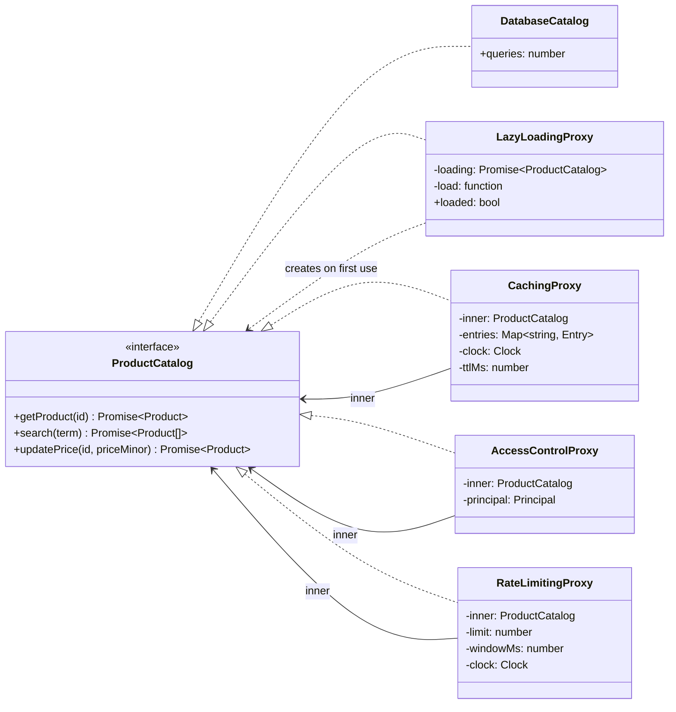
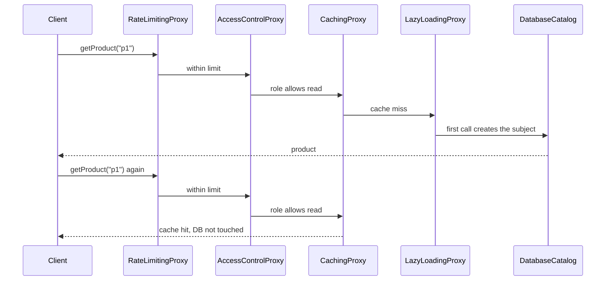

# Proxy

**Category:** Structural · **Code:** [`proxy.ts`](./proxy.ts) · **Run:** `npm run demo -- proxy` · `npx vitest run src/structural/proxy`

## Intent

Put a stand-in in front of an object that has *the same interface*, so it can control access to the real object: create it lazily, cache its answers, check permissions, or limit how often it is called. The client cannot tell the difference.

## The problem it solves

A storefront reads products from `DatabaseCatalog`. Then the requirements arrive one at a time: the connection pool is slow to start, so do not open it until the first request; product pages are hot, so cache reads for 30 seconds; support staff may read but not change prices; one partner hammers the API, so limit it to N calls a second. The naive fix puts all of this inside `DatabaseCatalog.getProduct()` and `updatePrice()`: an `if (!this.pool)`, a cache map, a role check and a counter in every method, each of them tested only through a real database. Every new method repeats the lot, and the background job that legitimately needs uncached, unthrottled access has to pass flags to switch it all off.

## The solution

| Participant | In this example |
|---|---|
| Subject (interface) | `ProductCatalog` |
| Real subject | `DatabaseCatalog` |
| Virtual proxy | `LazyLoadingProxy`: runs the loader on first call, once, even under concurrent first calls |
| Caching proxy | `CachingProxy`: TTL from an injected clock; `updatePrice` invalidates |
| Protection proxy | `AccessControlProxy`: viewers read, merchandisers and admins write |
| Rate-limiting proxy | `RateLimitingProxy`: fixed window, throws `RateLimitError` with `retryAfterMs` |
| Client | Any code typed against `ProductCatalog`, such as `priceOf()` in the tests |

`buildCatalog()` composes the stack, and the order is a design decision: rate limiting outermost so rejected calls cost nothing, access control *before* the cache so a cached product is never served to someone who may not read it. The lazy proxy caches the *promise*, not the result, so two first calls share one load, and it clears the promise on failure so the next call retries.

**The idiomatic JavaScript form** is the built-in `Proxy` object. `withCallLog(target, log)` uses one `get` trap to log every method call on any object, and `validatedDraft()` uses a `set` trap to reject a non-integer price at the moment of assignment. A class per interface is clearer for domain proxies (cache, auth) whose behaviour differs per method; `Proxy` wins for uniform, cross-cutting behaviour where writing every method by hand would be boilerplate.

### Adapter vs Decorator vs Proxy

All three wrap an object, which is why they are confused. Ask what the wrapper does to the *interface* and to the *intent*:

| | Interface | Purpose | Who creates the real object |
|---|---|---|---|
| **Adapter** | Different from the wrapped object's: it converts | Make an existing class fit an interface the client expects | The client, usually |
| **Decorator** | Same | *Add* behaviour (logging, retries, compression); designed to stack freely | The client, who chooses the decorators |
| **Proxy** | Same | *Control access* to the subject (when it is created, whether a call is allowed, whether it reaches it at all) | Often the proxy itself (virtual proxy), hidden from the client |

The line between Decorator and Proxy is intent, not structure: `CachingProxy` could be called a caching decorator. It is a proxy because it decides whether the call reaches the subject at all, and because clients are handed it in place of the real thing without choosing it.

## When to use it

- The real object is expensive to create and may not be needed: lazy database pools, SDK clients, large files, ML models.
- You need access control, quotas or auditing around an object you do not want to (or cannot) modify.
- Reads are hot and slightly stale data is acceptable: a cache in front of a repository or remote API.
- The subject is remote, and a local object should hide the network (a remote proxy: an RPC or HTTP client stub).
- Cross-cutting instrumentation (logging, metrics, tracing) on any object, via the JS `Proxy`.

## When not to use it

- The behaviour belongs in the subject itself: an invariant that every caller must respect (a price cannot be negative) should not live in an optional wrapper.
- Authorization that needs domain context (only the seller who owns a listing may edit it) usually belongs in a policy or service layer, not a generic proxy.
- A cache with tricky invalidation across many writers: use a real cache with explicit keys and events, not a per-process proxy that cannot see other processes' writes.
- Hot paths where a JS `Proxy`'s trap overhead matters, or code that relies on `#private` fields being accessed through the proxy (it throws).
- One-off needs. A proxy class per interface is boilerplate if a single `if` at the call site would do.

## Real-world sightings

- Vue 3's reactivity is built on JavaScript `Proxy`: `reactive()` wraps an object so reads are tracked and writes trigger updates. MobX and Immer also use `Proxy` (Immer's drafts record changes and produce an immutable copy).
- `http-proxy-middleware` and NGINX as reverse proxies; API gateways that add auth and rate limiting in front of services.
- ORMs with lazy-loaded relations (TypeORM lazy relations return a promise that loads on first access; Hibernate in the Java world).
- gRPC and tRPC client stubs are remote proxies: a local object with the service's interface that sends calls over the network.
- `express-rate-limit` and cache layers (DataLoader per request, `lru-cache` wrappers) placed in front of resources.
- Node's `require` cache and lazy `import()` patterns for expensive modules.

## Related patterns

- **Decorator**: same interface and same structure; adds behaviour the client opts into. Proxy controls access and is often handed to the client in place of the subject. See the table above.
- **Adapter**: changes the interface. A proxy never does.
- **Facade**: offers a new, simpler interface over several subsystems. A proxy has exactly the subject's interface.
- **Flyweight / Singleton**: a virtual proxy is often how a shared or singleton resource gets created on demand.
- **Chain of Responsibility**: a stack of proxies looks like a chain, but each proxy always forwards (or refuses) to one known subject; handlers in a chain decide who handles a request.

## Pitfalls

- Stacking in the wrong order: a cache outside the access check serves cached data to unauthorised users.
- Lazy loading that caches a rejected promise forever, or that loads twice under concurrent first calls. Store the promise; clear it on failure.
- Cache invalidation: invalidate *after* a successful write, and remember that other processes do not see this proxy's cache. Negative results ("not found") need their own short TTL, or a product created a second later stays invisible.
- Identity: `proxy !== subject`, so code using identity maps, `instanceof` on the concrete class, or `WeakMap` keys may behave differently.
- JS `Proxy` and private fields: calling a method with the proxy as `this` breaks `#private` access. Bind to the target (`Reflect.apply(value, target, args)`) as `withCallLog` does.
- Fixed-window rate limiting allows a burst of 2x the limit across a window boundary. Use a sliding window or token bucket when that matters; with many instances, the counter must live in a shared store such as Redis.
- Proxies that silently swallow errors or change semantics (returning `undefined` on denial) surprise callers. Fail loudly with typed errors.

## Interview Q&A

**Q: Proxy vs Decorator: aren't they the same class diagram?**
Yes, structurally. The difference is intent. A decorator adds behaviour and the client composes decorators deliberately. A proxy controls access to the subject: it may create it, refuse the call or answer without it, and it is typically handed to the client as if it were the real object.

**Q: Name the classic kinds of proxy.**
Virtual (lazy creation), remote (local stand-in for a network object), protection (access control), and smart reference or caching proxies (counting, caching, locking). Rate limiting is a protection proxy for capacity rather than identity.

**Q: How would you implement a lazy-loading proxy that is safe under concurrency?**
Store the loading promise the first time, so every concurrent caller awaits the same one, and clear it if the load rejects so a later call can retry. Storing the resolved value instead lets two early callers both start a load.

**Q: When would you use JavaScript's `Proxy` object instead of a proxy class?**
When the behaviour is uniform across all properties or methods, such as logging, metrics, validation, reactivity or read-only views, and you do not want to hand-write every method. For per-method logic like caching reads but not writes, a class is clearer and faster.

**Q: In what order would you stack rate limiting, auth and caching, and why?**
Rate limiting first, so rejected calls do no work. Then authorisation, so nobody is served data they may not see, even from cache. Then caching, then the lazily created real subject.
